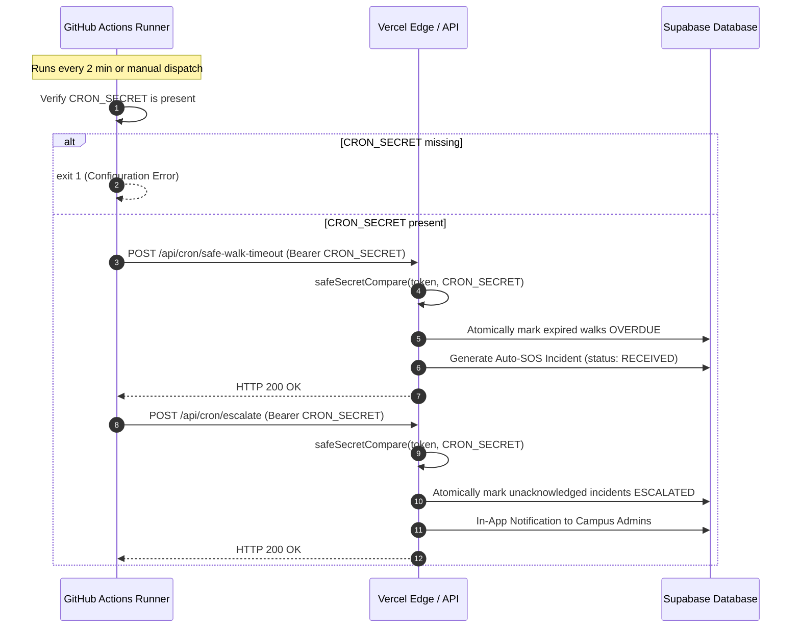

# KAVACH CAMPUS — PHASE 4 SCHEDULER & SAFE WALK VALIDATION REPORT

**Project Location:** `D:\Kavach Campus`  
**Audit Scope:** GitHub Actions Scheduler, Vercel Endpoint Authentication, Safe Walk Timeout, & Staff Escalation  
**Date:** 2026-11-03  
**Status:** `NOT VERIFIED` (Requires Owner Secret Rotation & Staging Run)

---

## 1. System Architecture & Trigger Mechanics

The Kavach Campus Life-Safety Scheduler operates via GitHub Actions to invoke serverless cron endpoints hosted on Vercel:



---

## 2. Security & Failure-Safety Review

### A. Missing `CRON_SECRET` Behavior
* **Code:** `.github/workflows/safe-walk-scheduler.yml`
* **Implementation:**
  ```bash
  if [ -z "$CRON_SECRET" ]; then
    echo "::error title=Configuration Error: Missing Secret::CRON_SECRET is not configured in GitHub Repository Secrets. The life-safety scheduler cannot run without authentication. Add CRON_SECRET under Settings -> Secrets and variables -> Actions."
    echo "FATAL: Life-safety scheduler cannot run without authentication secret CRON_SECRET."
    exit 1
  fi
  ```
* **Security Rationale:**
  - Missing secrets must **never** be treated as a silent success.
  - Exiting with `1` ensures GitHub Actions immediately surfaces the configuration defect.

### B. Constant-Time Authentication Guard
* **Endpoints:** `/api/cron/safe-walk-timeout`, `/api/cron/escalate`
* **Implementation:**
  ```ts
  function safeSecretCompare(provided?: string | null, expected?: string | null): boolean {
    if (!provided || !expected) return false;
    const bufProvided = Buffer.from(provided);
    const bufExpected = Buffer.from(expected);
    if (bufProvided.length !== bufExpected.length) return false;
    return timingSafeEqual(bufProvided, bufExpected);
  }
  ```
* **Security Rationale:**
  - Prevents byte-by-byte timing attacks on the cron authentication header.
  - Rejects all requests missing `Authorization: Bearer <secret>`.

### C. Concurrency, Idempotency & Fault Tolerance
1. **Atomic Guard:**
   - Safe Walk timeout transitions from `ACTIVE` to `OVERDUE` using an atomic conditional update:
     `.eq('id', walk.id).eq('status', 'ACTIVE').select('id')`
   - Concurrent cron executions cannot double-process the same safe walk.
2. **Crash Recovery:**
   - If a crash occurs after marking `OVERDUE` but before creating the emergency incident, the recovery query automatically detects and recovers it:
     `status = 'OVERDUE' AND auto_sos_enabled = true AND escalation_incident_id IS NULL`
3. **Escalation Atomicity:**
   - Incidents in `ASSIGNED` status for > 5 minutes are transitioned to `ESCALATED` atomically.
   - Escalations notify only Campus Admins of the affected college and `SUPER_ADMIN`.

---

## 3. Staging Validation Protocol (Dry Run & Live Check)

To validate the scheduler without affecting production:
1. **Secret Rotation:**
   - Generate a 32-byte cryptographic random secret.
   - Configure in Vercel environment variables and GitHub repository secrets.
2. **Dry Run Trigger:**
   - In GitHub Actions -> **Kavach Safe Walk & Escalation Scheduler** -> **Run workflow**.
   - Set `dry_run: true`.
   - Verify workflow succeeds without contacting live endpoints.
3. **Live Staging Endpoint Test:**
   - Trigger with `dry_run: false`.
   - Verify both steps return `HTTP 200` with JSON body:
     ```json
     { "success": true, "overdueProcessed": 0, "escalatedCount": 0 }
     ```

---

## 4. Current Scheduler Classification

* **Code Implementation:** `CODE VERIFIED ONLY`
* **Automated Workflow Tests:** `VERIFIED` (5 Vitest unit tests pass in `src/__tests__/safe-walk-scheduler-workflow.test.ts`)
* **Live Staging Execution:** `NOT VERIFIED` / `BLOCKED` (Requires Owner Secret Rotation & Staging Run)
