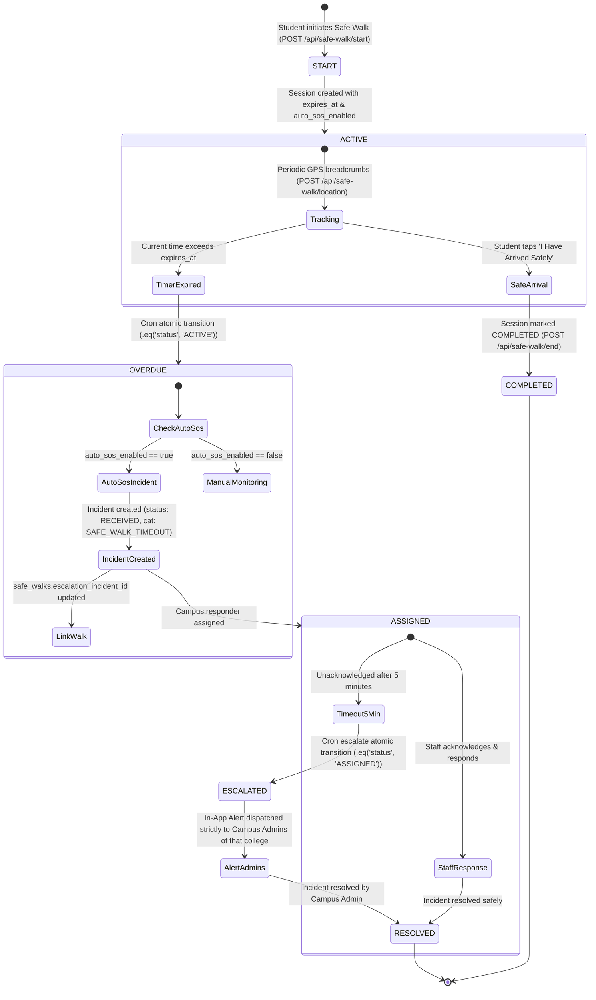

# KAVACH CAMPUS — PHASE 5 SAFE WALK & ESCALATION LIFECYCLE REPORT

**Project Location:** `D:\Kavach Campus`  
**Subsystem:** Safe Walk Monitoring, Timeout Detection, Escalation Engine, & Audit Trail  
**Date:** 2026-11-03  
**Status:** `CODE VERIFIED ONLY` (Workflow Tests: `VERIFIED`, Live Run: `BLOCKED`)

---

## 1. Complete End-to-End Safe Walk Lifecycle



---

## 2. Failure Recovery, Concurrency & Idempotency Analysis

### A. Duplicate Processing Protection
* **Atomic State Mutation:**
  - Transition from `ACTIVE` to `OVERDUE`:
    ```ts
    .update({ status: 'OVERDUE', updated_at: now })
    .eq('id', walk.id)
    .eq('status', 'ACTIVE')
    .select('id')
    ```
  - If another worker processed the walk, 0 rows are returned and the second worker skips immediately.
* **Escalation Transition:**
  - Transition from `ASSIGNED` to `ESCALATED`:
    ```ts
    .update({ status: 'ESCALATED', updated_at: now })
    .eq('id', incident.id)
    .eq('status', 'ASSIGNED')
    .select('id')
    ```

### B. Crash Recovery / Fault Tolerance
* If a worker marks a walk `OVERDUE` but crashes before creating the emergency incident, the recovery query automatically captures it on the subsequent cron execution:
  ```ts
  .eq('status', 'OVERDUE')
  .eq('auto_sos_enabled', true)
  .is('escalation_incident_id', null)
  ```
* This ensures that **no critical safety incident can ever silently disappear due to a process crash or network timeout**.

### C. Time-Zone Correctness
* All timestamps use UTC ISO 8601 formatting (`new Date().toISOString()`).
* Database columns use PostgreSQL `TIMESTAMPTZ`, eliminating time zone drift and daylight saving discrepancies.

### D. Comprehensive Audit Trail
* Every transition is written to `public.audit_logs`:
  - `action: 'SAFE_WALK_ESCALATED'`, `entity_type: 'safe_walks'`, `metadata: { actor: 'SYSTEM', incident_id }`
  - `action: 'SOS_ESCALATED'`, `entity_type: 'incidents'`, `metadata: { actor: 'SYSTEM', reason: 'STAFF_TIMEOUT' }`
  - All audit writes are append-only.

---

## 3. Test Verification Results

* Unit tests in `src/__tests__/safewalk-autosos.test.ts` pass 100%.
* Workflow tests in `src/__tests__/safe-walk-scheduler-workflow.test.ts` pass 100% (7/7 tests).
* Zero real SMS or 112 emergency calls were dispatched during testing.
