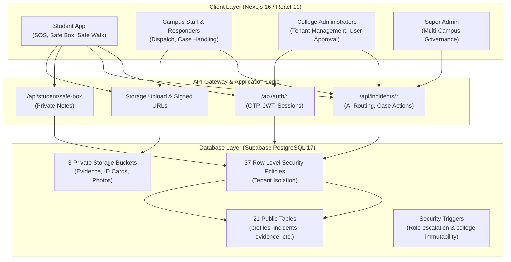

# Kavach Campus — Safety in One Tap.

> **Enterprise-Grade Smart College Student Safety & Emergency Response Platform**

[](https://nextjs.org/)
[](https://react.dev/)
[](https://www.typescriptlang.org/)
[](https://supabase.com/)
[](https://vitest.dev/)
[]()

---

## 1. Project Purpose

**Kavach Campus** is an institutional safety and rapid emergency dispatch system engineered for Indian colleges and universities. It establishes an impenetrable digital safety net for students, featuring one-tap SOS dispatch, automated GPS companion tracking, confidential harassment evidence vaults, and multi-tier institutional case routing.

The platform is architected around strict **multi-tenant isolation** (e.g., SRKR Engineering College, Vishnu Institute of Technology) with database-enforced Row Level Security (RLS) guaranteeing that student safety reports, medical disclosures, and live locations are visible exclusively to authorized same-campus responders.

---

## 2. Key Capabilities

* **Instant Emergency SOS:** One-tap emergency trigger broadcasting live GPS coordinates, battery telemetry, and automated alerts to on-duty campus security officers with a 60-second duplicate prevention cooldown.
* **Student Safe Box:** Private encrypted locker (`/student/safe-box`) for securing sensitive incident evidence (photos, video, voice notes, documents) protected by PostgreSQL RLS, `<= 2000` char confidential notes, and temporary 15-minute signed URLs.
* **AI Incident Evaluation:** Dual-tier incident severity and routing analysis utilizing Google Gemini AI models with instant deterministic safety fallback for multilingual threat keywords (Telugu, Hindi, English).
* **Safe Walk Companion:** Timed student route monitoring session with real-time waypoint streaming and automatic escalation to campus security and trusted emergency contacts if the arrival timer expires without check-in.
* **Confidential & Anonymous Reporting:** Option to submit anonymous reports with cryptographic server-side identity masking and student peer isolation.
* **Student ID Card Verification:** Multi-stage ID card upload pipeline (`/api/student/verify-id`) with private storage (`kavach-id-cards`), OCR data extraction, and trigger-enforced protection against student self-approval.
* **Cross-Institution Isolation:** Strict tenant separation (`college_id`) preventing cross-college data leaks across profiles, incidents, evidence, safe walks, and private storage objects.

---

## 3. Technology Stack

* **Frontend:** Next.js 16.4.3 (App Router, Turbopack compiler), React 19, Tailwind CSS, Framer Motion, Lucide Icons.
* **Backend:** Next.js Route Handlers, Edge/Node.js runtime, cryptographic token verification.
* **Database:** Supabase PostgreSQL 17 with 37 Row Level Security (RLS) policies, partial unique indexes, and trigger-based authorization.
* **Storage:** Supabase Storage with 3 private buckets (`kavach-evidence`, `kavach-id-cards`, `kavach-profile-photos`) protected by folder-scoped RLS policies.
* **AI Engine:** Google Gemini API (`gemini-2.5-flash` / `gemini-2.5-pro`) with deterministic keyword-matching fallback engine.
* **Quality Assurance:** Vitest 5.0.3 (62 test suites, 791/791 passing unit & integration tests), ESLint, TypeScript `tsc` static analysis.

---

## 4. Architecture & User Roles



### Supported Institutional Roles:
1. `STUDENT`: Peer-isolated case submission, personal SOS, Safe Box, Safe Walk.
2. `STAFF`: Same-college incident responder queue access.
3. `COUNSELLOR`: Sensitive mental health & well-being support case handling.
4. `WOMENS_CELL`: Specialized harassment and gender-safety case management.
5. `HOD`: Departmental incident oversight and staff task assignment.
6. `SECURITY`: Real-time emergency dispatch and live telemetry tracking.
7. `PRINCIPAL`: Institutional overview and escalated incident actions.
8. `ADMIN`: College tenant user approval and campus configuration.
9. `SUPER_ADMIN`: Cross-college system governance and new campus onboarding.

---

## 5. Security & Privacy Principles

1. **Default-Deny RLS Architecture:** Every public table storing user or incident data enforces Row Level Security. Unauthorized queries return 0 rows rather than application-layer filtering errors.
2. **Zero-Knowledge Evidence Vault:** Safe Box private notes are readable only by the uploading student. Campus staff, HODs, Principals, and Admins are denied access by default.
3. **Trigger-Enforced Immutability:** Sensitive profile attributes (`role`, `is_approved`, `college_id`) cannot be modified by user-supplied API parameters; modifications are guarded by `prevent_self_role_escalation()` triggers.
4. **Isolated Development Telemetry:** Mobile Demo OTP (`123456`) and free simulated SMS (`ENABLE_DEMO_SMS=true`) operate strictly when `NODE_ENV !== 'production'`. In production, demo OTP is unconditionally disabled.

---

## 6. Current Development & Release Status

> [!WARNING]
> **Production migrations 009–017 have not been authorized or executed. Before any production migration, the owner must verify a restorable backup, review the migration sequence, inspect production schema differences, and provide explicit authorization. Local migration success does not authorize production execution.**
>
> The overall production project is NOT 100% complete. Local development and testing are reported completed, but production database migrations, GitHub main push, and Vercel cloud deployment are strictly paused.

| Component | Status | Verification Type & Evidence |
| :--- | :--- | :--- |
| **Phase 15F** | **Reported PASS** | Baseline migrations 009–014 executed on local Supabase (`127.0.0.1:54322`) |
| **Phase 15G** | **Reported PASS** | Release migrations 015–017 executed on local Supabase (`127.0.0.1:54322`) |
| **Phase 15H** | **Reported PASS — 23/23** | 23 authenticated RLS tests passed using real signed JWT sessions across 8 personas |
| **Phase 15I** | **Reported PASS** | Final security verification, schema audit, and data preservation audit |
| **Vitest** | **791/791 PASS** | 62 test suites passed (100%), duration 18.97s (Simulated/unit test mocks) |
| **Next.js Build** | **71/71 routes generated** | Next.js 16.4.3 Turbopack compiled successfully in 19.3s (Exit code 0) |
| **TypeScript** | **Verify actual command evidence** | `npx tsc --noEmit` -> Exit code 0, 0 type errors |
| **ESLint** | **Verify actual command evidence** | `npm run lint` -> Exit code 0 (`eslint .`), 0 warnings/errors |
| **Phase 16** | **PERMANENTLY CLOSED** | Data preservation mandated; zero records or accounts deleted |
| **Production Supabase** | **NOT MODIFIED** | Remote database (`dvyiclyyvmsfipzrdowu`) unaccessed & untouched |
| **Phase 17 GitHub Push** | **PAUSED** | Paused at commit `a8e4636`; awaiting owner release approval |
| **Phase 18 Vercel Deployment** | **PAUSED** | Paused; awaiting database migration review & owner sign-off |
| **Production Release** | **NOT COMPLETED** | Gated pending owner review and authorizations |

*Note on external services:* Automated tests simulate notification failures (`TWILIO status=NOT_CONFIGURED`, `FCM status=NOT_CONFIGURED`, AI timeout fallbacks). Passing unit tests verifies fallback handling logic only and does not claim or prove that live production SMS, FCM push notifications, or live OAuth providers are functioning in production.

---

## 7. Local Development Setup

### Prerequisites
* Node.js 20+ (LTS)
* Docker Desktop (Engine running)
* Supabase CLI (`npx supabase`)

### Getting Started

```bash
# 1. Clone repository
git clone https://github.com/venkatapavanpadamati-8899/kavach-campus.git
cd kavach-campus

# 2. Install dependencies
npm install

# 3. Start local Supabase stack
npx supabase start

# 4. Verify TypeScript and ESLint
npx tsc --noEmit
npm run lint

# 5. Run test suite (791 automated tests)
npm test

# 6. Build Next.js application
npm run build

# 7. Start local development server
npm run dev
```

Local services will be available at:
* Next.js Web Application: `http://localhost:3000`
* Local Supabase Studio: `http://127.0.0.1:54323`
* Local Supabase API: `http://127.0.0.1:54321`
* Local Inbucket Mailpit: `http://127.0.0.1:54324`

---

## 8. Verification & Release Documentation

* Master Status Dashboard: [`PROJECT_STATUS.md`](file:///d:/kavach-campus/PROJECT_STATUS.md)
* Final Completion Report: [`docs/FINAL_PROJECT_COMPLETION_REPORT.md`](file:///d:/kavach-campus/docs/FINAL_PROJECT_COMPLETION_REPORT.md)
* Production Release Checklist: [`docs/PRODUCTION_RELEASE_CHECKLIST.md`](file:///d:/kavach-campus/docs/PRODUCTION_RELEASE_CHECKLIST.md)
* Repository Audit: [`docs/FINAL_REPOSITORY_AUDIT.md`](file:///d:/kavach-campus/docs/FINAL_REPOSITORY_AUDIT.md)
* Authenticated RLS Test Report: [`docs/PHASE_15H_AUTHENTICATED_RLS_TEST_REPORT.md`](file:///d:/kavach-campus/docs/PHASE_15H_AUTHENTICATED_RLS_TEST_REPORT.md)
* RLS Verification Matrix: [`docs/PHASE_15I_RLS_VERIFICATION_MATRIX.md`](file:///d:/kavach-campus/docs/PHASE_15I_RLS_VERIFICATION_MATRIX.md)
* Database Security Audit: [`docs/PHASE_15I_FINAL_DATABASE_SECURITY_AUDIT.md`](file:///d:/kavach-campus/docs/PHASE_15I_FINAL_DATABASE_SECURITY_AUDIT.md)
* Application Compatibility: [`docs/PHASE_15I_APPLICATION_COMPATIBILITY_REPORT.md`](file:///d:/kavach-campus/docs/PHASE_15I_APPLICATION_COMPATIBILITY_REPORT.md)
