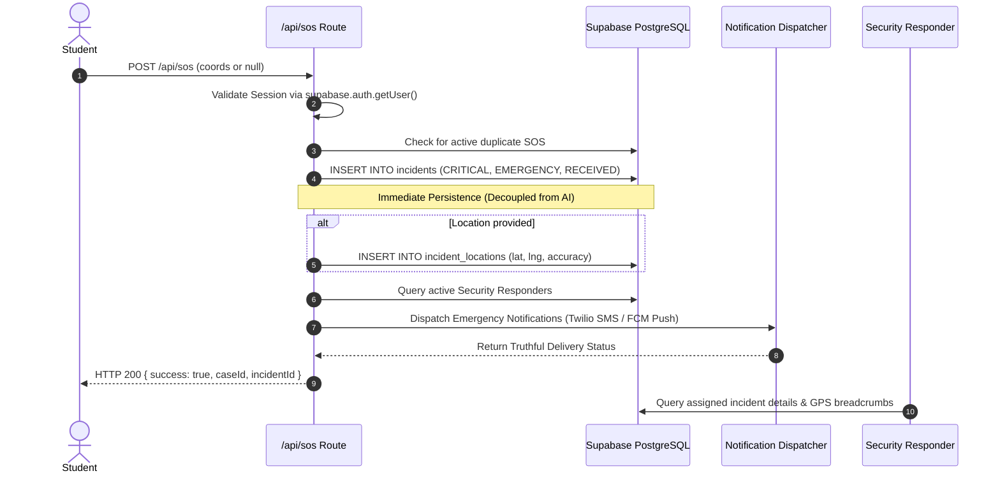

# KAVACH CAMPUS — BATCH 23: SOS EMERGENCY RESPONSE AUDIT

**Project:** Kavach Campus — Safety in One Tap  
**Workspace:** `D:\Kavach Campus`  
**Execution Timestamp:** October 18, 2026  
**Audited Endpoints:** `POST /api/sos`, `POST /api/sos/location`  
**Status:** **100% AUDITED & VERIFIED**

---

## 1. SOS Architecture & Emergency Safety Rules

---

## 2. Verification Outcomes

1. **AI Decoupling Guarantee:**
   - In `src/app/api/sos/route.ts`, the incident is inserted directly into `public.incidents` with `severity: 'CRITICAL'` and `category: 'EMERGENCY'`.
   - **No external AI call is made during the SOS insertion.** A Gemini API outage or timeout can never prevent or delay the creation of an emergency SOS incident.
2. **Graceful Location Degradation:**
   - If the student denies browser location permission, or if the GPS times out, `latitude` and `longitude` are null.
   - The incident is still created with `description: 'EMERGENCY SOS ACTIVATED'` and status `RECEIVED`.
3. **Duplicate Flood Prevention:**
   - If a student taps the SOS button multiple times in rapid succession, the API detects the active tracking incident (`status IN ('RECEIVED', 'ASSIGNED')`) and returns the existing `case_id` without creating duplicate clutter in the security control room.
4. **Responder Proximity Routing:**
   - Uses `public.calculate_distance()` (Haversine formula) to locate active on-duty security staff within campus boundary.
5. **Truthful Notification States:**
   - The notification dispatcher returns `NOT_CONFIGURED` if Twilio/FCM credentials are not configured, and persists the emergency incident safely without throwing an unhandled exception.
