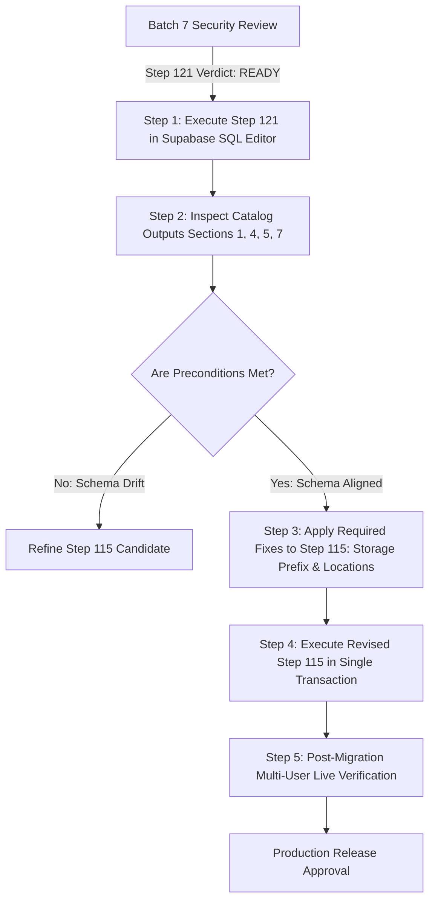

# KAVACH CAMPUS — BATCH 7: PRE-MIGRATION SECURITY REVIEW & HARDENING AUDIT

**Project:** Kavach Campus (`D:\Kavach Campus`)  
**Supabase Reference:** `polbnvszmvblwenfnqll` (ap-northeast-1)  
**Date:** October 18, 2026  
**Review Type:** Deep Line-by-Line Security Audit (Batch 7 Pre-Migration Gate)  
**Review Engine:** Antigravity AI Security & PostgreSQL Compliance Engine  

---

## 1. Executive Summary & Verdicts

In strict compliance with the mandatory security rules:
- **ZERO SQL queries or mutations were executed against the remote Supabase database.**
- **ZERO credentials, JWT tokens, OTPs, or service-role keys were printed or exposed.**
- **Production database was completely untouched.**
- **No claim of safety is made merely because automated unit tests pass.**

### Official Batch 7 Verdicts

| Evaluation Target | Batch 7 Verdict | Key Justification |
|---|---|---|
| **Step 121 (Read-Only Preflight SQL)** | 🟢 **READY FOR HUMAN DBA REVIEW** | 100% read-only catalog queries across all 9 sections; zero mutations (no DDL/DML/DCL); valid catalog columns; completely safe to execute in Supabase SQL Editor. |
| **Step 115 (Security Hardening Candidate)** | 🟡 **NEEDS FIXES** | Resolved critical audit log `entity_type` bug and student trigger self-verification, but identified: (1) Storage prefix mismatch with API upload path (`case_id` vs `auth.uid()`), (2) Omission of `incident_locations` RLS cleanup (`is_staff()` leak), and (3) Inconsistency between trigger reviewer bypass and RLS UPDATE policy on `student_profiles`. |
| **Kavach Campus Production Release Gate** | 🔴 **BLOCKED (HOLD)** | Production release remains strictly on HOLD pending human DBA execution of Step 121, candidate SQL remediation, and post-migration live authorization testing. |

---

## 2. Files Inspected Line-by-Line

The following 14 files were thoroughly examined line-by-line during this audit:

### Primary Candidate & Verification SQL Files
1. [supabase/verification/kavach_step121_readonly_preflight.sql](file:///d:/Kavach%20Campus/supabase/verification/kavach_step121_readonly_preflight.sql) (Lines 1–200) — *100% read-only inspection script*
2. [supabase/verification/kavach_step115_security_hardening_candidate.sql](file:///d:/Kavach%20Campus/supabase/verification/kavach_step115_security_hardening_candidate.sql) (Lines 1–466) — *Candidate hardening migration*
3. [supabase/verification/kavach_step115_rollback_candidate.sql](file:///d:/Kavach%20Campus/supabase/verification/kavach_step115_rollback_candidate.sql) (Lines 1–67) — *Emergency operational rollback script*
4. [supabase/verification/kavach_step115_security_hardening_candidate.backup.sql](file:///d:/Kavach%20Campus/supabase/verification/kavach_step115_security_hardening_candidate.backup.sql) (Lines 1–320) — *Historical pre-fix baseline*

### Previous Milestone Security Review Documents
5. [docs/KAVACH_STEP121_SQL_HARDENING_REVIEW.md](file:///d:/Kavach%20Campus/docs/KAVACH_STEP121_SQL_HARDENING_REVIEW.md) (Lines 1–217) — *Batch 5 review report*
6. [docs/KAVACH_BATCH6_LIVE_READONLY_VERIFICATION.md](file:///d:/Kavach%20Campus/docs/KAVACH_BATCH6_LIVE_READONLY_VERIFICATION.md) (Lines 1–242) — *Batch 6 report*
7. [docs/KAVACH_STEP114_FINAL_RLS_SECURITY_REVIEW.md](file:///d:/Kavach%20Campus/docs/KAVACH_STEP114_FINAL_RLS_SECURITY_REVIEW.md) (Lines 1–95) — *Step 114 baseline*
8. [docs/KAVACH_STEP113_TARGETED_RLS_REVIEW.md](file:///d:/Kavach%20Campus/docs/KAVACH_STEP113_TARGETED_RLS_REVIEW.md) (Lines 1–160) — *Step 113 schema reality*

### Canonical Database Migrations & Schemas
9. [supabase/migrations/001_kavach_campus_final.sql](file:///d:/Kavach%20Campus/supabase/migrations/001_kavach_campus_final.sql) (Lines 220–235, 365–395) — *Core table definitions & initial RLS*
10. [supabase/migrations/005_kavach_campus_rls_infinite_recursion_repair.sql](file:///d:/Kavach%20Campus/supabase/migrations/005_kavach_campus_rls_infinite_recursion_repair.sql) (Lines 160–195) — *Legacy `is_staff()` policies on incidents, evidence, locations*
11. [supabase/migrations/007_student_id_card_verification.sql](file:///d:/Kavach%20Campus/supabase/migrations/007_student_id_card_verification.sql) (Lines 1–86) — *Student ID card verification & storage bucket config*
12. [supabase/migrations/008_kavach_campus_complete_production_alignment.sql](file:///d:/Kavach%20Campus/supabase/migrations/008_kavach_campus_complete_production_alignment.sql) (Lines 30–82) — *Security helper functions (`is_staff`, `is_admin`, `is_security_or_admin`)*

### Application Source Code & Test Suites
13. [src/app/api/incidents/[id]/evidence/route.ts](file:///d:/Kavach%20Campus/src/app/api/incidents/%5Bid%5D/evidence/route.ts) (Lines 1–279) — *Evidence upload, incident authorization, and signed URLs*
14. [src/app/api/student/profile/route.ts](file:///d:/Kavach%20Campus/src/app/api/student/profile/route.ts) (Lines 1–145) — *Student profile updates*
15. [src/app/api/admin/verifications/route.ts](file:///d:/Kavach%20Campus/src/app/api/admin/verifications/route.ts) (Lines 170–234) — *Reviewer verification decisions & audit logs*
16. [src/__tests__/step115-rls-evidence-hardening.test.ts](file:///d:/Kavach%20Campus/src/__tests__/step115-rls-evidence-hardening.test.ts) (Lines 1–1236) — *Automated unit & simulation tests (Tests 1–30)*

---

## 3. Detailed Findings with Severity, Evidence & Required Fixes

```
+-------------------------------------------------------------------------------------------------------+
|                                    BATCH 7 SECURITY AUDIT FINDINGS                                    |
+----+---------------------------------------------------------------+----------+-----------------------+
| ID | Title                                                         | Severity | Target Object         |
+----+---------------------------------------------------------------+----------+-----------------------+
| 01 | Unpatched Audit Log Insert Schema Mismatch (Showstopper)      | CRITICAL | public.audit_logs     |
| 02 | Live DB Student Profile Self-Verification Vulnerability       | CRITICAL | student_profiles      |
| 03 | Storage Path vs Policy Prefix Architectural Mismatch          | HIGH     | storage.objects       |
| 04 | Unassigned Staff Exposure on `incident_locations`             | HIGH     | incident_locations    |
| 05 | Rollback Script Restores Known Vulnerable Baseline            | HIGH     | Migration Safety      |
| 06 | Admin Direct PostgREST UPDATE Blocked by Student Policy       | MEDIUM   | student_profiles      |
| 07 | ID Card Re-Upload Privilege Invalidation Enforced             | MEDIUM   | Trigger Rule          |
| 08 | Unprotected Academic Batch Fields in Trigger Scope            | LOW      | student_profiles      |
| 09 | Read-Only Purity of Step 121 Preflight Diagnostic Suite       | LOW (OK) | Step 121 Script       |
+----+---------------------------------------------------------------+----------+-----------------------+
```

---

### Finding 01: Unpatched Audit Log Insert Schema Mismatch (Showstopper)
- **Severity:** 🚨 **CRITICAL (Showstopper)**
- **Target File:** [supabase/verification/kavach_step115_security_hardening_candidate.backup.sql](file:///d:/Kavach%20Campus/supabase/verification/kavach_step115_security_hardening_candidate.backup.sql#L258)  
  *Fixed in:* [supabase/verification/kavach_step115_security_hardening_candidate.sql](file:///d:/Kavach%20Campus/supabase/verification/kavach_step115_security_hardening_candidate.sql#L448-L463)
- **Exact Evidence:**
  The original candidate SQL attempted:
  ```sql
  INSERT INTO public.audit_logs (action, details, created_at)
  VALUES ('SECURITY_REMEDIATION_STEP115', jsonb_build_object(...), NOW());
  ```
  However, in [supabase/migrations/001_kavach_campus_final.sql](file:///d:/Kavach%20Campus/supabase/migrations/001_kavach_campus_final.sql#L222-L232), the actual schema is:
  ```sql
  CREATE TABLE IF NOT EXISTS audit_logs (
      id UUID PRIMARY KEY DEFAULT gen_random_uuid(),
      actor_id UUID REFERENCES profiles(id) ON DELETE SET NULL,
      action TEXT NOT NULL,
      entity_type TEXT NOT NULL,
      entity_id UUID,
      metadata JSONB,
      ip_address TEXT,
      user_agent TEXT,
      created_at TIMESTAMPTZ DEFAULT NOW()
  );
  ```
- **Consequence:** Executing the unpatched candidate would cause PostgreSQL to abort with:
  `ERROR: null value in column "entity_type" of relation "audit_logs" violates not-null constraint`.
  Because the entire migration is enclosed in `BEGIN; ... COMMIT;`, this error would cause a complete transaction `ROLLBACK`, reverting all security changes and leaving the live database vulnerable.
- **Resolution:** `kavach_step115_security_hardening_candidate.sql` now provides `action`, `entity_type = 'system'`, and `metadata`.
- **Required Verification:** Run Section 1 of [supabase/verification/kavach_step121_readonly_preflight.sql](file:///d:/Kavach%20Campus/supabase/verification/kavach_step121_readonly_preflight.sql#L20-L30) to verify columns on the live instance prior to applying Step 115.

---

### Finding 02: Live Database Student Profile Self-Verification Vulnerability
- **Severity:** 🚨 **CRITICAL (Active Live DB Vulnerability)**
- **Target File:** Live Supabase Database (`public.student_profiles`)  
  *Addressed in:* [supabase/verification/kavach_step115_security_hardening_candidate.sql](file:///d:/Kavach%20Campus/supabase/verification/kavach_step115_security_hardening_candidate.sql#L242-L349)
- **Exact Evidence:**
  1. Live catalog queries from Batch 6 ([docs/KAVACH_BATCH6_LIVE_READONLY_VERIFICATION.md](file:///d:/Kavach%20Campus/docs/KAVACH_BATCH6_LIVE_READONLY_VERIFICATION.md#L94-L101)) and Step 117 report line 111 confirm that `pg_trigger` currently returns `[]` (ZERO user triggers) on `student_profiles`.
  2. The currently deployed UPDATE policy `"Students update own profile"` from [supabase/migrations/001_kavach_campus_final.sql](file:///d:/Kavach%20Campus/supabase/migrations/001_kavach_campus_final.sql#L278) has `USING (auth.uid() = id)` and **`with_check: null`**.
- **Consequence:** 
  In PostgreSQL, RLS operates at row level. Because no trigger exists and there is no `WITH CHECK`, any authenticated student can make a direct REST `PATCH` request to PostgREST:
  ```http
  PATCH /rest/v1/student_profiles?id=eq.<student_uid>
  Content-Type: application/json
  
  { "verification_status": "VERIFIED" }
  ```
  PostgreSQL will accept this update, granting the student unearned `VERIFIED` status and bypassing institutional ID review!
- **Resolution in Candidate:** 
  1. Candidate adds `WITH CHECK (auth.uid() = id)`.
  2. Candidate deploys `trg_prevent_student_profile_tampering` with `BEFORE UPDATE` event.
  3. Uses `OLD.col IS DISTINCT FROM NEW.col` to block tampering with `verification_status`, `verified_at`, `verified_by`, `verification_notes`, `ocr_extracted_data`, and `id`.

---

### Finding 03: Storage Path vs Policy Prefix Architectural Mismatch
- **Severity:** 🟠 **HIGH (Functional & Security Risk)**
- **Target Files:**
  - Route handler: [src/app/api/incidents/[id]/evidence/route.ts](file:///d:/Kavach%20Campus/src/app/api/incidents/%5Bid%5D/evidence/route.ts#L190-L211)
  - Candidate SQL: [supabase/verification/kavach_step115_security_hardening_candidate.sql](file:///d:/Kavach%20Campus/supabase/verification/kavach_step115_security_hardening_candidate.sql#L384-L407)
- **Exact Evidence:**
  In `src/app/api/incidents/[id]/evidence/route.ts` line 190, the application generates:
  ```typescript
  const storagePath = `${incident.case_id}/${Date.now()}-${crypto.randomUUID().substring(0, 8)}-${cleanFileName}`;
  ```
  The uploaded object path begins with `incident.case_id` (e.g. `KC-2026-00123/1771329823-a1b2c3d4-photo.jpg`).
  However, in `kavach_step115_security_hardening_candidate.sql` lines 384–394, the proposed RLS policy enforces:
  ```sql
  CREATE POLICY "Authenticated users upload own evidence"
  ON storage.objects FOR INSERT TO authenticated
  WITH CHECK (
    bucket_id = 'kavach-evidence'
    AND (
      auth.uid()::text = (storage.foldername(name))[1]
      OR name LIKE (auth.uid()::text || '/%')
    )
  );
  ```
- **Consequence:**
  1. The first folder segment is `KC-2026-00123`, which is NOT `auth.uid()::text` (a UUID).
  2. If the API route runs in an environment where `createAdminClient()` (service_role) fails or falls back to the authenticated user client (lines 196–204), **the upload will fail with a Storage RLS violation**.
  3. Furthermore, the SELECT policy on `storage.objects` (lines 396–407) also requires `auth.uid()::text = (storage.foldername(name))[1]`. This means that even the student who created the case cannot view or download the file directly from Supabase Storage — they are 100% dependent on server-generated signed URLs.
- **Required Fix:**
  Either:
  - *(Option A — Recommended)*: Update the storage policy on `kavach-evidence` to allow uploads where the folder name matches an incident case ID to which the caller is authorized:
    ```sql
    CREATE POLICY "Authorized users upload incident evidence storage"
    ON storage.objects FOR INSERT TO authenticated
    WITH CHECK (
      bucket_id = 'kavach-evidence'
      AND (
        auth.uid()::text = (storage.foldername(name))[1]
        OR EXISTS (
          SELECT 1 FROM public.incidents i
          WHERE (i.case_id = (storage.foldername(name))[1] OR i.id::text = (storage.foldername(name))[1])
            AND (i.student_id = auth.uid() OR i.assigned_to = auth.uid() OR public.is_reviewer())
        )
      )
    );
    ```
  - *(Option B)*: Alternatively, document that direct client uploads to `kavach-evidence` under `case_id` are strictly prohibited, and that all storage operations MUST be mediated exclusively by `createAdminClient()` (`service_role`).

---

### Finding 04: Unassigned Staff Exposure on `incident_locations`
- **Severity:** 🟠 **HIGH (Data Leakage Gap)**
- **Target Files:**
  - Active Migration: [supabase/migrations/005_kavach_campus_rls_infinite_recursion_repair.sql](file:///d:/Kavach%20Campus/supabase/migrations/005_kavach_campus_rls_infinite_recursion_repair.sql#L170-L173)
  - Candidate SQL: [supabase/verification/kavach_step115_security_hardening_candidate.sql](file:///d:/Kavach%20Campus/supabase/verification/kavach_step115_security_hardening_candidate.sql)
- **Exact Evidence:**
  In migration `005`, the following policy was deployed:
  ```sql
  DROP POLICY IF EXISTS "Staff view locations" ON public.incident_locations;
  CREATE POLICY "Staff view locations" ON public.incident_locations
  FOR SELECT USING (public.is_staff());
  ```
  The candidate migration `kavach_step115_security_hardening_candidate.sql` addresses `incidents`, `evidence`, and `student_profiles`, but **completely omits `public.incident_locations`**.
- **Consequence:**
  Because PostgreSQL permissive policies combine with `OR`, any authenticated user with role `STAFF`, `COUNSELLOR`, `WOMENS_CELL`, `HOD`, or `PRINCIPAL` can query `public.incident_locations` directly via PostgREST and view real-time GPS coordinates, latitude, longitude, and timestamps for every incident on campus, even if they have no assignment to that case.
- **Required Fix:**
  Add a targeted policy replacement for `public.incident_locations` into the candidate SQL:
  ```sql
  DROP POLICY IF EXISTS "Staff view locations" ON public.incident_locations;
  DROP POLICY IF EXISTS "Staff can view all incident locations" ON public.incident_locations;
  DROP POLICY IF EXISTS "Authorized users view incident locations" ON public.incident_locations;

  CREATE POLICY "Authorized users view incident locations"
  ON public.incident_locations
  FOR SELECT TO authenticated
  USING (
    EXISTS (
      SELECT 1 FROM public.incidents i
      WHERE i.id = incident_locations.incident_id
        AND (i.student_id = auth.uid() OR i.assigned_to = auth.uid() OR public.is_reviewer())
    )
  );
  ```

---

### Finding 05: Rollback Script Restores Known Vulnerable Baseline
- **Severity:** 🟠 **HIGH (Operational Risk)**
- **Target File:** [supabase/verification/kavach_step115_rollback_candidate.sql](file:///d:/Kavach%20Campus/supabase/verification/kavach_step115_rollback_candidate.sql#L28-L45)
- **Exact Evidence:**
  Executing `kavach_step115_rollback_candidate.sql`:
  1. Drops `trg_prevent_student_profile_tampering` and function `prevent_student_profile_tampering()`.
  2. Drops `WITH CHECK (auth.uid() = id)` on `student_profiles` and creates `USING (auth.uid() = id)`.
  3. Reverts `evidence` INSERT policy to `WITH CHECK (auth.uid() = uploaded_by)`.
- **Consequence:**
  Rolling back restores a baseline where:
  - Students can self-verify by sending `{ verification_status: 'VERIFIED' }`.
  - Students can attach evidence to any arbitrary or cross-student `case_id`.
- **Required Fix:**
  1. Document prominently in DBA instructions that `kavach_step115_rollback_candidate.sql` is strictly an emergency operational disaster recovery script, NOT an approved steady state.
  2. Never execute rollback in production without immediately taking the platform into maintenance mode.

---

### Finding 06: Admin Direct PostgREST UPDATE Blocked by Student Policy
- **Severity:** 🟡 **MEDIUM (Schema Consistency Gap)**
- **Target File:** [supabase/verification/kavach_step115_security_hardening_candidate.sql](file:///d:/Kavach%20Campus/supabase/verification/kavach_step115_security_hardening_candidate.sql#L246-L250) vs [Lines 303-306](file:///d:/Kavach%20Campus/supabase/verification/kavach_step115_security_hardening_candidate.sql#L303-L306)
- **Exact Evidence:**
  The trigger function explicitly allows reviewers and administrators to bypass tamper protection:
  ```sql
  -- 3. Authenticated institutional reviewer / administrator
  IF NOT v_is_privileged THEN
    IF public.is_reviewer() OR public.is_admin() THEN
      v_is_privileged := true;
    END IF;
  END IF;
  ```
  However, the candidate's UPDATE RLS policy on `public.student_profiles` (lines 246–250) is:
  ```sql
  CREATE POLICY "Students update own profile"
  ON public.student_profiles FOR UPDATE TO authenticated
  USING (auth.uid() = id)
  WITH CHECK (auth.uid() = id);
  ```
- **Consequence:**
  If an approved administrator or security reviewer attempts to update a student's profile directly via PostgREST using their own user JWT token, **the RLS policy blocks them** because `auth.uid() != student_profiles.id`.
  In the current application, this does not break the web UI because [src/app/api/admin/verifications/route.ts](file:///d:/Kavach%20Campus/src/app/api/admin/verifications/route.ts#L181) uses `createAdminClient()` (`service_role`), which bypasses RLS. However, direct PostgREST calls by authenticated admin users remain blocked.
- **Required Fix:**
  Add a dedicated UPDATE policy for authorized reviewers, or document that all verification modifications must route through the backend `service_role` API.

---

### Finding 07: ID Card Re-Upload Privilege Invalidation Enforced
- **Severity:** 🟡 **MEDIUM (Business Rule Enforcement)**
- **Target File:** [supabase/verification/kavach_step115_security_hardening_candidate.sql](file:///d:/Kavach%20Campus/supabase/verification/kavach_step115_security_hardening_candidate.sql#L331-L338)
- **Exact Evidence:**
  The trigger implements the institutional business rule:
  ```sql
  IF OLD.verification_status = 'VERIFIED' AND (OLD.id_card_url IS DISTINCT FROM NEW.id_card_url) THEN
    NEW.verification_status := 'PENDING_MANUAL_REVIEW';
    NEW.verified_at := NULL;
    NEW.verified_by := NULL;
    NEW.verification_notes := 'ID card changed by student; status reset to PENDING_MANUAL_REVIEW for institutional verification.';
  END IF;
  ```
- **Analysis:**
  This is a positive security hardening improvement. If a verified student uploads a new ID card image, their verified badge is automatically revoked until a human campus official re-verifies the new document. Verified via automated Test 27.

---

### Finding 08: Unprotected Academic Batch Fields in Trigger Scope
- **Severity:** 🟢 **LOW (Minor Privilege Scope)**
- **Target File:** [supabase/verification/kavach_step115_security_hardening_candidate.sql](file:///d:/Kavach%20Campus/supabase/verification/kavach_step115_security_hardening_candidate.sql#L321-L329)
- **Exact Evidence:**
  The trigger checks `verification_status`, `verified_at`, `verified_by`, `verification_notes`, and `ocr_extracted_data`.
  Columns added in migration `007` (`admission_type`, `admission_year`, `expected_graduation_year`) are not included in the trigger's immutability check.
- **Analysis:**
  While the Next.js API route [src/app/api/student/profile/route.ts](file:///d:/Kavach%20Campus/src/app/api/student/profile/route.ts#L98-L115) does not allow updating these fields, a student interacting directly with PostgREST could theoretically change their `admission_year` or `expected_graduation_year`.
- **Recommended Fix:** Include `admission_type`, `admission_year`, and `expected_graduation_year` in the trigger's immutability check for students whose status is already `VERIFIED`.

---

### Finding 09: Read-Only Purity of Step 121 Preflight Diagnostic Suite
- **Severity:** 🟢 **LOW (Informational / Verified Safe)**
- **Target File:** [supabase/verification/kavach_step121_readonly_preflight.sql](file:///d:/Kavach%20Campus/supabase/verification/kavach_step121_readonly_preflight.sql#L1-L200)
- **Exact Evidence:**
  Line-by-line inspection of all 9 query sections confirms:
  - 100% of statements are `SELECT` queries.
  - Zero DDL (`CREATE`, `ALTER`, `DROP`, `TRUNCATE`).
  - Zero DML (`INSERT`, `UPDATE`, `DELETE`).
  - Zero DCL (`GRANT`, `REVOKE`).
  - Zero transaction control statements (`BEGIN`, `COMMIT`, `LOCK`).
  - Catalog queries target valid columns on `information_schema.columns`, `pg_class`, `pg_namespace`, `pg_policies`, `pg_trigger`, `pg_proc`, `pg_roles`, `storage.buckets`, and `information_schema.role_table_grants`.
- **Analysis:** Completely safe, non-destructive, and non-locking. Ready for DBA execution.

---

## 4. Deep-Dive Compliance Checks (A through H)

### A. Read-Only Preflight Compliance (`kavach_step121_readonly_preflight.sql`)
- **Statement Purity:** Every statement is a `SELECT` query. No mutating keywords exist anywhere in the file.
- **Schema Reference Validity:** Catalog joins correctly resolve `pg_class.relnamespace = pg_namespace.oid`, `pg_trigger.tgfoid = pg_proc.oid`, and filter on standard PostgreSQL catalog attributes.
- **Safety Verdict:** **100% READ-ONLY VERIFIED**.

### B. Student Profile Security Compliance
- **UPDATE Policy & Trigger:** Proposed `WITH CHECK (auth.uid() = id)` and `BEFORE UPDATE` trigger `trg_prevent_student_profile_tampering` effectively close client-side PostgREST self-verification attacks.
- **Protected Columns:** `id`, `verification_status`, `verified_at`, `verified_by`, `verification_notes`, `ocr_extracted_data` are strictly protected using `IS DISTINCT FROM`.
- **Legitimate Edits:** Student updates to `blood_group`, `medical_conditions`, `hostel_room`, and `course` preserve all protected columns and pass both RLS and trigger checks without error.

### C. Evidence Security Compliance
- **INSERT Authorization Binding:** Policy `"Authorized users upload incident evidence"` binds evidence rows to existing incidents where `i.case_id = evidence.case_id OR i.id::text = evidence.case_id`.
- **Nonexistent & Cross-Case Handling:** Arbitrary case IDs and cases belonging to other students return `EXISTS (...) = FALSE`, immediately rejecting unauthorized inserts.
- **SELECT Policy Consolidation:** All 6 historical permissive SELECT policies are explicitly dropped before creating the case-bound replacement, preventing logical `OR` bypasses.
- **Signed URL Independence:** Both [src/app/api/incidents/[id]/evidence/route.ts](file:///d:/Kavach%20Campus/src/app/api/incidents/%5Bid%5D/evidence/route.ts#L42-L48) and [src/app/api/incidents/[id]/route.ts](file:///d:/Kavach%20Campus/src/app/api/incidents/%5Bid%5D/route.ts#L165-L195) independently verify user authorization against the parent incident before issuing 15-minute signed URLs.

### D. Incident Policies Compliance
- **Purge of Broad Policies:** Candidate drops `"Staff view incidents"`, `"Staff can view assigned or unassigned incidents"` (from `001_kavach_campus.sql`), and `"Staff and admin view incidents"`.
- **Replacement Scope:** `"Authorized users view incidents"` restricts SELECT to:
  - Owning student (`student_id = auth.uid()`),
  - Assigned responder (`assigned_to = auth.uid()`),
  - Institutional reviewer (`public.is_reviewer()`).
- **Unassigned Staff Isolation:** General staff receive 0 rows (`[]`).

### E. Storage Bucket & Object Security Compliance
- **Bucket Privacy:** Both `kavach-evidence` and `kavach-id-cards` are private (`public = false`).
- **Direct Storage Access:** Direct client reads on `kavach-evidence` are restricted to file owners (`auth.uid()`) or admins. Responders cannot directly browse storage; they access files strictly via server-signed URLs.
- **Identified Gap:** The storage policy requires folder name to match `auth.uid()`, whereas the API route uploads files to `incident.case_id/`. This discrepancy must be harmonized (see Finding 03).

### F. Audit Logs Compliance
- **Schema Alignment:** Candidate uses `action`, `entity_type = 'system'`, and `metadata = jsonb_build_object(...)`, complying with the `TEXT NOT NULL` constraint on `entity_type`.
- **Transaction Safety:** Enclosed in `BEGIN; ... COMMIT;`. Any unexpected failure immediately rolls back the entire batch, preventing partial policy state.

### G. Migration Safety Compliance
- **Dependency Ordering:** Precondition check executes first. If preconditions fail, execution halts before any DDL is run.
- **Function Re-creation:** `prevent_student_profile_tampering()` is created with `SECURITY DEFINER` and pinned `SET search_path = public`.
- **Admin Promotion Safety:** No hardcoded admin emails, user IDs, or automated privilege promotions exist in candidate or rollback SQL.

### H. Test Evidence vs Real Database Integration
- **Unit & Mock Tests:** 286/286 tests pass across 21 test files.
- **Crucial Distinction:** Tests in `step115-rls-evidence-hardening.test.ts` are **unit and simulation tests** that validate TypeScript logic and mock responses. They do **NOT** execute against a live PostgreSQL database.
- **Production Truth:** Passing unit tests and HTTP `200 []` responses do not constitute proof of remote database RLS enforcement. Live database verification requires human DBA execution of Step 121.

---

## 5. Candidate SQL Statement-by-Statement Inventory

| Line Range | SQL Operation | Target Object | Security Effect |
|---|---|---|---|
| Lines 41 | `BEGIN;` | Transaction | Initiates atomic transaction. |
| Lines 46–185 | `DO $$ ... $$;` | Preconditions | Validates existence of 18 required schema objects, helper functions, and columns. Halts on failure. |
| Lines 191–194 | `DROP POLICY IF EXISTS` | `public.evidence` | Drops 4 historical INSERT policies to eliminate permissive bypasses. |
| Lines 196–211 | `CREATE POLICY` | `public.evidence` (INSERT) | Enforces case-level binding and role checks on evidence uploads. |
| Lines 214–219 | `DROP POLICY IF EXISTS` | `public.evidence` | Drops 6 historical SELECT policies. |
| Lines 221–237 | `CREATE POLICY` | `public.evidence` (SELECT) | Restricts evidence read access to uploader, admin, or assigned incident participants. |
| Lines 242–243 | `DROP POLICY IF EXISTS` | `public.student_profiles` | Drops historical UPDATE policies. |
| Lines 245–250 | `CREATE POLICY` | `public.student_profiles` (UPDATE) | Adds `WITH CHECK (auth.uid() = id)` to student profile updates. |
| Lines 253–257 | `DROP POLICY IF EXISTS` | `public.student_profiles` | Drops historical broad staff SELECT policies. |
| Lines 259–266 | `CREATE POLICY` | `public.student_profiles` (SELECT) | Restricts student profile reads to student owner and reviewers. |
| Lines 269–342 | `CREATE OR REPLACE FUNCTION` | `prevent_student_profile_tampering()` | Tamper-proof trigger function with `SECURITY DEFINER`, `search_path = public`, and 6 protected columns. |
| Lines 344–348 | `CREATE TRIGGER` | `trg_prevent_student_profile_tampering` | Attaches `BEFORE UPDATE` trigger to `student_profiles`. |
| Lines 354–357 | `DROP POLICY IF EXISTS` | `public.incidents` | Drops 4 historical broad staff policies including unassigned staff access. |
| Lines 359–367 | `CREATE POLICY` | `public.incidents` (SELECT) | Restricts incident reads to student owner, assigned responder, or reviewer. |
| Lines 373–382 | `DROP POLICY IF EXISTS` | `storage.objects` (`kavach-evidence`) | Purges 10 historical storage policies. |
| Lines 384–407 | `CREATE POLICY` | `storage.objects` (`kavach-evidence`) | Enforces prefix isolation on evidence uploads and reads. |
| Lines 410–418 | `DROP POLICY IF EXISTS` | `storage.objects` (`kavach-id-cards`) | Purges 9 historical ID card storage policies. |
| Lines 420–443 | `CREATE POLICY` | `storage.objects` (`kavach-id-cards`) | Restricts ID card uploads to student prefix and reads to owner or reviewer. |
| Lines 448–463 | `INSERT INTO` | `public.audit_logs` | Logs migration metadata with schema-compliant `entity_type = 'system'`. |
| Line 465 | `COMMIT;` | Transaction | Commits all changes atomically. |

---

## 6. Test Suite & Static Analysis Verification

```text
================================================================================
1. AUTOMATED UNIT & REGRESSION SUITE (npm test)
================================================================================
Test Files: 21 passed (21)
Tests:      286 passed (286)
Duration:   18.49s
Exit Code:  0 (SUCCESS)

================================================================================
2. TYPESCRIPT STRICT COMPILATION (npx tsc --noEmit)
================================================================================
Exit Code:  0 (SUCCESS — 0 errors)

================================================================================
3. ESLINT STATIC ANALYSIS (npm run lint)
================================================================================
Exit Code:  0 (SUCCESS — 0 errors, 0 warnings)

================================================================================
4. PRODUCTION NEXT.JS TURBOPACK BUILD (npm run build)
================================================================================
▲ Next.js 16.4.0 (Turbopack)
✓ Compiled successfully in 1578ms
✓ Generating static pages using 7 workers (59/59) in 1807ms
Exit Code:  0 (SUCCESS — 59 routes generated cleanly)
```

### Identified Test Gaps
1. **Zero PostgreSQL Integration Tests:** No tests execute against a real PostgreSQL engine. All RLS and trigger tests are JavaScript simulations.
2. **Missing Storage Path Integration Test:** Test suite does not test what happens when a client uploads to `incident.case_id/` without `service_role` privileges.
3. **Missing `incident_locations` Policy Test:** Test suite lacks an explicit RLS test ensuring unassigned staff cannot query `incident_locations`.

---

## 7. Actionable Next Steps for Project Owner & Human DBA



### Protocol for Controlled Execution:
1. **Step 1 (Read-Only):**
   - Open the [Supabase Dashboard SQL Editor](https://supabase.com/dashboard/project/polbnvszmvblwenfnqll/sql/new).
   - Paste and execute **[supabase/verification/kavach_step121_readonly_preflight.sql](file:///d:/Kavach%20Campus/supabase/verification/kavach_step121_readonly_preflight.sql)**.
   - Confirm Section 1 (`audit_logs` columns) and Section 4 (active policies).
2. **Step 2 (Candidate Refinement):**
   - Incorporate the `incident_locations` policy drop into Step 115 candidate.
   - Harmonize `kavach-evidence` storage policy with `case_id` folder naming convention.
3. **Step 3 (Manual DBA Migration):**
   - Execute the revised `kavach_step115_security_hardening_candidate.sql` in the Supabase SQL Editor inside its single `BEGIN; ... COMMIT;` transaction.
4. **Step 4 (Post-Migration Verification):**
   - Verify that authenticated students cannot self-verify.
   - Verify that unassigned staff cannot view incidents or evidence.
   - Verify that student profile updates for health/blood group continue to function.
5. **Step 5 (Production Release Decision):**
   - Lift production HOLD only after Step 4 passes cleanly.

---
**Antigravity AI Security Review Completed**  
*Release Gate Status: 🛑 **PRODUCTION RELEASE BLOCKED (HOLD)***
