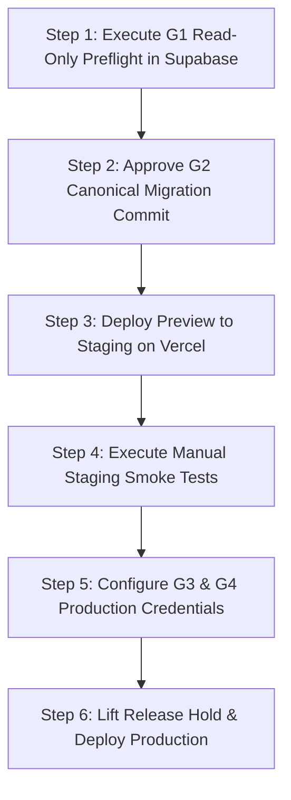

# KAVACH CAMPUS — FINAL BLOCKERS REPORT

**Project:** Kavach Campus — Safety in One Tap  
**Workspace:** `D:\Kavach Campus`  
**Execution Timestamp:** October 19, 2026  
**Auditor:** Antigravity Autonomous Security Subsystem  
**Reference Git Branch:** `master` (`aa96b34`)  
**Production Remote Database Reference:** `polbnvszmvblwenfnqll`  
**Current Release Status:** ⛔ **STRICT RELEASE HOLD ON PRODUCTION**

---

## 1. Summary of Blockers by Release Phase

| Phase | Blockers Present | Current Operational Status |
|:---|:---:|:---|
| **Development** | 0 Blockers | 🟢 **100% COMPLETE & PASSING** |
| **Staging / Preview** | 2 Blockers | 🟡 **BLOCKED ON OAUTH & STAGING DB RUN** |
| **Production** | 4 Critical Blockers | ⛔ **STRICT PRODUCTION RELEASE HOLD** |

---

## 2. The 4 Production Blockers (Gates G1 through G4)

### Gate G1: Remote Production Database Preflight (READ-ONLY)
- **Status:** ⛔ **BLOCKED / NOT RUN**
- **Description:** The production Supabase database (`polbnvszmvblwenfnqll`) has not been audited via live SQL catalog queries to verify that all 17 tables exist, all have RLS enabled, the `audit_logs` schema matches, and storage buckets are private.
- **Why it blocks production:** Applying application updates to an unverified remote schema risks runtime query failures or data exposure if expected security policies are not active.
- **Required Action:**
  1. Open the [Supabase SQL Editor](https://supabase.com/dashboard/project/polbnvszmvblwenfnqll/sql/new).
  2. Paste and run the 100% read-only verification script:
     [`supabase/verification/kavach_step121_readonly_preflight.sql`](file:///D:/Kavach%20Campus/supabase/verification/kavach_step121_readonly_preflight.sql).
  3. Confirm that tables show `rls_enabled = true` and buckets show `is_public = false`.

---

### Gate G2: Canonical Migration Reconciliation & Version Control Commit
- **Status:** ⏳ **PENDING USER APPROVAL**
- **Description:** Previous migrations contained duplicate numerical prefixes (`001`, `002`, `008`), a dependency error in Migration 002 (`evidence.uploaded_by` altered before dropping RLS policies), and hardcoded admin account promotions in migrations 006 and 008.
- **Solution Prepared:** We created a clean 8-step monotonic ISO-timestamped sequence in [`supabase/migrations_canonical/`](file:///D:/Kavach%20Campus/supabase/migrations_canonical/).
- **Required Action:**
  1. User confirms adoption of the canonical migration sequence.
  2. The 4 dangerous legacy files (`001_kavach_campus.sql`, `002_kavach_campus_final_repair.sql`, `006_provision_super_admin.sql`, `008_kavach_campus_complete_production_alignment.sql`) are quarantined to `supabase/migrations/archive/`.
  3. Git changes are committed with an approved message.

---

### Gate G3: Institutional Notification Credentials (Twilio SMS & Firebase Push)
- **Status:** ⏳ **PENDING CREDENTIAL CONFIGURATION**
- **Description:** In local development, SMS and push adapters return `NOT_CONFIGURED` without crashing. In production, campus safety requires reliable real-time dispatch of emergency SOS messages to security personnel and trusted contacts.
- **Required Action:**
  Configure the following environment variables in the hosting dashboard (Vercel / Cloud Run):
  - `TWILIO_ACCOUNT_SID`
  - `TWILIO_AUTH_TOKEN`
  - `TWILIO_PHONE_NUMBER`
  - `FCM_SERVER_KEY` / `GOOGLE_APPLICATION_CREDENTIALS`
  - Set `ENABLE_REAL_NOTIFICATIONS=true`

---

### Gate G4: Production Gemini AI & Google OAuth Configuration
- **Status:** ⏳ **PENDING CREDENTIAL CONFIGURATION**
- **Description:**
  - **Gemini AI:** While emergency SOS persistence is decoupled and never depends on AI, non-critical multilingual incident classification and automated severity suggestion require an active Gemini API key.
  - **Google OAuth:** One-tap login via institutional Google accounts requires configuring the Google Web Client ID and Secret in Supabase Auth.
- **Required Action:**
  - Add `GEMINI_API_KEY` to Vercel production environment variables.
  - Configure Authorized Redirect URIs in Google Cloud Console (`https://polbnvszmvblwenfnqll.supabase.co/auth/v1/callback`) and save credentials in Supabase Dashboard -> Authentication -> Providers -> Google.

---

## 3. Recommended Resolution Sequence

