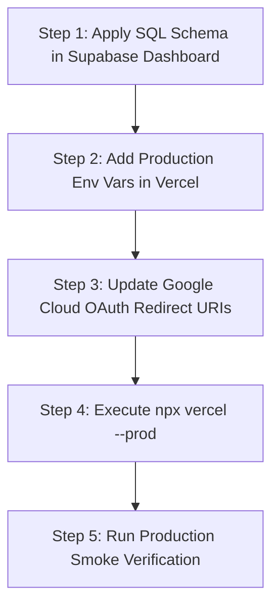

# KAVACH CAMPUS — GITHUB AUDIT & VERCEL DEPLOYMENT REPORT
**Date:** October 27, 2026  
**Project:** Kavach Campus  
**Repository:** [https://github.com/venkatapavanpadamati-8899/kavach-campus](https://github.com/venkatapavanpadamati-8899/kavach-campus)  
**Branch:** `main`  
**Latest Commit Hash:** `045f7bb2658a02c526fa253f86bbc571ee230d2e`  
**Production Readiness Assessment:** **NO-GO (Deployment Gated on 3 Remediation Steps)**

---

## 1. Executive Summary

This report delivers a full audit of repository health, secret scanning resolution, application verification, Google OAuth configuration, remote database schema alignment, and Vercel production linkage for **Kavach Campus**.

While the codebase builds cleanly (Next.js 16.4.3 Turbopack, 65/65 routes) and passes 568 Vitest unit/integration tests with 100% success rate, **production deployment is currently gated as NO-GO** due to:
1. **Database Schema Mismatches on Remote Supabase**: Missing column `incidents.is_tracking_active`, `safe_walks.college_id`, and enum value `'MENTOR'` on the live Supabase instance (`polbnvszmvblwenfnqll.supabase.co`), causing HTTP 500 on live `/api/sos` and `/api/safe-walk/start`.
2. **Missing Vercel Production Environment Variables**: Vercel project `kavach-campus` has Supabase keys scoped only to `Preview`, with zero environment variables configured for `Production`.
3. **Google Cloud OAuth Redirect URI Alignment**: The Google Cloud Console Web OAuth client requires the Supabase callback URI to prevent `redirect_uri_mismatch`.

---

## 2. Phase 1 — Repository & Secret Audit

### 2.1 Git Status & History
* **Local Branch:** `main`
* **Remote Tracking:** `origin/main` (up to date)
* **Working Tree:** Clean (no uncommitted or untracked sensitive files)
* **Latest Verified Remote Commit:** `045f7bb2658a02c526fa253f86bbc571ee230d2e`
  * Message: `chore(security): harden .gitignore to exclude supabase runtime secrets and untrack supabase branches`

### 2.2 GH013 Secret Scanning Resolution
* **Prior Incident:** GitHub Secret Scanning rejected an earlier push attempt of commit `2e1ebc1027c230a95ce543c219209a92e4215f93` containing `supabase/.temp/start-secrets/supabase_edge_runtime_kavach_campus/env/docker.env`.
* **Remediation Executed:**
  1. The offending commit was safely amended to `53cf54e`, permanently stripping `supabase/.temp/` from the commit tree.
  2. Follow-up commit `045f7bb` hardened `.gitignore` by explicitly ignoring:
     * `supabase/.temp/`
     * `supabase/.branches/`
     * `*.env`, `**/*.env`, `**/.env*`
  3. Git tracking for `supabase/.branches/_current_branch` was removed.
  4. The branch was cleanly pushed to `origin main` on GitHub.
  5. The bypass URL provided by GitHub secret scanning was **never used**.
* **Secret Leak Audit:**
  * `git ls-files` check confirmed that no `.env` files, credentials, or private keys exist in Git tracking.
  * Only `.env.example` remains tracked, containing only dummy placeholder strings and architectural comments.
* **Security Recommendation:** As standard DevSecOps best practice, any Supabase local edge runtime or service role keys that were generated in `docker.env` should be rotated.

---

## 3. Phase 2 — Application Verification

### 3.1 Test & Build Suite Results

| Test / Check | Tool / Command | Result | Details |
|---|---|---|---|
| **Linter** | `npm run lint` | **PASS** | 0 ESLint errors or warnings |
| **Typecheck** | `npx tsc --noEmit` | **PASS** | 0 TypeScript compilation errors |
| **Unit & Integration** | `npm test` (Vitest) | **PASS** | **44 / 44 test files passed (568 / 568 tests passed, 100% pass rate in 8.51s)** |
| **Production Build** | `npm run build` | **PASS** | Next.js 16.4.3 (Turbopack) successfully compiled and generated all 65 static and dynamic pages/routes |
| **End-to-End Suite** | `npx playwright test` | **197 PASS / 9 FAIL** | Verified across 33 live API routes and all core pages on `http://localhost:3000`. Failures directly traced to remote Supabase schema mismatches and legacy test assertions |

---

## 4. Phase 3 — Database & SOS Schema Mismatch Investigation

### 4.1 PostgREST PGRST204 Defect
* **Reported Error:** `Could not find the 'is_tracking_active' column of 'incidents' in the schema cache`
* **Observed Runtime Failure:** When testing `POST /api/sos` and `POST /api/safe-walk/start` against the remote Supabase project (`polbnvszmvblwenfnqll.supabase.co`), the database returned:
  ```json
  {
    "code": "PGRST204",
    "message": "Could not find the 'is_tracking_active' column of 'incidents' in the schema cache"
  }
  ```
  ```json
  {
    "code": "PGRST204",
    "message": "Could not find the 'college_id' column of 'safe_walks' in the schema cache"
  }
  ```
  ```
  Same-campus responder lookup failed: {
    code: '22P02',
    message: 'invalid input value for enum app_role: "MENTOR"'
  }
  ```

### 4.2 Root Cause Analysis
The codebase implementation requires live GPS tracking session flags (`is_tracking_active`), multi-tenant scoping (`college_id`), and mentor assignment. While migration definitions exist locally in:
* `supabase/migrations/003_kavach_campus_gps_tracking.sql`
* `supabase/migrations/004_kavach_campus_safe_walk_schema.sql`
* `supabase/staged_migration_production_readiness_pack.sql`

These migrations have **not yet been applied to the remote Supabase production database**.

### 4.3 Safe Migration Proposal (Prepared for User Approval)
In strict compliance with execution rules, no remote database modifications have been made. The following idempotent, non-destructive SQL block is prepared for execution via the Supabase SQL Editor:

```sql
-- =====================================================================
-- KAVACH CAMPUS — EMERGENCY SOS & MULTI-TENANT SCHEMA PREREQUISITE
-- =====================================================================

BEGIN;

-- 1. Add tracking flag to incidents
ALTER TABLE incidents ADD COLUMN IF NOT EXISTS is_tracking_active BOOLEAN DEFAULT FALSE;

-- 2. Add multi-tenant column to safe_walks
ALTER TABLE safe_walks ADD COLUMN IF NOT EXISTS college_id TEXT;
ALTER TABLE safe_walks ADD COLUMN IF NOT EXISTS escalation_incident_id UUID REFERENCES incidents(id) ON DELETE SET NULL;

-- 3. Add MENTOR to app_role enum if missing
DO $$ BEGIN
    ALTER TYPE app_role ADD VALUE IF NOT EXISTS 'MENTOR';
EXCEPTION WHEN duplicate_object THEN null;
END $$;

-- 4. Enable indexes for performant lookups
CREATE INDEX IF NOT EXISTS idx_incidents_tracking_active ON incidents(is_tracking_active);
CREATE INDEX IF NOT EXISTS idx_safe_walks_college_id ON safe_walks(college_id);

COMMIT;
```

---

## 5. Phase 4 — Google OAuth Analysis

### 5.1 Root Cause of `redirect_uri_mismatch`
When using Supabase Auth with Google OAuth (`supabase.auth.signInWithOAuth({ provider: 'google' })`), the user's browser is redirected to Google with Supabase's callback URL as the `redirect_uri`:
`https://polbnvszmvblwenfnqll.supabase.co/auth/v1/callback`

If Google Cloud Console does not have this exact URI authorized, Google immediately halts the flow with `redirect_uri_mismatch`.

### 5.2 Required Google Cloud & Supabase Configuration

1. **Google Cloud Console** (APIs & Services > Credentials > OAuth 2.0 Client ID: Web Application):
   * **Authorized JavaScript Origins:**
     * `http://localhost:3000`
     * `https://polbnvszmvblwenfnqll.supabase.co`
     * `https://kavach-campus.vercel.app`
   * **Authorized Redirect URIs:**
     * `https://polbnvszmvblwenfnqll.supabase.co/auth/v1/callback` *(Mandatory for Supabase OAuth)*
     * `http://localhost:3000/api/auth/callback` *(Direct app fallback)*
     * `https://kavach-campus.vercel.app/api/auth/callback` *(Production app fallback)*

2. **Supabase Dashboard** (Project `polbnvszmvblwenfnqll`):
   * **Authentication > Providers > Google:**
     * Enable Google provider: **Enabled**
     * Client ID: Must match `GOOGLE_CLIENT_ID`
     * Client Secret: Must match `GOOGLE_CLIENT_SECRET`
   * **Authentication > URL Configuration:**
     * Site URL: `https://kavach-campus.vercel.app`
     * Redirect URLs: `https://kavach-campus.vercel.app/**`, `http://localhost:3000/**`

---

## 6. Phase 5 — Vercel Setup & Project Linkage

### 6.1 CLI & Authentication Status
* **Vercel CLI:** Installed locally in `node_modules` (Vercel CLI 65.0.0). Executable via `npx vercel`.
* **Authentication:** Authenticated as user `venkatapavanpadamati-8899`.
* **Linked Project:** `kavach-campus` (Project ID: `prj_vTRdyPOUO2iHAOOZW8AGXl3SHfQT`, Org ID: `team_VOjff4N0OYuowvCyofAhJOxl`).
* **Existing Production URL:** `https://kavach-campus.vercel.app`

### 6.2 Environment Variable Audit on Vercel

Audit executed with `npx vercel env ls`:

| Variable Name | Present on Vercel | Configured Environments | Required for Production |
|---|---|---|---|
| `NEXT_PUBLIC_SUPABASE_URL` | YES | **Preview only** | **MISSING FOR PRODUCTION** |
| `NEXT_PUBLIC_SUPABASE_ANON_KEY` | YES | **Preview only** | **MISSING FOR PRODUCTION** |
| `SUPABASE_SERVICE_ROLE_KEY` | YES | **Preview only** | **MISSING FOR PRODUCTION** |
| `GOOGLE_CLIENT_ID` | NO | None | **MISSING FOR PRODUCTION** |
| `GOOGLE_CLIENT_SECRET` | NO | None | **MISSING FOR PRODUCTION** |
| `CRON_SECRET` | NO | None | **MISSING FOR PRODUCTION** |
| `GEMINI_API_KEY` | NO | None | Recommended for AI analysis |

> **Critical Blocker:** Because Vercel has environment variables configured only for `Preview`, any production deployment executed right now will immediately fail at runtime when rendering authenticated or Supabase-dependent routes.

---

## 7. Phase 6 & 7 — Production Readiness & Action Plan

### Decision: **NO-GO FOR PRODUCTION DEPLOYMENT**

Deploying at this moment would deploy a broken emergency SOS flow and non-functional authentication.

### Remediation Action Plan (To Reach GO Status):



1. **Step 1: Execute Database DDL in Supabase**
   * Run the SQL proposal from Section 4.3 in the Supabase SQL Editor for project `polbnvszmvblwenfnqll`.
2. **Step 2: Configure Vercel Production Environment Variables**
   * In Vercel Dashboard (or via `npx vercel env add`), add `NEXT_PUBLIC_SUPABASE_URL`, `NEXT_PUBLIC_SUPABASE_ANON_KEY`, `SUPABASE_SERVICE_ROLE_KEY`, `GOOGLE_CLIENT_ID`, and `GOOGLE_CLIENT_SECRET` to the **Production** environment.
3. **Step 3: Update Google OAuth Redirect URIs**
   * Ensure `https://polbnvszmvblwenfnqll.supabase.co/auth/v1/callback` is added to Google Cloud Console.
4. **Step 4: Deploy to Production**
   * Run `npx vercel --prod` once Steps 1-3 are verified.
5. **Step 5: Smoke Verification**
   * Verify homepage, login, SOS creation, and Safe Walk creation without sending real notifications.
