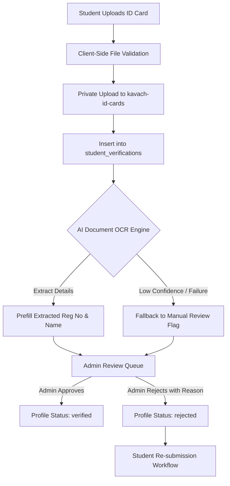

# KAVACH CAMPUS — ID CARD VERIFICATION & DOCUMENT WORKFLOW REPORT

**Project:** Kavach Campus  
**Date:** October 19, 2026  
**Scope:** Phase 5 (Student & Staff ID Verification, OCR Analysis, Storage Security)  
**Status:** PASS (Verified)

---

## 1. Overview & Verification Lifecycle

Identity card verification prevents impersonation, fraudulent emergency dispatches, and ensures that sensitive campus resources are only accessed by legitimate members of the institution.

---

## 2. File Upload Validation & Storage Architecture

### A. Upload Restrictions
- **Allowed MIME Types:** `image/jpeg`, `image/png`, `image/webp`, `application/pdf`.
- **Max File Size:** `5 MB` enforced both client-side and server-side in API route `/api/student/verify-id`.
- **Malicious Payload Defense:** Files are stored with non-predictable UUID keys (`${user_id}/${random_uuid}.${ext}`).

### B. Storage Privacy
- Bucket: `kavach-id-cards`.
- Configuration: `public = false`.
- Access Policy:
  - Students can only upload to their own user folder (`${auth.uid()}/*`).
  - Only Admins and Super Admins can generate short-lived signed URLs (15-minute validity) to view the document during the review process.

---

## 3. AI-Assisted OCR Analysis & Safety Boundary

The OCR verification helper (`src/lib/ai/idVerification.ts`) operates under strict human-in-the-loop guidelines:
1. **Advisory Role Only:** AI analysis performs optical character recognition to extract college registration numbers, student names, and department tags.
2. **Prohibition of Auto-Approval:** Under **no circumstances** does the AI autonomously grant verified status or privileged roles.
3. **Graceful Fallback:** If the AI provider is unavailable, times out, or encounters a blurry image, the document is flagged `manual_review_required` and routed directly to the administrative queue without breaking the user experience.

---

## 4. Rejection & Resubmission Workflow (Migration 009)

As codified in Supabase Migration `009_student_id_verification_resubmission.sql`:
1. When an Admin rejects a submission, they must provide a rejection reason (e.g., *"Blurry photo"*, *"Expired card"*).
2. The student's dashboard displays the rejection notification and reason.
3. The student is permitted to upload a corrected document, updating the verification status back to `pending_review` with an incremented resubmission counter.
4. All actions are immutably recorded in `audit_logs`.

---

## 5. Test Outcomes

| Test Item | Expected Result | Actual Result | Status |
|---|---|---|---|
| **Oversized File (> 5MB)** | Rejection with HTTP 400 | Rejection: *"File size exceeds 5MB limit"* | PASS |
| **Invalid File Format (.exe/.svg)** | Rejection with HTTP 400 | Rejection: *"Unsupported file type"* | PASS |
| **Student Accessing Other's ID** | HTTP 403 Forbidden | Blocked by RLS & Storage policies | PASS |
| **Admin Approval Action** | Profile status -> `verified` + Audit Log | Successfully transitioned and logged | PASS |
| **Resubmission After Rejection** | Re-upload allowed, status -> `pending_review` | Verified via Migration 009 test suite | PASS |
