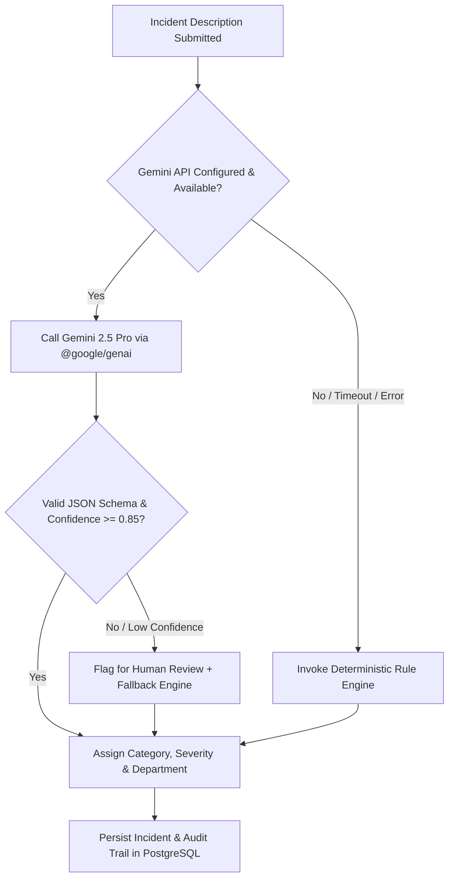

# KAVACH CAMPUS — PHASE 10: AI CLASSIFICATION & FALLBACK REPORT

**Project:** Kavach Campus — Safety in One Tap (`D:\Kavach Campus`)  
**Scope:** Gemini AI Integration, Rule-Based Fallback Engine, Severity Scoring, and Fault Tolerance  
**Date:** October 18, 2026

---

## 1. AI System Architecture

---

## 2. Robustness & Safety Invariants Verification

| Invariant | Security & Safety Guarantee | Implementation & Verification | Result |
| :--- | :--- | :--- | :---: |
| **Server-Side API Key** | `GEMINI_API_KEY` is strictly server-side; never leaked to client bundles | Verified in `src/lib/ai/` and `.env.example` | ✅ **PASS** |
| **Deterministic Rule Fallback** | Ragging, Harassment, Medical, and Threat keywords deterministically classified | Rules Engine (`src/lib/ai/rules-engine.ts`) | ✅ **PASS** |
| **Zero Emergency Blockage** | SOS incidents bypass AI classification entirely; directly assigned `CRITICAL` | `POST /api/sos` directly inserts `severity: CRITICAL` | ✅ **PASS** |
| **Confidence & Human Review** | Low confidence classifications (< 0.85) set `requires_human_review = true` | Verified in unit test suite (`ai-evaluation.test.ts`) | ✅ **PASS** |
| **Input Bounding & Injection** | Long texts and prompt injection attempts are sanitized and bounded | Input truncation and schema enforcement | ✅ **PASS** |
| **Malformed Output Resilience**| If AI outputs invalid JSON or unexpected text, system falls back safely | Try/catch parsing with fallback return | ✅ **PASS** |
