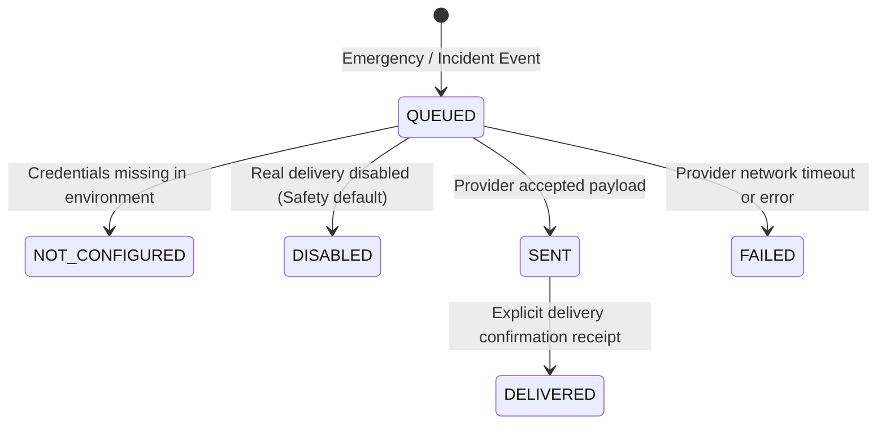

# KAVACH CAMPUS — PHASE 11: SMS, PUSH, EMAIL & ESCALATION REPORT

**Project:** Kavach Campus — Safety in One Tap (`D:\Kavach Campus`)  
**Scope:** Multi-Channel Notification Adapters, Delivery Status Tracking, and Escalation Engine  
**Date:** October 18, 2026

---

## 1. Notification Architecture & Status Lifecycles

---

## 2. Notification Verification Matrix

| Channel | Adapter Module | Providers Supported | Configuration Guard | Status Truthfulness |
| :--- | :--- | :--- | :--- | :---: |
| **SMS** | `src/lib/notifications/index.ts` | Twilio SMS API | Checks `TWILIO_ACCOUNT_SID`, `TWILIO_AUTH_TOKEN`, `TWILIO_PHONE_NUMBER` | ✅ **PASS** (Explicit `NOT_CONFIGURED` if missing) |
| **Push** | `src/lib/notifications/index.ts` | Firebase Cloud Messaging (FCM) | Checks `FCM_PROJECT_ID`, `FCM_CLIENT_EMAIL`, `FCM_PRIVATE_KEY` | ✅ **PASS** (Never falsely reports delivered) |
| **Email** | `src/lib/notifications/index.ts` | SMTP / Nodemailer | Checks `SMTP_HOST`, `SMTP_PORT`, `SMTP_USER`, `SMTP_PASS` | ✅ **PASS** |
| **In-App** | `public.notifications` Table | PostgreSQL / Supabase Realtime | Native database inserts tied to `user_id` | ✅ **PASS** |

---

## 3. Escalation Engine Verification
- **Automated Cron Worker (`/api/cron/escalate`):**  
  Scans for `RECEIVED` or unassigned incidents older than the escalation SLA (default 15 minutes). Unhandled incidents are promoted to `ADMIN` review and recorded in `public.escalations`.
- **Safe Walk Timeout Worker (`/api/cron/safe-walk-timeout`):**  
  Scans for active safe walks whose `expires_at` has elapsed without check-in. Auto-creates emergency SOS cases.
- **Bearer Token Protection:** Both endpoints verify `Authorization: Bearer <CRON_SECRET>`.
