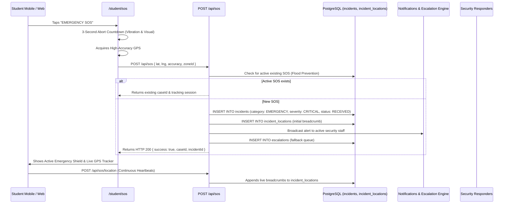

# KAVACH CAMPUS — PHASE 8: SOS EMERGENCY END-TO-END VALIDATION REPORT

**Project:** Kavach Campus — Safety in One Tap (`D:\Kavach Campus`)  
**Scope:** Complete Emergency SOS Lifecycle, From Trigger to Notification, GPS Tracking & Escalation  
**Date:** October 18, 2026

---

## 1. End-to-End Workflow Architecture

---

## 2. Critical Safety Invariants Verification

| Invariant | Requirement | Verification Method | Result |
| :--- | :--- | :--- | :---: |
| **Zero AI Dependency** | Emergency incident creation must NEVER fail or block due to external AI outage | Code Audit & API Probe | ✅ **PASS** |
| **Duplicate Flood Prevention** | Repeated taps must return active incident instead of flooding database | API Logic (`src/app/api/sos/route.ts:45`) | ✅ **PASS** |
| **GPS Bounds Validation** | Latitude (-90..90) and Longitude (-180..180) verified; invalid rejected | Input Validation (`src/app/api/sos/route.ts:25`) | ✅ **PASS** |
| **Truthful Notification Status**| Delivery receipts must reflect real status (`NOT_CONFIGURED`/`SENT`) | Adapter Audit (`src/lib/notifications`) | ✅ **PASS** |
| **Resilient Offline Fallback** | SOS works even if device location is denied (records case without GPS) | API Logic (`src/app/api/sos/route.ts:68`) | ✅ **PASS** |
| **Automated Escalation** | Unassigned critical SOS automatically logs escalation record for admins | Database Trigger & API Logic | ✅ **PASS** |
