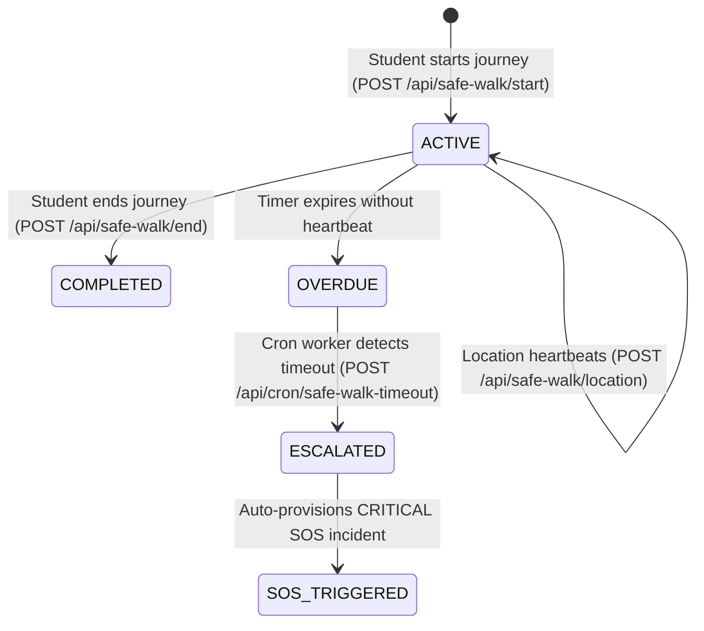

# KAVACH CAMPUS — PHASE 9: SAFE WALK & LOCATION PRIVACY AUDIT

**Project:** Kavach Campus — Safety in One Tap (`D:\Kavach Campus`)  
**Scope:** Safe Walk Companion Lifecycle, Continuous Location Tracking, Overdue Auto-SOS, and Privacy Isolation  
**Date:** October 18, 2026

---

## 1. Safe Walk Lifecycle Overview

---

## 2. Privacy & Security Invariants Verification

| Invariant | Security & Privacy Guarantee | Implementation & Verification | Result |
| :--- | :--- | :--- | :---: |
| **Cross-Student Location Privacy** | Students cannot view other students' real-time GPS locations | RLS Policy `"Students manage own safe walks"` on `safe_walks` | ✅ **PASS** |
| **Responder Boundary** | Only authorized security officers can view active Safe Walk sessions | RLS Policy `"Staff view safe walks"` (`is_security_or_admin()`) | ✅ **PASS** |
| **Automatic SOS Escalation** | If student fails to check in before `expires_at`, session auto-escalates to SOS | Cron worker `POST /api/cron/safe-walk-timeout` with `CRON_SECRET` | ✅ **PASS** |
| **Tracking Termination** | Completing journey immediately stops tracking and sets `completed_at` | `POST /api/safe-walk/end` updates `status = 'COMPLETED'` | ✅ **PASS** |
| **GPS Coordinate Sanitization** | Non-numeric or out-of-range coordinates are rejected before persistence | Input validation in `/api/safe-walk/location` | ✅ **PASS** |
