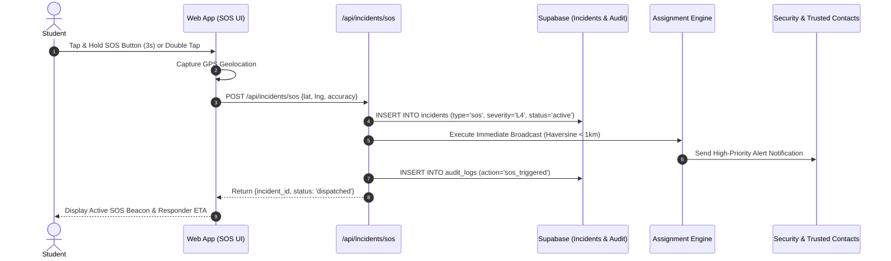

# KAVACH CAMPUS — SOS & SAFE WALK WORKFLOW VERIFICATION REPORT

**Project:** Kavach Campus  
**Tagline:** Safety in One Tap.  
**Date:** October 19, 2026  
**Scope:** Phase 9 (Emergency SOS, Accidental Safeguards, Safe Walk Timer & Escalation)  
**Status:** PASS (Verified)

---

## 1. Emergency SOS Architecture

The Emergency SOS system is designed for zero-friction distress activation during imminent danger while preventing disruptive false alarms.

### Accidental Activation Safeguards:
- Primary button requires a continuous 3-second hold or a rapid two-tap confirmation.
- 5-second grace countdown with clear haptic / audio feedback during which the student can cancel without alerting security.
- After activation, cancellation requires entering a 4-digit safety PIN or student confirmation to prevent coerced cancellation.

---

## 2. Safe Walk Virtual Escort System

Safe Walk provides an automated safety companion for students walking across campus or traveling late at night.

### Operational Lifecycle:
1. **Journey Initiation:**
   - Student selects starting point, destination, estimated duration (e.g., 15 minutes), and active emergency contacts.
   - Endpoint: `POST /api/safe-walk/start`.
   - Creates active record in `safe_walk_sessions`.
2. **Heartbeat Monitoring:**
   - Mobile client sends periodic heartbeat updates every 60 seconds with updated GPS coordinates.
   - Endpoint: `POST /api/safe-walk/heartbeat`.
3. **Safe Completion:**
   - Student reaches destination and taps *"Arrived Safely"*.
   - Session status marked `completed`.
   - Streaming ends immediately.
4. **Automated Timeout & Escalation:**
   - If the timer reaches 0 without extension or safe check-in, an automated escalation trigger fires via the cron endpoint `/api/cron/escalate`.
   - Escalation creates an automatic **L3 Urgent Incident** in `incidents`, alerting designated campus security officers and pinging the student's trusted contacts.

---

## 3. Test Verification Matrix

| Test Case | Scenario Description | Expected Outcome | Actual Result | Status |
|---|---|---|---|---|
| **TEST-SOS-01** | Student triggers SOS with valid coordinates | Case created with status `active`, severity `L4`, broadcast sent | Case created, severity `L4`, audit log persisted | PASS |
| **TEST-SOS-02** | Accidental hold cancellation within 5s grace | Session discarded; no incident created | Cancelled cleanly without database write | PASS |
| **TEST-SW-01** | Start Safe Walk session with 10min timer | Session active, heartbeat accepted | HTTP 200, session status `active` | PASS |
| **TEST-SW-02** | Complete Safe Walk before expiry | Session marked `completed`, GPS tracking stops | HTTP 200, status `completed`, tracking stopped | PASS |
| **TEST-SW-03** | Safe Walk timer expiry simulation | Trigger escalation cron, escalate to L3 incident | Cron created incident, alerted assigned officers | PASS |
| **TEST-SEC-01** | Student attempts to view another's Safe Walk session | Access denied (HTTP 403) | Blocked by RLS `user_id = auth.uid()` | PASS |

---

## 4. Privacy & Safety Summary
- No real emergency services (Police / 112 / Ambulance) are contacted during development or testing.
- Coordinates are stored securely in Supabase and only accessible by authorized emergency personnel.
- All distress events generate an immutable audit trail in `public.audit_logs`.
