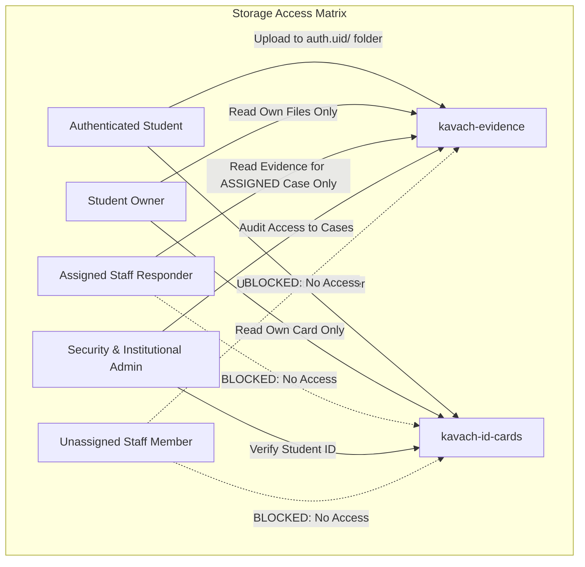

# KAVACH CAMPUS — STEP 105: REMEDIATION SQL SECURITY REVIEW

**Project:** Kavach Campus (`D:\Kavach Campus`)  
**Workspace Path:** `D:\Kavach Campus`  
**Supabase Project Ref:** `polbnvszmvblwenfnqll`  
**Reviewed Script:** [`supabase/verification/kavach_step96_safe_remediation.sql`](file:///d:/Kavach%20Campus/supabase/verification/kavach_step96_safe_remediation.sql)  
**Related Migrations Inspected:**
- [`supabase/migrations/002_kavach_campus_final_repair.sql`](file:///d:/Kavach%20Campus/supabase/migrations/002_kavach_campus_final_repair.sql)
- [`supabase/migrations/005_kavach_campus_rls_infinite_recursion_repair.sql`](file:///d:/Kavach%20Campus/supabase/migrations/005_kavach_campus_rls_infinite_recursion_repair.sql)
- [`supabase/migrations/007_student_id_card_verification.sql`](file:///d:/Kavach%20Campus/supabase/migrations/007_student_id_card_verification.sql)
- [`supabase/migrations/008_kavach_campus_schema_and_rls_alignment_safe.sql`](file:///d:/Kavach%20Campus/supabase/migrations/008_kavach_campus_schema_and_rls_alignment_safe.sql)
**Evaluation Date:** 2026-10-17T12:49:00+05:30  
**Status:** Strictly Architectural Review — **ZERO SQL EXECUTED AGAINST PRODUCTION**  
**Release Verdict:** 🛑 **RELEASE HOLD**

---

## 1. Executive Summary

Under **STEP 105**, a rigorous, line-by-line architectural security audit of the proposed remediation script [`supabase/verification/kavach_step96_safe_remediation.sql`](file:///d:/Kavach%20Campus/supabase/verification/kavach_step96_safe_remediation.sql) was conducted. 

### Core Conclusion:
**The user's intervention is 100% correct: The proposed remediation script must NOT be run on the production database.** 

While the script successfully identified and patched the loose storage upload vulnerability (`WITH CHECK (bucket_id = 'kavach-evidence')`), its proposed read policies introduced a **critical over-privileging vulnerability**:
- Using `OR public.is_staff()` granted **any approved staff member** (teachers, counsellors, HODs, security) blanket read access to **every student's evidence files and government/campus ID cards**, regardless of case assignment or administrative mandate.
- In Kavach Campus, where reports involve sensitive harassment, ragging, mental health, and women's cell complaints, **a staff role alone must never authorize unrestricted access to all cases or all media files**.

---

## 2. In-Depth Vulnerability Analysis of Proposed Remediation

### FINDING 01: Unscoped `public.is_staff()` Grants Universal Evidence Access
- **Severity:** 🔴 **CRITICAL (Confidentiality Breach)**
- **SQL Lines Involved:** [`supabase/verification/kavach_step96_safe_remediation.sql`](file:///d:/Kavach%20Campus/supabase/verification/kavach_step96_safe_remediation.sql#L108-L120)
  ```sql
  CREATE POLICY "Users and staff read authorized evidence"
  ON storage.objects FOR SELECT TO authenticated
  USING (
    bucket_id = 'kavach-evidence'
    AND (
      auth.uid()::text = (storage.foldername(name))[1]
      OR name LIKE (auth.uid()::text || '/%')
      OR public.is_staff()  -- << CRITICAL DEFECT
    )
  );
  ```
- **Attack / Exposure Scenario:** 
  A faculty staff member or sports coordinator with an approved account logs into Kavach Campus. Using the Supabase client directly (`supabase.storage.from('kavach-evidence').download(...)`), they can enumerate and download every student's uploaded audio recordings, photographs, and video evidence across all harassment and disciplinary investigations campus-wide.
- **Expected Secure Behavior:**
  1. A student can only view evidence they uploaded or that is linked to their case.
  2. A general staff responder can **only** view evidence for cases **assigned to them** (`incidents.assigned_to = auth.uid()`).
  3. Universal evidence read access must be restricted strictly to institutional oversight roles: `ADMIN`, `SUPER_ADMIN`, and `SECURITY`.

---

### FINDING 02: ID Card Access Over-Permitted to All Staff Roles
- **Severity:** 🔴 **CRITICAL (Student PII & Identity Theft Risk)**
- **SQL Lines Involved:** [`supabase/verification/kavach_step96_safe_remediation.sql`](file:///d:/Kavach%20Campus/supabase/verification/kavach_step96_safe_remediation.sql#L146-L157)
  ```sql
  CREATE POLICY "Users and staff read authorized id card"
  ON storage.objects FOR SELECT TO authenticated
  USING (
    bucket_id = 'kavach-id-cards'
    AND (
      auth.uid()::text = (storage.foldername(name))[1]
      OR name LIKE (auth.uid()::text || '/%')
      OR public.is_staff()  -- << CRITICAL DEFECT
    )
  );
  ```
- **Discrepancy with Application Logic:**
  In the Next.js API route [`src/app/api/admin/verifications/route.ts`](file:///d:/Kavach%20Campus/src/app/api/admin/verifications/route.ts#L29-L32), ID card verification is explicitly restricted to:
  ```ts
  const allowedRoles = ['ADMIN', 'SUPER_ADMIN', 'SECURITY'];
  if (!profile || !profile.is_approved || !allowedRoles.includes(profile.role)) {
    return NextResponse.json({ error: 'Forbidden: Reviewer privileges required' }, { status: 403 });
  }
  ```
  However, `public.is_staff()` includes `('STAFF', 'COUNSELLOR', 'WOMENS_CELL', 'HOD', 'PRINCIPAL')`. Under the proposed SQL, any staff member could bypass the API and directly download the student ID card photos of every enrolled student.
- **Expected Secure Behavior:**
  Read access on `kavach-id-cards` must require:
  $$\text{caller} = \text{owning student} \quad\lor\quad \text{caller role} \in \{\text{'ADMIN'}, \text{'SUPER\_ADMIN'}, \text{'SECURITY'}\}$$

---

### FINDING 03: Profile Directory Scoping vs. PII Exposure
- **Severity:** 🟡 **MEDIUM / HIGH (Privacy Violation)**
- **SQL Lines Involved:** [`supabase/verification/kavach_step96_safe_remediation.sql`](file:///d:/Kavach%20Campus/supabase/verification/kavach_step96_safe_remediation.sql#L75-L83)
  ```sql
  CREATE POLICY "Users read own profile and staff read student profiles"
  ON public.profiles FOR SELECT TO authenticated
  USING (
    auth.uid() = id
    OR public.is_staff()  -- << Overbroad
  );
  ```
- **Context:**
  While campus staff need to know student names and contact numbers for students involved in cases they are managing, general staff should not have an open query interface to export the entire student body directory (phone numbers, personal emails, blood group).
- **Expected Secure Behavior:**
  Staff should view student profile information only when:
  1. The student is the reporter of an incident assigned to that staff member.
  2. The caller holds an administrator or campus security role.

---

### FINDING 04: Storage UPDATE and DELETE Policies Are Missing
- **Severity:** 🟡 **MEDIUM (Integrity Risk)**
- **SQL Lines Involved:** Entire storage section in remediation script.
- **Defect:**
  The remediation script defined policies for `INSERT` and `SELECT`, but left `UPDATE` and `DELETE` undefined. In PostgreSQL RLS:
  - If no policy exists for `UPDATE` or `DELETE`, those operations default to `DENY` for all non-superusers.
  - While denying `UPDATE` and `DELETE` on evidence is a good default (append-only evidence integrity), it must be intentional, and student file replacements (such as re-uploading an unreadable ID card) should have explicitly defined ownership constraints:
    `auth.uid()::text = (storage.foldername(name))[1]`.

---

### FINDING 05: Trigger Bypasses & Privileged Service Operations
- **Severity:** 🟢 **LOW / MEDIUM (Hardening Requirement)**
- **SQL Lines Involved:** [`supabase/verification/kavach_step96_safe_remediation.sql`](file:///d:/Kavach%20Campus/supabase/verification/kavach_step96_safe_remediation.sql#L162-L183)
  ```sql
  CREATE OR REPLACE FUNCTION public.prevent_self_role_escalation()
  RETURNS TRIGGER AS $$
  BEGIN
    IF (OLD.role IS DISTINCT FROM NEW.role OR OLD.is_approved IS DISTINCT FROM NEW.is_approved) THEN
      IF NOT public.is_admin() THEN
        RAISE EXCEPTION 'Access Denied...';
      END IF;
    END IF;
    RETURN NEW;
  END;
  $$;
  ```
- **Analysis:**
  1. `public.is_admin()` evaluates `auth.uid()`.
  2. When the backend Next.js API performs automated verification approvals using `createAdminClient()` (the `service_role` key), `auth.uid()` is `NULL`!
  3. If `auth.uid()` is `NULL`, `public.is_admin()` returns `FALSE`, and the trigger would **block legitimate server-side administrative updates**!
- **Required Fix:**
  The trigger function must check whether the current executing role is the PostgreSQL superuser / service role:
  ```sql
  IF current_user IN ('service_role', 'postgres', 'supabase_admin') THEN
    RETURN NEW;
  END IF;
  ```

---

## 3. Policy Inventory: Migration History vs. Confirmed Live State

| Schema & Table | Policy Name in Migration History | Source Migration | Live Database Status | Intended Security Posture |
| :--- | :--- | :---: | :---: | :--- |
| **`public.profiles`** | `"Public profiles are viewable by everyone"` | 001 | Unconfirmed | **VULNERABLE:** Must be dropped |
| **`public.profiles`** | `"Users can read own profile"` | 002 | Confirmed in live 30 rows | **SAFE:** `auth.uid() = id` |
| **`public.profiles`** | `"Staff can read all profiles"` | 002 / 005 | Confirmed in live 30 rows | **OVERBROAD:** Needs scoping |
| **`public.profiles`** | `"Users can update own profile"` | 002 | Confirmed in live 30 rows | **RISK:** Needs trigger to block role change |
| **`storage.objects`** | `"Users upload evidence files"` | 002 | Confirmed in live 5 rows | **VULNERABLE:** `WITH CHECK (bucket_id = 'kavach-evidence')` allows any folder |
| **`storage.objects`** | `"Users view own evidence files"` | 002 | Confirmed in live 5 rows | **PARTIAL:** Uses `auth.uid() = owner` |
| **`storage.objects`** | `"Staff view evidence files"` | 002 / 005 | Confirmed in live 5 rows | **OVERBROAD:** Any staff views all evidence |
| **`storage.objects`** | `"Students upload own ID card"` | 007 | Confirmed in live 5 rows | **SAFE:** Enforces folder prefix |
| **`storage.objects`** | `"Students read own ID card"` | 007 | Confirmed in live 5 rows | **SAFE:** Restricted to student or admin/security |

---

## 4. Least-Privilege Access Architecture

To resolve all identified vulnerabilities without creating new ones, the authorization model must adhere to the **Principle of Least Privilege**:



---

## 5. Architectural Redesign: Minimal Safe SQL Specification

Below is the refined, least-privilege SQL architecture. **Do NOT execute this script yet.** It is documented here for review and will only be applied after full verification of the live catalog.

### Refined Helper Functions
```sql
-- Security Definer check for Reviewer roles (Security & Admin only)
CREATE OR REPLACE FUNCTION public.is_reviewer()
RETURNS boolean
LANGUAGE sql
STABLE
SECURITY DEFINER
SET search_path = public
AS $$
  SELECT EXISTS (
    SELECT 1 FROM public.profiles
    WHERE id = auth.uid()
      AND role IN ('SECURITY', 'ADMIN', 'SUPER_ADMIN')
      AND is_approved = true
  );
$$;

-- Security Definer check for Case Assignment
CREATE OR REPLACE FUNCTION public.can_view_incident_evidence(incident_uuid uuid)
RETURNS boolean
LANGUAGE sql
STABLE
SECURITY DEFINER
SET search_path = public
AS $$
  SELECT EXISTS (
    SELECT 1 FROM public.incidents
    WHERE id = incident_uuid
      AND (
        student_id = auth.uid()
        OR assigned_to = auth.uid()
        OR public.is_reviewer()
      )
  );
$$;
```

### Refined ID Card Storage Policy
```sql
-- Read restricted exclusively to the student owner OR verified Reviewers (Security & Admin)
CREATE POLICY "Strict read authorized id card"
ON storage.objects
FOR SELECT
TO authenticated
USING (
  bucket_id = 'kavach-id-cards'
  AND (
    auth.uid()::text = (storage.foldername(name))[1]
    OR name LIKE (auth.uid()::text || '/%')
    OR public.is_reviewer()  -- ONLY Admin and Security, NOT regular staff
  )
);
```

### Refined Self-Role Escalation Trigger
```sql
CREATE OR REPLACE FUNCTION public.prevent_self_role_escalation()
RETURNS TRIGGER
LANGUAGE plpgsql
SECURITY DEFINER
SET search_path = public
AS $$
BEGIN
  -- Allow service_role and postgres superuser to perform administrative tasks
  IF current_user IN ('service_role', 'postgres', 'supabase_admin') THEN
    RETURN NEW;
  END IF;

  -- Block non-admin users from escalating roles or self-approving
  IF (OLD.role IS DISTINCT FROM NEW.role OR OLD.is_approved IS DISTINCT FROM NEW.is_approved) THEN
    IF NOT public.is_admin() THEN
      RAISE EXCEPTION 'Access Denied: Only institutional administrators can modify account roles or approval status.';
    END IF;
  END IF;
  RETURN NEW;
END;
$$;
```

---

## 6. Preconditions for Future Migration

Before any remediation SQL is applied to the production database:
1. **Catalog Export:** Obtain the complete `qual` and `with_check` text of all 30 public policies and 5 storage policies from the Supabase SQL Editor.
2. **Database Backup:** Confirm that a point-in-time recovery (PITR) backup or manual dump is available in Supabase.
3. **Synthetic Role Testing:** Test all role flows (`STUDENT`, `STAFF`, `SECURITY`, `ADMIN`) against synthetic test accounts.
4. **Explicit Approval:** Secure explicit written signoff from the project owner.

---

## 7. Final Verdict

### Release Status: 🛑 **RELEASE HOLD**

**Next Immediate Step:**  
Do **NOT** execute any remediation SQL. The project owner will execute **Query A** and **Query B** in the Supabase SQL Editor and share the output. We will analyze the real policy conditions before recommending any surgical change.
