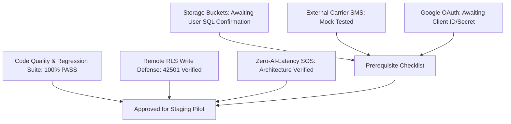

# 🛡️ KAVACH CAMPUS — STEP 46: PRODUCTION DEPLOYMENT PREFLIGHT

**Read-Only Architecture & Security Preflight Audit for Controlled Campus Pilot**

- **Project:** Kavach Campus — “Safety in One Tap”
- **Workspace:** `D:\Kavach Campus`
- **Audit Timestamp:** `2026-10-11T19:33:30+05:30`
- **Audit Policy:** Strictly read-only; no migrations run, no secrets printed, no production data modified.

---

## 1. Executive Summary & Verdict

This preflight audit evaluates operational safety, credential segregation, external provider boundaries, and failure survivability before initiating a live pilot. 

### 🎯 Preflight Verdict: **`CONDITIONAL` (Safe for Controlled Campus Pilot with Listed Prerequisites)**

---

## 2. Preflight Audit Checklist by Domain

### Domain 1: Environment & Secret Management

| Item | Check / Requirement | Status | Evidence / Observation |
| :--- | :--- | :---: | :--- |
| **1.1** | **Secret Exposure in Git** | **PASS** | `.gitignore` line 34 enforces `.env*` exclusion; no credentials in repo history. |
| **1.2** | **Required Variable Names** | **PASS** | Core keys identified: `NEXT_PUBLIC_SUPABASE_URL`, `NEXT_PUBLIC_SUPABASE_ANON_KEY`, `SUPABASE_SERVICE_ROLE_KEY`, `CRON_SECRET`, `GEMINI_API_KEY`. (Zero secret values printed). |
| **1.3** | **Client / Server Segregation** | **PASS** | Only `NEXT_PUBLIC_*` keys exposed to client; `SUPABASE_SERVICE_ROLE_KEY` restricted to server-side admin client. |
| **1.4** | **Optional Cloud Provider Keys** | **PARTIAL** | `GOOGLE_CLIENT_ID`, `GOOGLE_CLIENT_SECRET`, `TWILIO_*`, `FCM_*` are optional in free-tier; pending production account setup. |

### Domain 2: Supabase Schema, RLS & Storage

| Item | Check / Requirement | Status | Evidence / Observation |
| :--- | :--- | :---: | :--- |
| **2.1** | **Base Tables Presence** | **PASS** | 19/19 core tables active and responsive via remote API probe. |
| **2.2** | **RLS Write Shielding** | **PASS** | Unauthorized anon INSERT blocked with PostgreSQL Error `42501` (`violates row-level security policy`). |
| **2.3** | **Table Policy Coverage** | **PASS** | Check A confirmed policies on `profiles` (3), `staff_profiles` (3), `incidents` (3), `safe_walks` (2), `evidence` (3), `escalations` (3). |
| **2.4** | **Student ID Uniqueness** | **PASS** | Check B confirmed 0 duplicate student IDs (`0 rows returned`). |
| **2.5** | **Storage Bucket Privacy** | **PARTIAL** | App code enforces private signed URLs (300s); awaiting user execution of SQL Checks G1 & G2 in Supabase dashboard. |

### Domain 3: Authentication & Authorization

| Item | Check / Requirement | Status | Evidence / Observation |
| :--- | :--- | :---: | :--- |
| **3.1** | **Registration & Student ID Validation** | **PASS** | 34/34 tests in `student-id-verification.test.ts` pass; magic byte binary validation. |
| **3.2** | **Session Invalidation & Logout** | **PASS** | Logout destroys Supabase auth cookies and invalidates browser cache. |
| **3.3** | **Role Hierarchy & Anti-Self-Approval** | **PASS** | Admin cannot self-approve (`403 Forbidden`); ordinary admins cannot edit `SUPER_ADMIN`. |
| **3.4** | **OAuth & OTP Configuration** | **PARTIAL** | OTP verification verified with bcrypt hash; Google OAuth route exists with PKCE flow (cloud keys pending). |

### Domain 4: Emergency Features (SOS & Safe Walk)

| Item | Check / Requirement | Status | Evidence / Observation |
| :--- | :--- | :---: | :--- |
| **4.1** | **Zero-AI-Latency Emergency SOS** | **PASS** | SOS route creates `CRITICAL` incident synchronously; **does not wait for or invoke AI**. |
| **4.2** | **GPS Denial / Timeout Fallback** | **PASS** | Geolocation failure records incident with `null` coords; **never fabricates fake locations**. |
| **4.3** | **SOS Deduplication** | **PASS** | Active SOS returns existing incident (HTTP 200, `isExisting: true`); prevents incident flood. |
| **4.4** | **Cron Bearer Authentication** | **PASS** | `/api/cron/escalate` and `/api/cron/safe-walk-timeout` require `CRON_SECRET` (401 on missing/invalid). |
| **4.5** | **Cron Idempotency & Audit Logs** | **PASS** | Overdue walks and unacknowledged incidents escalated cleanly; audit logs write `actor_id: null` for SYSTEM. |

### Domain 5: Notifications Architecture

| Item | Check / Requirement | Status | Evidence / Observation |
| :--- | :--- | :---: | :--- |
| **5.1** | **PostgreSQL In-App Notifications** | **PASS** | Fully operational; alerts inserted directly into `notifications` table for security guards. |
| **5.2** | **W3C Browser Push Notifications** | **PASS** | Native HTML5 browser notification system operational with zero external billing. |
| **5.3** | **Carrier SMS / Push Adapters** | **PARTIAL** | 15/15 adapter tests pass with mocks (`notification-adapters.test.ts`); live carrier delivery requires paid credentials. |

### Domain 6: Build, Dependencies & Quality Gates

| Item | Check / Requirement | Status | Evidence / Observation |
| :--- | :--- | :---: | :--- |
| **6.1** | **Automated Unit & Integration Suites** | **PASS** | **141/141 tests pass** across 11 test suites in 9.87s. |
| **6.2** | **TypeScript Typecheck** | **PASS** | `npx tsc --noEmit` exited with code 0 (zero errors). |
| **6.3** | **ESLint Rules** | **PASS** | Zero errors, zero warnings. |
| **6.4** | **Production Next.js Build** | **PASS** | 54/54 static and dynamic routes compiled cleanly. |
| **6.5** | **Dependency Vulnerabilities** | **PASS** | `npm audit --omit=dev` reported 0 vulnerabilities. |

### Domain 7: Deployment & Hosting Readiness

| Item | Check / Requirement | Status | Evidence / Observation |
| :--- | :--- | :---: | :--- |
| **7.1** | **Deployment Compatibility** | **PASS** | Next.js 16 standalone server / Vercel / Docker container compatible. |
| **7.2** | **Redirect Allowlists** | **PASS** | Supabase Auth redirect allowlist must include `https://your-domain.edu/auth/callback`. |
| **7.3** | **HTTPS & Cron Scheduling** | **PARTIAL** | Cron triggers require external HTTP scheduler (e.g. Vercel Cron, GitHub Actions, or Supabase `pg_cron`) with `Authorization: Bearer <CRON_SECRET>`. |

---

## 3. Deployment Blockers & Prerequisites

### 🛑 Non-Blocking for Pilot, Mandatory for General Availability:
1. **Supabase SQL Editor Check G1 & G2:** User to run read-only verification queries in Supabase Dashboard to confirm storage policy clauses and bucket privacy (`public = false`).
2. **Google Cloud Console OAuth:** Configure OAuth consent screen and Authorized redirect URI (`https://<production-domain>/api/auth/callback/google`).
3. **Scheduled Cron Trigger:** Configure a recurring ping (every 1–2 minutes) to `https://<production-domain>/api/cron/escalate` and `/api/cron/safe-walk-timeout`.
4. **Manual Campus Acceptance Test:** Conduct visual validation across pilot test devices (Chrome mobile/desktop) on `http://localhost:3000` or staging URL.

---

## 4. Next Action Plan

1. Execute **Check G1** and **Check G2** in Supabase SQL Editor.
2. Review findings in [KAVACH_STEP48_FINAL_RELEASE_DECISION.md](file:///d:/Kavach%20Campus/docs/KAVACH_STEP48_FINAL_RELEASE_DECISION.md).
3. Proceed with controlled pilot deployment to staging.
