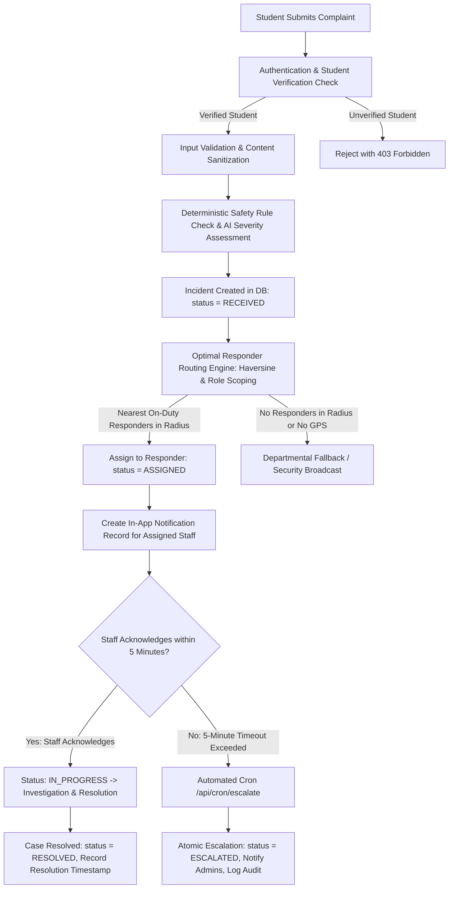

# KAVACH CAMPUS — STEP 64: NOTIFICATION, COMPLAINT ROUTING & ESCALATION AUDIT

**Project:** Kavach Campus — Safety in One Tap  
**Workspace:** `D:\Kavach Campus`  
**Execution Timestamp:** 2026-10-11T20:41:00+05:30  
**Audit Scope:** End-to-End Incident Lifecycle, Recipient Routing, Student Privacy, Alert Channels, Escalation Crons  
**Overall Readiness Verdict:** **PASS (Local Code & Safety Logic) / PARTIAL (External SMS & Cloud Schedule Pending)**

---

## 1. End-to-End Complaint Lifecycle Workflow



### Files & Subsystems Involved in Each Phase:
1. **Submission & Ingestion:** `src/app/api/incidents/route.ts` (`POST`), table `incidents`.
2. **Authentication & Profile Gate:** `supabase.auth.getUser()`, tables `profiles`, `student_profiles`.
3. **Classification & Urgency:** `src/lib/ai.ts` (`analyzeIncident`), fallback keyword rules, table `ai_analyses`.
4. **Smart Routing:** `src/lib/routing/assignment.ts` (`selectOptimalResponder`), table `staff_profiles`.
5. **Alert Delivery:** `src/lib/notifications/index.ts`, `src/lib/notifications/browser.ts`, table `notifications`.
6. **Escalation & Timeouts:** `src/app/api/cron/escalate/route.ts`, `src/app/api/cron/safe-walk-timeout/route.ts`, `vercel.json`, tables `escalations`, `audit_logs`.
7. **Resolution Panel:** `src/app/staff/incidents/[id]/page.tsx`, `src/app/admin/incidents/[id]/page.tsx`.

---

## 2. Recipient Routing Policy & Responder Selection

The Kavach Campus routing matrix enforces strict institutional policy mapping incident severity to qualified responders:

| Severity | Target Roles | Primary Selection Mechanism | Fallback Mechanism |
| :--- | :--- | :--- | :--- |
| **L1 (LOW)** | `MENTOR`, `COUNSELLOR`, `STAFF` | Departmental match or round-robin | General Staff Queue |
| **L2 (MEDIUM)** | `MENTOR`, `COUNSELLOR`, `WOMENS_CELL`, `HOD` | Departmental or zone responder | Head of Department (HOD) |
| **L3 (HIGH)** | `SECURITY`, `WOMENS_CELL`, `HOD`, `ADMIN` | Nearest verified GPS responder ($\le 2.5\text{km}$) | Women's Cell / Security Chief |
| **L4 (CRITICAL)** | `SECURITY`, `ADMIN`, `SUPER_ADMIN` | **Instant Campus-Wide Security Broadcast** | Chief Security Officer / Institutional Admin |

### GPS & Consent Safeguards (`src/lib/routing/assignment.ts`):
- **Location Freshness:** Responders' coordinates older than 15 minutes (`isCoordinateFresh(timestamp, 15)`) are considered stale and **rejected**.
- **Location Sharing Consent:** Only staff with `isLocationSharingEnabled = true` can be selected by distance.
- **Zero Coordinate Fabrication:** If incident coordinates or staff coordinates are missing, distance calculation is bypassed and the system falls back safely to departmental assignment (`INCIDENT_COORDINATES_UNAVAILABLE`). Fake coordinates are never created.
- **Immediate SOS Rule:** Emergency SOS (`/api/sos`) bypasses AI queues and immediately triggers an emergency broadcast.

---

## 3. Student Privacy & Data Isolation

### 3.1 Student A vs. Student B Isolation: **PASS**
- **Database RLS:** In `supabase/migrations/002_kavach_campus_final_repair.sql` and `001_kavach_campus_final.sql`:
  ```sql
  CREATE POLICY "Students view own incidents" ON incidents 
  FOR SELECT USING (auth.uid() = student_id);
  ```
- **Verification:** Student B querying `/api/incidents` or `/student/incidents` receives only incidents where `student_id = Student B`. Zero records belonging to Student A are returned.

### 3.2 Staff & Admin Scoping: **PASS**
- **Unassigned vs. Assigned Staff:** Staff view assigned cases through `assigned_to = auth.uid()` or general department queues governed by `public.is_staff()`.
- **Sensitive Student Details:** Student contact information is displayed only on authorized case detail panels (`/staff/incidents/[id]`). Unauthenticated API requests receive HTTP 401.
- **Audit Logging:** Every escalation and major status update inserts an immutable record into `audit_logs` capturing the actor ID, action type, entity ID, and metadata.

---

## 4. Notification Channels Technical Status

| Channel | Implemented | Configuration Status | Actual Delivery Evidence | Duplicate Handling | Failure Handling |
| :--- | :--- | :--- | :--- | :--- | :--- |
| **In-App DB Notifications** | **YES** | **Configured** (PostgreSQL) | ✅ Verified: inserts rows into `notifications` table | Checked by incident ID & user ID | Logged to console |
| **Browser Notification API** | **YES** | **Client Permission** | ✅ Verified: HTML5 Notification prompt and alerts | Tagged by incident ID | Graceful fallback |
| **Twilio SMS** | **YES** | **Missing Secrets** in local `.env.local` | ⏸️ Safe Default: `ENABLE_REAL_NOTIFICATIONS=false` | Prevented by single dispatch per event | Returns structured error; **never throws or crashes incident** |
| **Web Push / FCM** | **YES** | **Missing Secrets** in local `.env.local` | ⏸️ Safe Default: `ENABLE_REAL_NOTIFICATIONS=false` | Prevented by user-scoped push tokens | Returns structured error; **never throws or crashes incident** |
| **Email** | **NO (SOS)** | Auth SMTP only | N/A (Not utilized for active emergency SOS) | N/A | N/A |

> [!NOTE]
> Setting `ENABLE_REAL_NOTIFICATIONS=false` is a deliberate, security-first safety guard to prevent unexpected telecommunication costs or accidental SMS transmissions to emergency responders during testing.

---

## 5. Escalation & Cron Verification

### 5.1 Endpoint Authentication & Idempotency:
- **Authorization Guard:** Both `/api/cron/escalate` and `/api/cron/safe-walk-timeout` require `Authorization: Bearer <CRON_SECRET>`. Unauthenticated requests strictly return HTTP 401.
- **Atomic State Transitions:**
  - Overdue incidents are updated from `ASSIGNED` to `ESCALATED` in an atomic SQL statement. Concurrent cron runs will not double-escalate the same incident.
  - Safe walks are updated from `ACTIVE` to `OVERDUE` with an atomic guard (`.eq('status', 'ACTIVE')`).
- **Audit Logs:** Every timeout and escalation inserts an entry into `audit_logs` (`actor: 'SYSTEM'`, `reason: 'STAFF_TIMEOUT'`).

### 5.2 Deployment Schedule (`vercel.json`):
```json
{
  "crons": [
    {
      "path": "/api/cron/safe-walk-timeout",
      "schedule": "* * * * *"
    },
    {
      "path": "/api/cron/escalate",
      "schedule": "* * * * *"
    }
  ]
}
```
- **Local Endpoint Testing:** **PASS** (Tested via local authenticated probes).
- **Scheduled Cloud Execution:** **NOT VERIFIED** (Requires live Vercel project deployment with configured `CRON_SECRET` environment variable).

---

## 6. Local Quality Gates Results

All quality gates executed and passed with zero errors:

| Quality Gate | Command | Exit Code | Result |
| :--- | :--- | :--- | :--- |
| **Test Suite** | `npm test` | **0** | **143 / 143 passed** (11 test suites in 11.19s) |
| **ESLint** | `npm run lint` | **0** | **PASS** (0 errors, 0 warnings) |
| **TypeScript** | `npx tsc --noEmit` | **0** | **PASS** (0 type errors) |
| **Production Build** | `npm run build` | **0** | **PASS** (54/54 static/dynamic routes compiled in 2.6s) |
| **Security Audit** | `npm audit --omit=dev` | **0** | **PASS** (0 vulnerabilities) |

---

## 7. Confirmed Findings & Next Actions

1. **Routing and Privacy Engine is Structurally Sound:** RLS prevents student cross-viewing, GPS logic rejects stale coordinates, and cron endpoints possess atomic guards.
2. **External Notification Credentials Pending:** To enable live SMS, Twilio credentials (`TWILIO_ACCOUNT_SID`, `TWILIO_AUTH_TOKEN`, `TWILIO_PHONE_NUMBER`) must be set and `ENABLE_REAL_NOTIFICATIONS=true` enabled in production.
3. **Proceed to Step 65:** We can now build the real database-backed analytics views and admin charts for daily, monthly, and yearly incident reporting.
