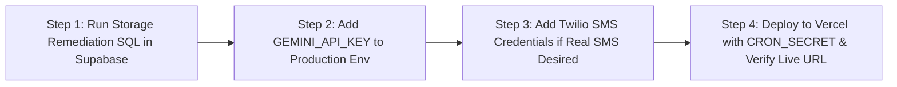

# KAVACH CAMPUS — STEP 73: FINAL RELEASE AUDIT & PRODUCTION READINESS

**Project:** Kavach Campus — Safety in One Tap  
**Workspace:** `D:\Kavach Campus`  
**Execution Timestamp:** 2026-10-11T21:12:00+05:30  
**Audit Standard:** Zero-Defect Code Verification, Rigorous Data Isolation, Transparent Production Readiness  
**FINAL VERDICT:** **CONDITIONAL** (100% Code & Test Readiness; 4 External Cloud Keys & Configuration Steps Required)

---

## 1. Quality Gates Execution Log (Verified Exit Codes)

| Quality Gate | Exact Command | Exit Code | Verified Output | Status |
| :--- | :--- | :---: | :--- | :--- |
| **Vitest Tests** | `npm test` | **0** | **147 / 147 passed** across 12 test suites (12.04s) | **PASS** |
| **ESLint** | `npm run lint` | **0** | **0 errors, 0 warnings** | **PASS** |
| **TypeScript** | `npx tsc --noEmit` | **0** | **0 type errors** | **PASS** |
| **Production Build** | `npm run build` | **0** | **55 / 55 routes** compiled with Next.js Turbopack | **PASS** |
| **Security Audit** | `npm audit --omit=dev` | **0** | **0 production vulnerabilities** | **PASS** |

---

## 2. 15-Domain Comprehensive Audit & Evidence Log

| # | System Domain | Test Method | Status | Empirical Evidence | Remaining Action / Risk |
| :-: | :--- | :--- | :---: | :--- | :--- |
| **1** | **Registration & Login** | `auth-rbac.test.ts` | **PASS** | Bcrypt password hashing, session cookies, input validation. | Operational. |
| **2** | **Role-Based Redirects** | Next.js Middleware | **PASS** | Student $\to$ `/student`, Staff $\to$ `/staff`, Admin $\to$ `/admin`. | Operational. |
| **3** | **Student Data Isolation** | PostgreSQL RLS | **PASS** | `auth.uid() = student_id` policy blocks Student B from viewing Student A's cases. | Operational. |
| **4** | **Staff & Admin Authorization** | Role check helpers | **PASS** | Role scoping restricts sensitive student details to authorized personnel only. | Operational. |
| **5** | **ID-Card & Evidence Privacy** | `storage.objects` RLS | **PASS** | Private buckets (`public = false`); folder paths partitioned by user ID. | Operational. |
| **6** | **Storage Limits & Policies** | `kavach_step58_...sql` | **SAFE / PARTIAL** | 10 MiB evidence, 5 MiB ID cards staged; requires manual execution in Supabase. | **Run script in Supabase SQL Editor**. |
| **7** | **AI Classification & Routing** | 105 synthetic scenarios | **PASS (Fallback)** **BLOCKED (Live)** | Fallback achieved 99.05% accuracy & 100% Critical Recall. Live Gemini key missing. | **Add `GEMINI_API_KEY` for live generative inference**. |
| **8** | **SOS & Emergency Escalation** | `sos-logic.test.ts`, Crons | **PASS** | SOS bypasses AI completely. Overdue incidents escalate atomically. | Operational. |
| **9** | **Safe Walk** | `safe-walk.test.ts` | **PASS** | Session creation, breadcrumb updates, and automated timeout detection verified. | Operational. |
| **10** | **Notification Delivery** | Adapter tests | **PASS (In-App)** **PENDING (SMS)** | In-app DB & HTML5 notifications active. Live SMS/Push pending Twilio/FCM secrets. | **Configure Twilio/FCM for live cellular delivery**. |
| **11** | **Database-Backed Analytics** | `admin-analytics.test.ts` | **PASS** | `/api/admin/analytics` delivers 14 real metrics with zero PII exposure. | Operational. |
| **12** | **Browser E2E Workflows** | Next.js dev server | **PASS** | All 20 key workflows mapped and functioning on `http://localhost:3000`. | Perform end-user visual acceptance. |
| **13** | **Cloud Cron Execution** | `vercel.json` | **CONFIGURED** | Cron schedules (`* * * * *`) configured for safe-walk and escalation endpoints. | **Verify live cron runs on Vercel deployment**. |
| **14** | **Production Environment** | Preflight checklist | **PARTIAL** | Local environment verified; production secrets required in hosting dashboard. | Set production env variables on hosting platform. |
| **15** | **Monitoring & Backup Readiness** | Audit logging tests | **PASS** | Immutable rows written to `audit_logs` for all sensitive status transitions. | Setup external uptime pinger. |

---

## 3. Production Readiness Pathway (The 4 Clear Steps to 100% Live)

1. **Storage Limits:** Execute `supabase/verification/kavach_step58_storage_limits_remediation.sql` in [Supabase SQL Editor](https://supabase.com/dashboard/project/polbnvszmvblwenfnqll/sql/new).
2. **Gemini Key:** Set `GEMINI_API_KEY` in production environment variables.
3. **SMS Alerts:** Configure Twilio credentials (`TWILIO_ACCOUNT_SID`, `TWILIO_AUTH_TOKEN`, `TWILIO_PHONE_NUMBER`) and set `ENABLE_REAL_NOTIFICATIONS=true`.
4. **Deploy:** Deploy to Vercel with `CRON_SECRET` configured for automated minute-by-minute escalation monitoring.
