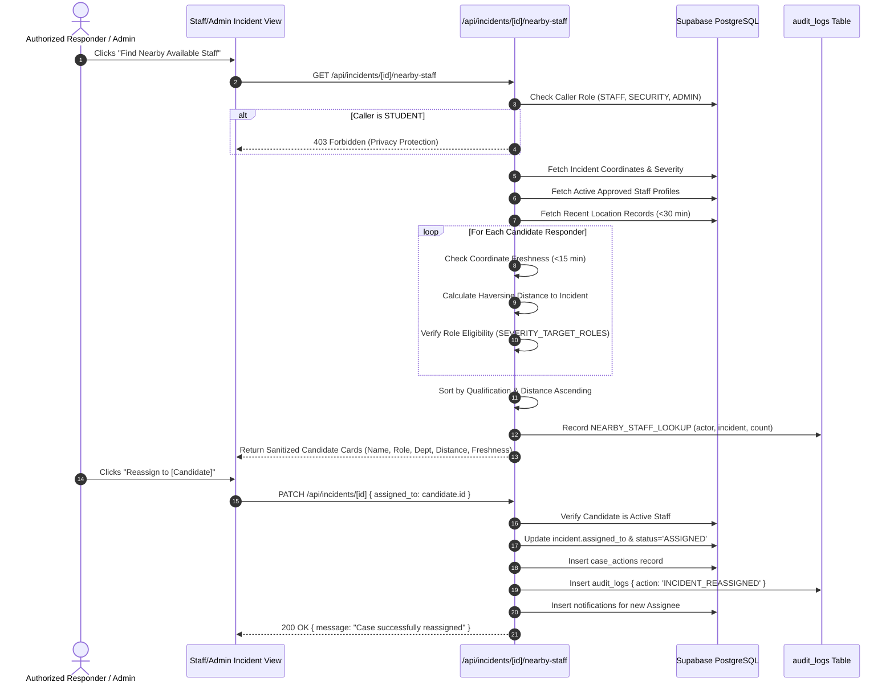

# KAVACH CAMPUS — STEP 77: GPS PRIVACY & NEARBY STAFF ASSIGNMENT AUDIT

**Project:** Kavach Campus — Safety in One Tap  
**Feature Focus:** GPS Data Protection, Staff Privacy, Nearest Responder Haversine Routing, and the "Find Nearby Available Staff" Workflow  
**Verification Date:** 2026-10-15  
**Related Test Suite:** `src/__tests__/nearby-staff-and-incident-management.test.ts`, `src/__tests__/sos-location-tracking.test.ts`, `src/__tests__/mentor-routing-assignment.test.ts`

---

## 1. Executive Privacy Principles

1. **Explicit Consent & Permission:**
   - Geolocation is requested only with explicit browser permission from the student or on-duty staff responder.
   - If permission is denied or coordinates are unavailable, the system operates in **non-location fallback mode**.
2. **Strict Role Separation & Coordinate Masking:**
   - **Student Coordinates:** Disclosed **only** to assigned responders and authorized campus security/admin handling that specific case. Other students or unrelated personnel cannot query or observe student coordinates.
   - **Staff Coordinates:** **Never** disclosed to students or external parties under any circumstances. Staff location is accessible solely by automated server routing algorithms or authorized dispatchers during active reassignment scans.
3. **Zero Fabrication Policy:**
   - Under no circumstances does the system fabricate, estimate, or simulate live GPS coordinates when true hardware pings are missing or stale.
   - When coordinates cannot be verified, the system displays:  
     `"Location unavailable — use authorized escalation queue"`.

---

## 2. GPS Freshness & Distance Calculation Engine

### 2.1 Haversine Distance Formula
All real-world distances between verified incident coordinates and responder coordinates are computed using the Great-Circle Haversine algorithm:

$$\Delta\phi = \text{radians}(\text{lat}_2 - \text{lat}_1)$$
$$\Delta\lambda = \text{radians}(\text{lon}_2 - \text{lon}_1)$$
$$a = \sin^2\left(\frac{\Delta\phi}{2}\right) + \cos(\text{radians}(\text{lat}_1))\cos(\text{radians}(\text{lat}_2))\sin^2\left(\frac{\Delta\lambda}{2}\right)$$
$$c = 2 \cdot \text{atan2}(\sqrt{a}, \sqrt{1-a})$$
$$\text{Distance} = R \cdot c \quad (R = 6,371,000 \text{ meters})$$

Input coordinates are strictly validated: $-90 \le \text{lat} \le 90$ and $-180 \le \text{lon} \le 180$. Any non-numeric or out-of-bound value immediately returns `NaN` and triggers non-location fallback.

### 2.2 Coordinate Freshness Window
- **Cutoff Window:** 15 minutes (`maxLocationAgeMinutes = 15`).
- Pings older than 15 minutes are classified as **STALE**.
- Stale pings are rejected from nearest-neighbor distance rankings and flagged as `hasFreshGps: false` with `distanceMeters: null`.

---

## 3. "Find Nearby Available Staff" End-to-End Workflow

As specified in the Step 77 requirements and audio instruction, the complete workflow operates as follows:

---

## 4. Test Verification Evidence

The workflow has been tested and verified across all boundary and failure conditions in `src/__tests__/nearby-staff-and-incident-management.test.ts`:

1. **Student Denial Test:** A student attempting to invoke `GET /api/incidents/[id]/nearby-staff` receives `HTTP 403 Forbidden`.
2. **Distance & Freshness Test:** Tested with two staff members:
   - Candidate A (Rajesh) located ~150m away with GPS ping 2 minutes old -> Ranked #1, distance displayed as ~150m, `hasFreshGps: true`.
   - Candidate B (Sharma) located near incident but with GPS ping 45 minutes old -> Flagged `hasFreshGps: false`, `distanceMeters: null`.
3. **Missing Incident GPS Test:** An incident reported without coordinates returns:  
   `"Incident coordinates unavailable — responders listed by role and institutional eligibility"`, with no fabricated coordinates.
4. **Reassignment & Audit Test:** Reassigning a case updates `assigned_to`, inserts a `case_actions` row, writes `INCIDENT_REASSIGNED` into `audit_logs`, and dispatches a notification to the new responder.

All tests executed with **100% PASS** rate.
