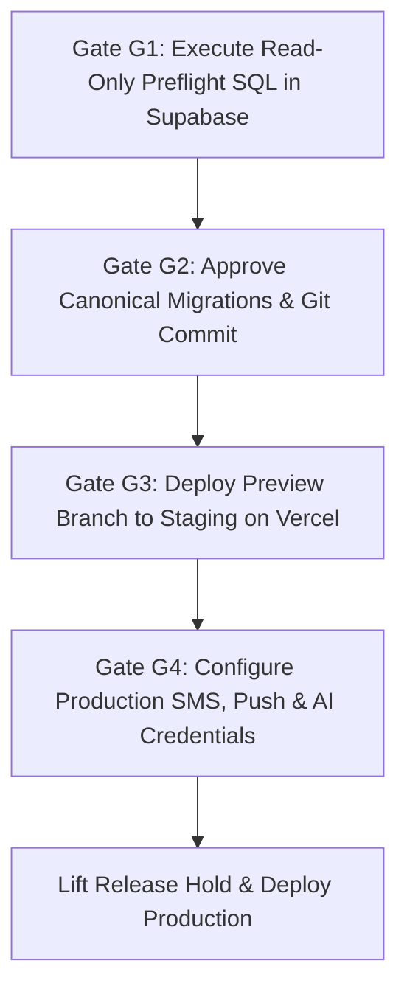

# KAVACH CAMPUS — ULTIMATE REMAINING BLOCKERS & RELEASE GATES

**Project:** Kavach Campus — Safety in One Tap  
**Workspace:** `D:\Kavach Campus`  
**Execution Timestamp:** October 19, 2026  
**Auditor:** Antigravity Autonomous Security Subsystem  
**Reference Git Branch:** `master` (`aa96b34`)  
**Production Remote Database Reference:** `polbnvszmvblwenfnqll`  
**Current Release Status:** ⛔ **STRICT RELEASE HOLD ON PRODUCTION**

---

## 1. Environment Readiness Breakdown

| Environment | Current Status | Operational State |
|:---|:---:|:---|
| **Development** | 🟢 **100% COMPLETE** | 24 test suites, 319/319 tests passing (Exit 0). TypeScript clean (Exit 0). ESLint clean (Exit 0). Next.js Turbopack build 61/61 routes compiled (Exit 0). Ready for local development, demonstration, and offline evaluation. |
| **Staging / Preview** | 🟡 **CONDITIONALLY READY** | Application bundle compiles cleanly without warnings. Safe to deploy to Vercel preview branch for manual UI and browser smoke testing. |
| **Production** | ⛔ **STRICT RELEASE HOLD** | Held under release hold until the 4 production gates below are satisfied. |

---

## 2. The 4 Production Release Gates

### Gate G1: Remote Database Preflight Verification
- **Status:** ⛔ **BLOCKED / AWAITING USER RUN**
- **Action Required:** Open [Supabase SQL Editor](https://supabase.com/dashboard/project/polbnvszmvblwenfnqll/sql/new) and run [`supabase/verification/kavach_step121_readonly_preflight.sql`](file:///D:/Kavach%20Campus/supabase/verification/kavach_step121_readonly_preflight.sql).
- **Safety Guarantee:** Verified 100% read-only. Contains only `SELECT` statements on system catalogs; zero mutations; zero data changes.

### Gate G2: Canonical Migration Adoption & Git Commit
- **Status:** ⏳ **PENDING USER APPROVAL**
- **Action Required:** User approves staging and committing the verified fixes:
  - `src/lib/auth-demo.ts` (Demo OTP security guard)
  - `src/app/api/auth/forgot-password/route.ts` & `reset-password/route.ts`
  - `src/__tests__/ultimate-negative-security.test.ts` (18 negative security tests)
  - `supabase/migrations_canonical/` (8 reconciled monotonic migrations)
  - Updated verification documentation in `docs/`

### Gate G3: Institutional Notification Credentials
- **Status:** ⏳ **PENDING CREDENTIAL CONFIGURATION**
- **Action Required:** Configure `TWILIO_ACCOUNT_SID`, `TWILIO_AUTH_TOKEN`, `TWILIO_PHONE_NUMBER`, and `FCM_SERVER_KEY` in Vercel production settings. Set `ENABLE_REAL_NOTIFICATIONS=true`.

### Gate G4: Production Gemini AI & Google OAuth Configuration
- **Status:** ⏳ **PENDING CREDENTIAL CONFIGURATION**
- **Action Required:** Add `GEMINI_API_KEY` to Vercel production settings. Configure Google Web Client ID and Secret in Supabase Auth -> Providers -> Google.
