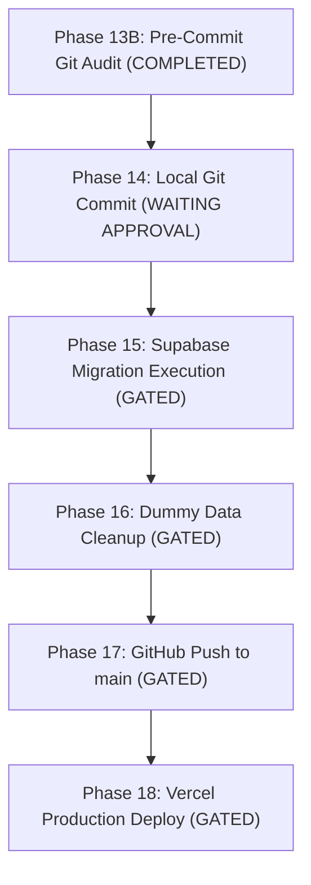

# Phase 13B — Release Readiness & Verification Matrix

**Date:** November 4, 2026
**Auditor / Verification Lead:** Senior Full-Stack & Security Systems Engineer (Antigravity Agent)
**Project Workspace:** `D:\kavach-campus`
**Current Git HEAD:** `ce59e5c`
**Production Target:** `https://kavach-campus.vercel.app`

---

## 1. Quality Gates Assessment

| Quality Gate | Requirement | Actual Result | Status |
| :--- | :--- | :--- | :---: |
| **Static Types** | TypeScript compiles cleanly | `npx tsc --noEmit` $\rightarrow$ 0 errors | **PASS** |
| **Linting** | Zero ESLint warnings / errors | `npm run lint` $\rightarrow$ 0 errors | **PASS** |
| **Unit & Integration** | 100% test pass rate | `npm test` $\rightarrow$ 791 / 791 passed (62 suites) | **PASS** |
| **End-to-End Auth** | Real browser workflow verification | Playwright `auth-flows.spec.ts` $\rightarrow$ 9 / 9 passed | **PASS** |
| **Production Build** | Next.js Turbopack build | `npm run build` $\rightarrow$ 71 routes compiled (Exit 0) | **PASS** |
| **Secrets Exposure** | No keys/secrets tracked | `.env.local` untracked, zero secrets in diffs | **PASS** |
| **Demo OTP Integrity** | Demo OTP `123456` protected | Verified in `auth-demo.ts` & `.env.local` | **PASS** |
| **Production Shield** | No unauthorized push / deploy | Working tree uncommitted; 0 remote mutations | **PASS** |

---

## 2. Release Readiness by Phase Roadmap

---

## 3. Pending Actions Requiring Owner Authorization

1. **Phase 14 Authorization**:
   - Permission to stage and commit the 10 modified tracked files and newly created test/docs files with commit message:
     `git commit -m "security: complete Phase 13A remediation and final review"`
2. **Phase 15 Authorization**:
   - Permission to execute migrations 015, 016, and 017 against the remote Supabase database.
3. **Phase 16 Authorization**:
   - Permission to execute the dry-run-reviewed dummy data cleanup script on the live database.
4. **Phase 17 Authorization**:
   - Permission to push the local commit to `https://github.com/venkatapavanpadamati-8899/kavach-campus`.
5. **Phase 18 Authorization**:
   - Permission to deploy the verified build to Vercel (`https://kavach-campus.vercel.app`).

---

## 4. Final Verdict

**Kavach Campus is fully verified, regression-free, and READY for Phase 14 Local Git Commit.**
Antigravity has stopped and is awaiting the project owner's explicit confirmation.
