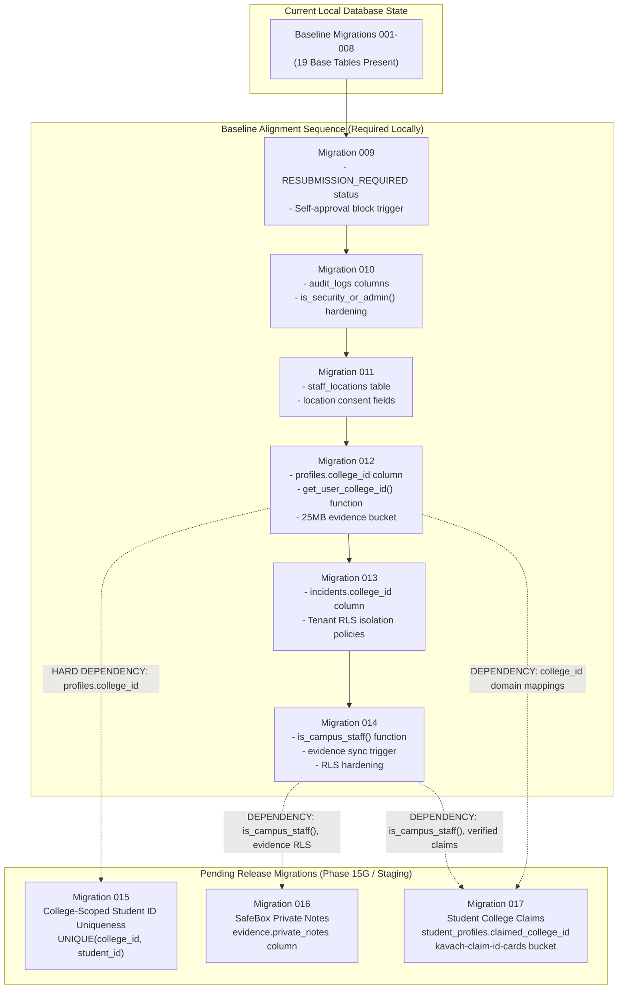

# KAVACH CAMPUS — PHASE 15E: MIGRATION DEPENDENCY ANALYSIS

**Project:** Kavach Campus  
**Workspace:** `D:\kavach-campus`  
**Focus:** Dependency Mapping between Baseline Migrations (009–014) and Pending Migrations (015–017)  
**Generated At:** 2026-11-04  
**Audit Status:** COMPLETE — READ-ONLY ANALYSIS  

---

## 1. Executive Summary

A formal dependency tracing analysis was conducted to establish the structural and functional relationships between the pending production release migrations (`015`, `016`, `017`) and the baseline migrations (`009` through `014`).

The analysis demonstrates that **Migration 015 has a hard, unconditional dependency on Migration 012**. Migration 016 and Migration 017 likewise depend directly upon structures and security functions established in migrations `012`, `013`, and `014`. Attempting to apply any of the pending migrations to the local database in its current state without first executing migrations `009` through `014` will result in fatal SQL execution failures and broken RLS evaluation.

---

## 2. Dependency Graph (Mermaid)



---

## 3. Detailed Migration Dependency Breakdown

### 3.1 Migration 015: College-Scoped Student ID Uniqueness
- **SQL File:** `supabase/migrations/015_college_scoped_student_id_uniqueness.sql`
- **Primary Operation:**
  ```sql
  CREATE UNIQUE INDEX IF NOT EXISTS idx_profiles_college_student_id_unique
    ON public.profiles (college_id, student_id)
    WHERE student_id IS NOT NULL;
  ```
- **Direct Upstream Dependency:** **Migration 012 (`012_profiles_college_tenant.sql`)**
- **Dependency Rationale:**
  Migration 015 creates a composite unique index on `(college_id, student_id)`. The column `college_id` on `public.profiles` does NOT exist in baseline migrations 001–008. It was created in Migration 012.
- **Premature Execution Failure Mode:**
  If executed against the current local database, PostgreSQL will abort with:
  ```
  ERROR: column "college_id" does not exist
  SQLSTATE: 42703
  ```

---

### 3.2 Migration 016: SafeBox Private Notes & Evidence Privacy
- **SQL File:** `supabase/migrations/016_safe_box_private_notes.sql`
- **Primary Operation:**
  ```sql
  ALTER TABLE public.evidence
    ADD COLUMN IF NOT EXISTS private_notes TEXT,
    ADD COLUMN IF NOT EXISTS is_private BOOLEAN DEFAULT false;
  ```
- **Direct Upstream Dependencies:**
  1. **Migration 014 (`014_cross_college_rls_hardening.sql`)**: Establishes `is_campus_staff()` and redefines evidence RLS policies.
  2. **Migration 013 (`013_cross_college_rls_isolation.sql`)**: Establishes tenant isolation on incidents referenced by evidence.
- **Dependency Rationale:**
  Migration 016 creates updated RLS policies for evidence items with `is_private = true`. These policies rely on `is_campus_staff()` and `get_user_college_id()` to ensure counselor/staff privacy boundaries.
- **Premature Execution Failure Mode:**
  If executed without 012/013/014, policy compilation fails due to undefined functions `is_campus_staff()` or `get_user_college_id()`.

---

### 3.3 Migration 017: Student College Claims & Verification Flow
- **SQL File:** `supabase/migrations/017_student_college_claims.sql`
- **Primary Operation:**
  ```sql
  ALTER TABLE public.student_profiles
    ADD COLUMN IF NOT EXISTS claimed_college_id TEXT;
  
  INSERT INTO storage.buckets (id, name, public)
  VALUES ('kavach-claim-id-cards', 'kavach-claim-id-cards', false)
  ON CONFLICT (id) DO NOTHING;
  ```
- **Direct Upstream Dependencies:**
  1. **Migration 009 (`009_student_id_verification_resubmission.sql`)**: Establishes `check_verification_status` constraint compatibility and self-approval prevention.
  2. **Migration 012 (`012_profiles_college_tenant.sql`)**: Defines canonical `college_id` values (`srkr-bhimavaram`, `vishnu-bhimavaram`).
  3. **Migration 014 (`014_cross_college_rls_hardening.sql`)**: Establishes `is_campus_staff()` for claim approval policies.
- **Dependency Rationale:**
  Migration 017 attaches student claims to institutional tenants and establishes storage policies for ID card uploads. It assumes campus staff helper functions exist.
- **Premature Execution Failure Mode:**
  Storage policies referencing `is_campus_staff()` fail to create, and status transitions to `'RESUBMISSION_REQUIRED'` trigger constraint violation errors.

---

## 4. Execution Sequence Constraints

The dependencies enforce an absolute, non-negotiable execution order:

```
[M009] -> [M010] -> [M011] -> [M012] -> [M013] -> [M014]
                                 |
                                 v
                              [M015] -> [M016] -> [M017]
```

1. **Step 1:** Complete baseline alignment locally by applying `009`, `010`, `011`, `012`, `013`, and `014` in sequential order.
2. **Step 2:** Verify that `profiles.college_id`, `incidents.college_id`, `get_user_college_id()`, and `is_campus_staff()` exist and operate without errors.
3. **Step 3:** Apply pending release migrations `015`, `016`, and `017` on the aligned local database.
4. **Step 4:** Execute full authenticated multi-tenant RLS test suites.

