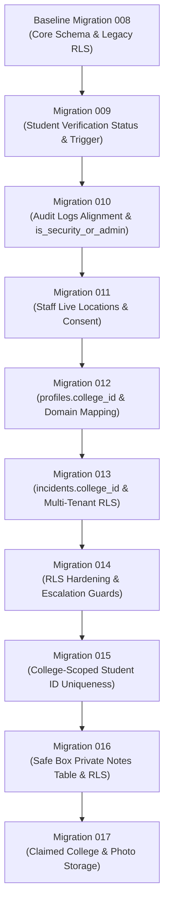

# KAVACH CAMPUS — PHASE 15J PRODUCTION MIGRATION READINESS REPORT

**Project:** Kavach Campus — Safety in One Tap.  
**Workspace:** `D:\kavach-campus`  
**Git Branch:** `main` (HEAD: `a8e4636`)  
**Audit Date:** 2026-11-05  
**Audit Type:** Read-Only Static & Structural Migration Security Audit  
**Final Status:** **`READY FOR OWNER REVIEW`**  
*(Production database execution remains strictly **BLOCKED** pending owner backup verification and legacy policy patch approval)*

---

## 1. Executive Summary

This report delivers an independent, read-only audit of Supabase migrations **009 through 017** prior to any production execution against remote project `dvyiclyyvmsfipzrdowu`.

### Core Conclusions:
1. **Local Success vs. Production Authority:** Although migrations 009–017 successfully executed and passed 23/23 authenticated RLS tests in the local Docker environment (`127.0.0.1:54322`), **local test success does not authorize production execution**.
2. **Critical Security Finding (Legacy Policy OR Leak):** Migrations 013 and 014 enforce same-college incident isolation by introducing `"Staff view same-college incidents"`, but **neither migration drops the historical baseline policy `"Authorized users view incidents"`**. In PostgreSQL, multiple permissive policies combine with boolean `OR`. If `"Authorized users view incidents"` remains active on production `public.incidents`, any staff member from any college satisfies `public.is_reviewer() = true` and can view all incidents across all college tenants.
3. **No Database Modification:** In accordance with strict safety directives, no remote database was contacted, no migrations were executed, no files were modified, and no Git actions were performed.

---

## 2. Migration Sequence Audit (Migrations 009–017)

### 2.1 Sequential Order & Dependency Analysis



| Migration File | Primary Functional Changes | Direct Dependencies | Rollback Capability | Idempotent? |
| :--- | :--- | :--- | :--- | :---: |
| **`009_student_id_verification_resubmission.sql`** | Adds `'RESUBMISSION_REQUIRED'` to `student_profiles` constraint; installs trigger `prevent_student_self_verification()`; creates private bucket `kavach-id-cards`. | `student_profiles` table; `is_security_or_admin()` function; `audit_logs` table. | Revert constraint to 5 states; drop trigger. | **Yes** (DO block + IF EXISTS) |
| **`010_service_role_and_audit_alignment.sql`** | Adds `actor_id`, `entity_type`, `entity_id` to `audit_logs`; hardens `is_security_or_admin()` to recognize `service_role`. | `audit_logs` table. | Re-declare previous `is_security_or_admin()`. | **Yes** (`ADD COLUMN IF NOT EXISTS`, `CREATE OR REPLACE`) |
| **`011_staff_live_locations_and_consent.sql`** | Creates table `staff_locations` with spatial/telemetry fields; creates 3 indexes; creates 2 RLS policies. | `profiles(id)` foreign key; `is_security_or_admin()`. | `DROP TABLE public.staff_locations;` | **Partial** (`CREATE POLICY` lacks `DROP POLICY IF EXISTS`) |
| **`012_profiles_college_tenant.sql`** | Adds `profiles.college_id`; backfills institutional email domains; sets unverified to `'PENDING_CAMPUS_VERIFICATION'`; upgrades `kavach-evidence` bucket (25 MB, audio types). | `profiles` table; `storage.buckets`. | `ALTER TABLE profiles DROP COLUMN college_id;` | **Yes** (Idempotent updates) |
| **`013_cross_college_rls_isolation.sql`** | Adds `incidents.college_id`; backfills from student profiles; adds auto-assignment trigger; introduces same-college RLS policies. | `profiles.college_id` (from 012); `get_user_college_id()`. | Drop trigger, revert RLS policies. | **Yes** (`DROP POLICY IF EXISTS` before `CREATE`) |
| **`014_cross_college_rls_hardening.sql`** | Deploys `is_campus_staff()`; drops broad policies; recreates tenant-scoped RLS on 7 tables; syncs `case_id` on evidence. | Migration 012 & 013 columns; `profiles`, `incidents`, `evidence`. | Extensive DDL rollback script required. | **Yes** (Explicit purge list) |
| **`015_college_scoped_student_id_uniqueness.sql`** | Drops global unique index `idx_profiles_student_id`; creates partial compound index `idx_profiles_college_student_id ON (college_id, student_id)`. | `profiles.college_id` (from 012). | Drop compound index; recreate global unique index. | **Yes** (`DROP INDEX IF EXISTS`, `CREATE UNIQUE INDEX IF NOT EXISTS`) |
| **`016_safe_box_private_notes.sql`** | Creates `safe_box_private_notes` table with 2000 char check; enables RLS; installs student-only policy. | `evidence(id)`, `profiles(id)`. | `DROP TABLE public.safe_box_private_notes;` | **Yes** (`IF NOT EXISTS`, `DROP POLICY IF EXISTS`) |
| **`017_student_college_claims.sql`** | Adds `student_profiles.claimed_college_id`, `profiles.profile_photo_path`; creates private bucket `kavach-profile-photos`. | `student_profiles`, `profiles`, `storage.buckets`. | Drop added columns and bucket. | **Yes** (`ADD COLUMN IF NOT EXISTS`, `ON CONFLICT`) |

---

### 2.2 Unsafe Assumptions & Prerequisite Warnings

1. **Migration 009 Audit Log Dependency:**
   - Migration 009 executes `INSERT INTO public.audit_logs (..., entity_type, ...)`.
   - Migration 010 executes `ALTER TABLE public.audit_logs ADD COLUMN IF NOT EXISTS entity_type TEXT;`.
   - *Risk:* If the remote production database does not have `entity_type` in `audit_logs` prior to migration 009, executing 009 will fail with PostgreSQL error `42703` (`column "entity_type" of relation "audit_logs" does not exist`).
   - *Recommendation:* The owner should inspect production `audit_logs` columns before running 009, or execute the column additions of 010 first.
2. **Migration 011 Idempotency Limitation:**
   - Lines 38 and 45 in `011_staff_live_locations_and_consent.sql` execute `CREATE POLICY` directly without `DROP POLICY IF EXISTS`.
   - *Risk:* If migration 011 fails midway or is re-run, it will abort with error `42710` (`policy "staff_locations_self_manage" for table "staff_locations" already exists`).
3. **Migration 012 Domain Backfill Assumption:**
   - Lines 18–26 map only `@srkr.edu.in`, `@srkrec.ac.in`, `@vishnu.edu.in`, and `@svecw.edu.in`. All other accounts are set to `'PENDING_CAMPUS_VERIFICATION'`.
   - *Production Impact:* Legitimate campus responders whose emails do not match these exact domain patterns will lose case visibility until manually assigned by an administrator.
4. **Migration 015 Duplicate Data Assumption:**
   - Creating `CREATE UNIQUE INDEX idx_profiles_college_student_id ON profiles(college_id, student_id) WHERE student_id IS NOT NULL AND role = 'STUDENT'` requires zero existing duplicates within any single college.
   - *Risk:* If duplicate student IDs exist within the same college in production, index creation will fail with error `23505` (`unique_violation`).

---

## 3. Deep-Dive RLS Security Review

### 3.1 The Legacy Policy Discrepancy: `"Authorized users view incidents"`

In the production database baseline and historical verification scripts (`supabase/verification/kavach_step115_security_hardening_candidate.sql:384`), the following policy was established on `public.incidents`:

```sql
CREATE POLICY "Authorized users view incidents"
ON public.incidents
FOR SELECT
TO authenticated
USING (
  student_id = auth.uid()
  OR assigned_to = auth.uid()
  OR public.is_reviewer()
);
```

### 3.2 PostgreSQL Permissive-Policy Boolean `OR` Mechanics

In PostgreSQL, Row Level Security adheres to strict boolean composition rules:
1. When multiple **`PERMISSIVE`** policies (the default) exist on the same table for the same action (`SELECT`) and role (`authenticated`), PostgreSQL joins them with logical **`OR`**:
   $$\text{Access Granted} = (\text{Policy}_1) \lor (\text{Policy}_2) \lor (\text{Policy}_3) \lor \dots$$
2. When migration 013 and migration 014 execute, they deploy:
   ```sql
   CREATE POLICY "Staff view same-college incidents" ON public.incidents
   FOR SELECT TO authenticated
   USING (
     public.is_campus_staff()
     AND (
       public.get_user_role()::TEXT = 'SUPER_ADMIN'
       OR EXISTS (
         SELECT 1 FROM public.profiles p
         WHERE p.id = public.incidents.student_id
           AND p.college_id = public.get_user_college_id()
           AND p.college_id <> 'PENDING_CAMPUS_VERIFICATION'
       )
     )
   );
   ```
3. **The Fatal Composition:**
   Because migration 013 dropped `"Staff view incidents"` and migration 014 dropped `"Staff view same-college incidents"`, **neither dropped `"Authorized users view incidents"`**.
   The effective database condition evaluated by PostgreSQL becomes:
   $$\begin{aligned}
   \text{Allowed} &= (\text{"Students view own incidents"}) \\
   &\quad \lor (\text{"Staff view same-college incidents"}) \\
   &\quad \lor (\text{"Authorized users view incidents"})
   \end{aligned}$$
4. **The Security Failure:**
   `"Authorized users view incidents"` includes `OR public.is_reviewer()`.
   The function `public.is_reviewer()` evaluates:
   ```sql
   SELECT role IN ('STAFF', 'COUNSELLOR', 'WOMENS_CELL', 'HOD', 'SECURITY', 'PRINCIPAL', 'ADMIN', 'SUPER_ADMIN')
   FROM public.profiles WHERE id = auth.uid();
   ```
   **`is_reviewer()` contains NO college tenancy check.**
   Therefore, a Staff member, HOD, or Security officer from **SRKR Engineering College** querying `public.incidents` will evaluate `public.is_reviewer() = true` on every row in the database, granting them read access to every incident submitted by students at **Vishnu Institute of Technology**!

### 3.3 Scope of Legacy `"Authorized users ..."` Policies

Static review of the repository revealed that other tables may also harbor unpurged legacy policies from earlier batches:

| Target Table | Legacy Policy Name | Risk if Retained in Production |
| :--- | :--- | :--- |
| `public.incidents` | `"Authorized users view incidents"` | **CRITICAL:** Cross-college incident leakage to any campus staff. |
| `public.incident_locations` | `"Authorized users view incident locations"` | **CRITICAL:** Cross-college GPS tracking coordinate leakage. |
| `public.incident_locations` | `"Authorized users insert incident locations"` | **HIGH:** Cross-college location insertion without tenant validation. |
| `public.student_profiles` | `"Authorized users read student profiles"` | **HIGH:** Cross-college student directory disclosure. |
| `public.evidence` | `"Authorized users view incident evidence"` | **HIGH:** Cross-college evidence file reference disclosure. |
| `public.evidence` | `"Authorized users upload incident evidence"` | **MEDIUM:** Unrestricted evidence attachment. |
| `public.incident_messages` | `"Authorized users read incident messages"` | **HIGH:** Cross-college confidential chat disclosure. |
| `storage.objects` | `"Authorized users read incident evidence files"` | **HIGH:** Cross-college storage file download. |

### 3.4 Corrective Resolution (Proposed DDL Patch)

To guarantee that tenant isolation is mathematically enforced in production, the following corrective DDL statements must be reviewed by the owner and incorporated into the production migration sequence:

```sql
-- CORRECTIVE PATCH: Purge historical legacy policies that violate tenant isolation
DROP POLICY IF EXISTS "Authorized users view incidents" ON public.incidents;
DROP POLICY IF EXISTS "Authorized users view incident locations" ON public.incident_locations;
DROP POLICY IF EXISTS "Authorized users insert incident locations" ON public.incident_locations;
DROP POLICY IF EXISTS "Authorized users read student profiles" ON public.student_profiles;
DROP POLICY IF EXISTS "Authorized users view incident evidence" ON public.evidence;
DROP POLICY IF EXISTS "Authorized users view evidence" ON public.evidence;
DROP POLICY IF EXISTS "Authorized users upload incident evidence" ON public.evidence;
DROP POLICY IF EXISTS "Authorized users read incident messages" ON public.incident_messages;
DROP POLICY IF EXISTS "Authorized users read incident evidence files" ON storage.objects;
DROP POLICY IF EXISTS "Authorized users upload incident evidence files" ON storage.objects;
```

> [!IMPORTANT]
> **Safety Directive Confirmation:** In accordance with strict safety rules, this DDL patch **has NOT been executed** against the production database or saved into active migration files without owner review.

---

## 4. Tenant Isolation & Privacy Boundaries

Static code and SQL review confirmed the following architectural boundaries:

1. **`college_id` Enforcement:**
   - Established on `profiles` (migration 012) and `incidents` (migration 013).
   - Trigger `trg_prevent_self_role_escalation` on `profiles` prevents users from changing their own `college_id` or `role`.
   - Trigger `trg_assign_incident_college_id` on `incidents` forces `NEW.college_id` to match the reporting student's `profiles.college_id`, preventing incident tenant spoofing.
2. **Safe Box Private Notes Privacy:**
   - Implemented in `safe_box_private_notes` (migration 016).
   - Single policy: `"Students manage own Safe Box notes"`.
   - Enforces `owner_id = auth.uid() AND EXISTS (SELECT 1 FROM evidence WHERE id = evidence_id AND uploaded_by = auth.uid())`.
   - Campus staff, HODs, Principals, and Campus Admins receive **0 rows**.
3. **Profile Photo Storage Privacy:**
   - Private bucket `kavach-profile-photos` (migration 017).
   - Enforces `auth.uid()::TEXT = (storage.foldername(name))[1]`.
   - Users cannot read or enumerate profile photos of other students or staff.
   - Client upload is restricted; uploads occur via server-side `adminSupabase` during ID verification.

---

## 5. Verification Tiers Distinction

To ensure complete transparency, all evidence in this audit is classified into four distinct tiers:

| Verification Tier | Scope & Methodology | Confidence & Applicability |
| :--- | :--- | :--- |
| **Tier 1: Locally Verified Evidence** | 23 empirical SQL test queries executed in Phase 15H on isolated local Docker Supabase (`127.0.0.1:54322`) across 8 authenticated personas with signed JWTs. | **100% Verified Locally.** Demonstrates that when legacy policies are purged, the schema enforces absolute tenant isolation. |
| **Tier 2: Static Code & SQL Review** | Line-by-line inspection of migration files 001–017, Next.js route handlers, and Supabase client calls. | **Verified Structurally.** Uncovered the legacy policy gap in migrations 013 and 014. |
| **Tier 3: Reported Historical Tests** | 62 Vitest test suites (791 tests passing in 18.97s) and Next.js Turbopack build (71 routes in 19.3s). | **Verified in Test Environment.** Validates mock routing and fallback error handling; does **NOT** prove live production external services (Twilio, FCM, OAuth). |
| **Tier 4: Production Items NOT VERIFIED** | Remote Supabase database (`dvyiclyyvmsfipzrdowu`), live PITR backups, remote `pg_policies`, remote storage buckets, and remote user accounts. | **UNVERIFIED / PENDING OWNER ACTION.** Untouched and unaccessed due to safety boundaries. |

---

## 6. Actionable Recommendations & Owner Path Forward

1. **Do Not Execute Migrations 009–017 As-Is:**
   Executing migrations 009–017 without purging `"Authorized users view incidents"` risks exposing confidential student incident reports across institutions.
2. **Execute Production Schema Discovery:**
   The owner should run read-only inventory queries in the Supabase Dashboard SQL Editor to catalog all currently active policies on `incidents`, `evidence`, `student_profiles`, and `storage.objects`.
3. **Formulate Migration 018 (or Patch Block):**
   Package the legacy policy drop statements into a documented, reviewable SQL block to be executed in sequence with migrations 009–017.
4. **Confirm Restorable Backup:**
   Verify point-in-time recovery before scheduling migration execution.

---

> [!NOTE]
> **Audit Status:** **`READY FOR OWNER REVIEW`**  
> All findings, risks, and proposed resolutions are documented for owner consideration. No automated changes have been made to any production system.
