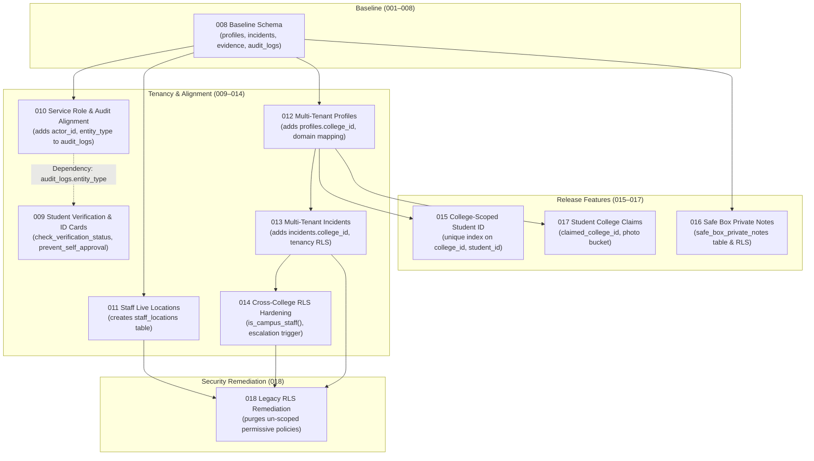

# KAVACH CAMPUS — PHASE 15K MIGRATION DEPENDENCY REPORT

**Scope:** Migrations 001 through 018  
**Audit Executed:** 2026-11-05  
**Review Focus:** Prerequisites, Schema Dependencies, Order of Execution & Production Safety  
**Status:** **`VERIFIED & DOCUMENTED`**  

---

## 1. Migration Dependency Graph



---

## 2. Investigation of Migration 009 vs. 010 Column Dependency

### 2.1 The Issue Reported in Phase 15J
In Phase 15J, static review noted that:
* `009_student_id_verification_resubmission.sql` (Line 77) executes:
  ```sql
  INSERT INTO public.audit_logs (id, action, entity_type, metadata, created_at)
  VALUES (gen_random_uuid(), 'SCHEMA_MIGRATION_009', 'student_profiles', ...);
  ```
* `010_service_role_and_audit_alignment.sql` (Line 8) executes:
  ```sql
  ALTER TABLE public.audit_logs ADD COLUMN IF NOT EXISTS entity_type TEXT;
  ```

### 2.2 Forensic Findings & Verification
1. **Origin in Historical Baseline:** In `001_kavach_campus.sql` line 176, `audit_logs` was initially declared with `entity_type TEXT NOT NULL`.
2. **Why 010 Added `ADD COLUMN IF NOT EXISTS`:** During historical migrations on intermediate staging instances (`polbnvszmvblwenfnqll`), some environments experienced schema drift where `audit_logs` had dropped `entity_type` or replaced it with `target_type`. Migration 010 was authored as a defensive alignment script.
3. **The Dependency is REAL on Drifted Databases:** If a target production database was initialized from a schema variant lacking `entity_type`, executing 009 before 010 will trigger PostgreSQL error `42703` (`column "entity_type" of relation "audit_logs" does not exist`).
4. **Local Execution Outcome:** In the local Docker Supabase environment, `audit_logs` already possessed `entity_type`, so executing 009 in numerical order succeeded.

---

## 3. Recommended Production Execution Sequence

To avoid any possible prerequisite failure on production, the execution sequence should apply schema structural alignment (`audit_logs` columns) before executing audit insertions:

| Step | Script / Migration | Safe Execution Reason |
| :-: | :--- | :--- |
| **1** | `010_service_role_and_audit_alignment.sql` | Adds `entity_type`, `actor_id`, and `entity_id` to `audit_logs` first; updates `is_security_or_admin()`. |
| **2** | `009_student_id_verification_resubmission.sql` | Safely inserts audit log with `entity_type`; applies `check_verification_status` and ID card bucket. |
| **3** | `011_staff_live_locations_and_consent.sql` | Creates `staff_locations` table and indexes. |
| **4** | `012_profiles_college_tenant.sql` | Adds `profiles.college_id`, maps institutional domains, upgrades `kavach-evidence` bucket. |
| **5** | `013_cross_college_rls_isolation.sql` | Adds `incidents.college_id` and backfills tenancy from `profiles.college_id`. |
| **6** | `014_cross_college_rls_hardening.sql` | Installs `is_campus_staff()`, sync triggers, and role escalation guards. |
| **7** | `015_college_scoped_student_id_uniqueness.sql` | Replaces global student ID index with composite `(college_id, student_id)` index. |
| **8** | `016_safe_box_private_notes.sql` | Creates `safe_box_private_notes` table with RLS and char limit. |
| **9** | `017_student_college_claims.sql` | Adds `claimed_college_id` and private bucket `kavach-profile-photos`. |
| **10** | `018_legacy_rls_policy_remediation.sql` | Purges un-scoped historical permissive policies across 5 tables; hardens `staff_locations`. |

---

## 4. Reverse Dependencies & Rollback Strategy

1. **Migration 018 Rollback:** If 018 must be reverted, the canonical policies remain untouched; only legacy un-scoped policies were purged. Reverting would re-expose the security leak.
2. **Migration 017 Rollback:** Drop `kavach-profile-photos` bucket; drop columns `claimed_college_id` and `profile_photo_path`.
3. **Migration 016 Rollback:** `DROP TABLE public.safe_box_private_notes CASCADE;`.
4. **Migration 015 Rollback:** Drop compound index `idx_profiles_college_student_id`; recreate global unique index `idx_profiles_student_id`.
5. **Full Restoration:** If a failure occurs during execution, the verified pre-migration point-in-time recovery (PITR) snapshot should be restored.

