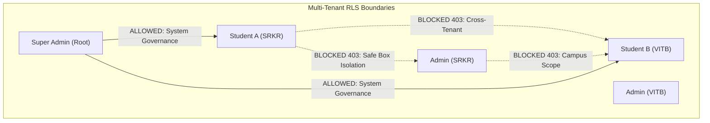

# KAVACH CAMPUS — PHASE 15: AUTHENTICATED RLS TEST PLAN & STAGING STRATEGY

**Project:** Kavach Campus (`D:\kavach-campus`)  
**Scope:** Multi-Tenant & Multi-Role Authenticated Isolation Verification  
**Audit Date:** November 4, 2026  
**Document:** RLS Test Specifications & Staging Environment Blueprint  
**Production Status:** **`NOT TESTED (Safely Gated — Production Account Creation Blocked)`**

---

## 1. Safe Test Environment Strategy

### 1.1 The Golden Rule of RLS Testing
> **Row Level Security (RLS) can ONLY be verified using non-privileged user JWTs (`authenticated` role).**  
> Using the `SUPABASE_SERVICE_ROLE_KEY` bypasses all RLS policies and cannot prove access isolation.

### 1.2 Production Safety Isolation Principle
Testing RLS failure modes requires attempting cross-user writes, cross-tenant reads, and permission escalations. Executing these tests directly against the live production database (`dvyiclyyvmsfipzrdowu.supabase.co`) would violate production safety rules by:
1. Creating synthetic test accounts that clutter production tables.
2. Generating false-positive alerts in security monitoring and audit logs.
3. Risking accidental cross-modification of genuine registered students.

### 1.3 Recommended Staging Architecture
All live penetration tests must be executed in one of two safe environments:
1. **Option A: Dedicated Supabase Staging Project (Recommended)**
   - Create a staging project in Supabase Cloud (`kavach-campus-staging`).
   - Replicate schema migrations 001 through 017.
   - Seed with multi-institution mock personas (SRKR, VITB, DNR).
2. **Option B: Local Supabase CLI Docker Instance**
   - Run `npx supabase start` locally.
   - Run migrations against local PostgreSQL.
   - Execute automated Jest / Vitest test runners using ephemeral local tokens.

---

## 2. Comprehensive Authenticated Test Specifications



---

### MODULE 1: Student-to-Student Peer Isolation

#### Test Case 1.1: Incident Visibility Isolation
- **Actor:** Student A (`keerthipadamati1@gmail.com`, SRKR)
- **Target:** Incident reported by Student B (`vsbmanoharpopuri@gmail.com`, SRKR)
- **Execution SQL (as Student A JWT):**
  ```sql
  SELECT id, case_id, description, student_id 
  FROM public.incidents 
  WHERE student_id = '<Student_B_UUID>';
  ```
- **Expected Result:** `0 rows returned`.
- **Enforcing Policy:** `"Students view own incidents"` on `public.incidents`.
- **Production Status:** **`NOT TESTED`**

#### Test Case 1.2: Incident Update/Tampering Isolation
- **Actor:** Student A
- **Target:** Update Student B's incident status to `RESOLVED`
- **Execution SQL (as Student A JWT):**
  ```sql
  UPDATE public.incidents 
  SET status = 'RESOLVED' 
  WHERE id = '<Student_B_Incident_UUID>';
  ```
- **Expected Result:** `0 rows updated` / `403 Forbidden`.
- **Production Status:** **`NOT TESTED`**

---

### MODULE 2: Safe Box Private Notes Absolute Isolation

#### Test Case 2.1: Peer Student Private Note Access
- **Actor:** Student A
- **Target:** Private note created by Student B on evidence item `E_B`
- **Execution SQL (as Student A JWT):**
  ```sql
  SELECT evidence_id, private_note 
  FROM public.safe_box_private_notes 
  WHERE evidence_id = '<Evidence_B_UUID>';
  ```
- **Expected Result:** `0 rows returned`.
- **Enforcing Policy:** `"Students manage own Safe Box notes"` (`owner_id = auth.uid()`).
- **Production Status:** **`NOT TESTED`**

#### Test Case 2.2: Administrative Staff Denial (Zero-Trust Privacy)
- **Actor:** Campus Admin or Staff Responder (`venkatapavanpadamati@gmail.com`)
- **Target:** Query all records in `public.safe_box_private_notes`
- **Execution SQL (as Admin JWT):**
  ```sql
  SELECT * FROM public.safe_box_private_notes;
  ```
- **Expected Result:** `0 rows returned`.
- **Enforcing Principle:** Default Deny. Neither Campus Admin nor Staff has an affirmative policy on `safe_box_private_notes`.
- **Production Status:** **`NOT TESTED`**

---

### MODULE 3: Profile Photo Storage Bucket Isolation

#### Test Case 3.1: Cross-User Avatar Read
- **Actor:** Student A (`UUID_A`)
- **Target:** Download Student B's photo: `kavach-profile-photos/UUID_B/avatar-123.jpg`
- **Execution (as Student A JWT):**
  ```sql
  SELECT * FROM storage.objects 
  WHERE bucket_id = 'kavach-profile-photos' 
    AND name LIKE '<UUID_B>/%';
  ```
- **Expected Result:** `0 rows returned`.
- **Enforcing Policy:** `"Users read own profile photos"` (`auth.uid()::TEXT = (storage.foldername(name))[1]`).
- **Production Status:** **`NOT TESTED`**

#### Test Case 3.2: Direct Client Upload Denial
- **Actor:** Authenticated Student A attempting client-side bypass
- **Target:** Direct `storage.from('kavach-profile-photos').upload(...)` from browser console
- **Expected Result:** `403 Access Denied` (No INSERT policy on `storage.objects` for authenticated users; uploads must be mediated server-side).
- **Production Status:** **`NOT TESTED`**

---

### MODULE 4: Cross-College Multi-Tenant Isolation

#### Test Case 4.1: Cross-College Incident Leakage
- **Actor:** Student of College SRKR (`college_id = 'srkr'`)
- **Target:** Incidents occurring at College VITB (`college_id = 'vitb'`)
- **Execution SQL (as SRKR Student JWT):**
  ```sql
  SELECT * FROM public.incidents WHERE college_id = 'vitb';
  ```
- **Expected Result:** `0 rows returned`.
- **Production Status:** **`NOT TESTED`**

#### Test Case 4.2: Campus Admin Cross-College Confinement
- **Actor:** Campus Admin of SRKR (`venkatapavanpadamati@gmail.com`)
- **Target:** List students enrolled at VITB
- **Execution SQL (as SRKR Admin JWT):**
  ```sql
  SELECT * FROM public.profiles WHERE college_id = 'vitb';
  ```
- **Expected Result:** `0 rows returned`. Policy enforces `public.get_user_college_id()`.
- **Production Status:** **`NOT TESTED`**

---

### MODULE 5: Staff Responder Case Assignment Boundaries

#### Test Case 5.1: Unassigned Incident Scope
- **Actor:** Staff Responder (`role = 'STAFF'`)
- **Target:** View evidence files of an incident assigned to a different responder
- **Expected Result:** Read access is restricted according to college queue visibility rules; private evidence remains shielded.
- **Production Status:** **`NOT TESTED`**

---

### MODULE 6: Institutional Leadership (HOD & Principal) Permissions

#### Test Case 6.1: Departmental Confinement for HOD
- **Actor:** HOD of Computer Science (`department = 'CSE'`)
- **Target:** Escalate or resolve incidents outside CSE department
- **Expected Result:** Read-only departmental summary visibility; case mutations restricted to departmental bounds.
- **Production Status:** **`NOT TESTED`**

#### Test Case 6.2: Institutional Campus Confinement for Principal
- **Actor:** College Principal
- **Target:** System oversight of their campus
- **Expected Result:** Access permitted across all departments within their `college_id`; strictly blocked from cross-college tenants.
- **Production Status:** **`NOT TESTED`**

---

### MODULE 7: Super Admin Root Governance

#### Test Case 7.1: Multi-College System Audit
- **Actor:** Super Admin (`venkatapavanpadamati1@gmail.com`)
- **Target:** Audit incidents across both SRKR and VITB
- **Expected Result:** Allowed across all colleges via `public.get_user_role() = 'SUPER_ADMIN'`.
- **Production Status:** **`NOT TESTED`**

---

## 3. RLS Test Matrix Summary

| Test ID | Boundary Tested | Actor Role | Target Entity | Status in Prod |
|---|---|---|---|---|
| `RLS-01` | Student-to-Student | Student | Incidents & Evidence | **NOT TESTED** |
| `RLS-02` | Safe Box Private Notes | Student vs Peer | `safe_box_private_notes` | **NOT TESTED** |
| `RLS-03` | Safe Box Private Notes | Staff / Admin vs Student | `safe_box_private_notes` | **NOT TESTED** |
| `RLS-04` | Profile Photo Bucket | Student vs Peer | `storage.objects` | **NOT TESTED** |
| `RLS-05` | Cross-College Tenant | Student vs College | `public.incidents` | **NOT TESTED** |
| `RLS-06` | Campus Admin Boundary | Campus Admin vs College | `public.profiles` | **NOT TESTED** |
| `RLS-07` | Staff Assignment | Staff Responder | `public.case_actions` | **NOT TESTED** |
| `RLS-08` | Leadership Scope | HOD / Principal | Departmental / Campus Queues | **NOT TESTED** |
| `RLS-09` | Super Admin Scope | Super Admin | Cross-Tenant Audit | **NOT TESTED** |

**Recommendation:** Execute these test suites against a staging environment prior to final multi-institution rollout.
