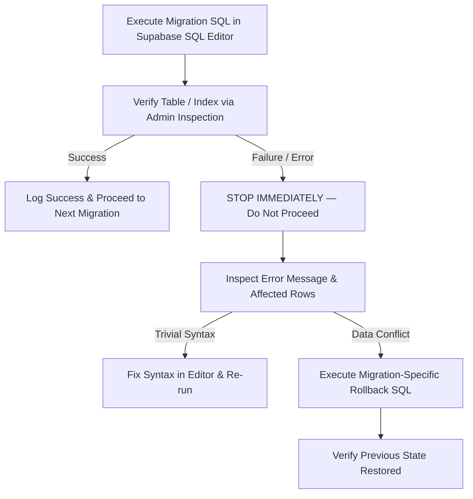

# Phase 15 — Database Backup & Rollback Plan

**Date:** November 4, 2026  
**Lead DBA:** Senior Supabase Database Administrator (Antigravity Agent)  
**Project Workspace:** `D:\kavach-campus`  
**Supabase Project ID:** `dvyiclyyvmsfipzrdowu`  

---

## 1. Supabase Automated Snapshot & Backup Verification

Before applying any schema migration:
1. **Automated Point-in-Time Recovery (PITR) / Daily Snapshots**:
   - Supabase project `dvyiclyyvmsfipzrdowu` manages PostgreSQL WAL and daily physical snapshots.
   - Verify active project status in Supabase Dashboard $\rightarrow$ Settings $\rightarrow$ Database $\rightarrow$ Backups:
     `https://supabase.com/dashboard/project/dvyiclyyvmsfipzrdowu/settings/database`
2. **Current Schema & Data Export**:
   - Prior to execution, export the current table inventory via `scripts/inspect_all_19_tables_data.ts` to ensure a local JSON dump of existing rows is stored safely.

---

## 2. Migration-by-Migration Rollback Procedures

### Rollback Migration 015
If compound unique index `idx_profiles_college_student_id` causes an unexpected constraint conflict:
```sql
-- ROLLBACK 015: Restore global partial unique index on student_id
DROP INDEX IF EXISTS public.idx_profiles_college_student_id;

CREATE UNIQUE INDEX IF NOT EXISTS idx_profiles_student_id
ON public.profiles(student_id)
WHERE student_id IS NOT NULL AND role = 'STUDENT';

COMMENT ON INDEX public.idx_profiles_student_id IS
'Restored global partial unique index on student_id for student role';
```

### Rollback Migration 016
If table `safe_box_private_notes` needs to be removed:
```sql
-- ROLLBACK 016: Drop private notes table and policies
DROP POLICY IF EXISTS "Students manage own Safe Box notes" ON public.safe_box_private_notes;
DROP TABLE IF EXISTS public.safe_box_private_notes CASCADE;
```
*(Note: Application code in `POST /api/student/safe-box` has built-in PostgreSQL 42P01 fallback handling and continues functioning safely even if this table is dropped).*

### Rollback Migration 017
If columns or storage bucket need to be removed:
```sql
-- ROLLBACK 017: Revert claims columns and storage configuration
DROP POLICY IF EXISTS "Users read own profile photos" ON storage.objects;

DELETE FROM storage.buckets WHERE id = 'kavach-profile-photos';

DROP INDEX IF EXISTS public.idx_student_profiles_claimed_college_status;

ALTER TABLE public.student_profiles
  DROP COLUMN IF EXISTS claimed_college_id;

ALTER TABLE public.profiles
  DROP COLUMN IF EXISTS profile_photo_path;
```

---

## 3. Disaster Recovery Decision Tree



