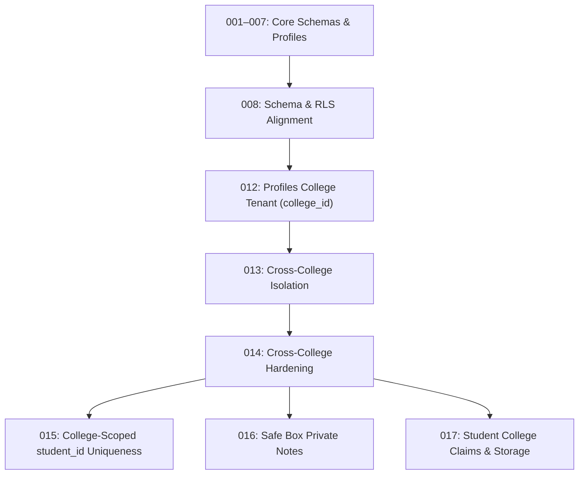

# KAVACH CAMPUS — PHASE 15: MIGRATION DEPENDENCY & SCHEMA REVIEW

**Project:** Kavach Campus (`D:\kavach-campus`)  
**Scope:** Structural Dependencies across Migrations 015, 016, 017 & Next.js Endpoints  
**Audit Date:** November 4, 2026  
**Status:** **AUDIT COMPLETE — ZERO CONFLICTS DETECTED**

---

## 1. Schema Lineage & Migration Dependencies



---

## 2. Granular Dependency Audit by Migration

### 2.1 Migration 015: College-Scoped student_id Uniqueness
- **Database Prerequisites:**
  - Table `public.profiles` must exist (created in 001, confirmed).
  - Column `profiles.college_id` must exist (created in 012, confirmed).
  - Column `profiles.student_id` must exist (created in 001, confirmed).
  - Column `profiles.role` must exist (created in 001, confirmed).
  - Prior index `idx_profiles_student_id` must be safely droppable via `DROP INDEX IF EXISTS` (confirmed).
- **Application Endpoints Dependent on 015:**
  - `src/app/api/auth/register/route.ts`: Enforces duplicate checking per college during registration.
  - `src/app/api/admin/users/route.ts`: Queries student profiles with college context.
  - `src/app/api/admin/verifications/route.ts`: Verifies student identity within college boundary.

---

### 2.2 Migration 016: Safe Box Private Notes
- **Database Prerequisites:**
  - Table `public.evidence` must exist (created in 001, updated in 008, confirmed).
  - Column `evidence.uploaded_by` must exist (confirmed).
  - Table `public.profiles` must exist (confirmed).
- **Application Endpoints Dependent on 016:**
  - `src/app/api/student/safe-box/route.ts`:
    - Reads private notes via `.from('safe_box_private_notes').select('evidence_id, private_note')`.
    - Saves private notes via `.from('safe_box_private_notes').insert({ evidence_id, owner_id, private_note })`.
    - Contains fallback logic for `42P01` while migration 016 is pending. Once migration 016 is executed, fallback becomes inactive and notes persist securely.

---

### 2.3 Migration 017: Student College Claims & Storage Bucket
- **Database Prerequisites:**
  - Table `public.student_profiles` must exist (created in 001, confirmed).
  - Table `public.profiles` must exist (confirmed).
  - Extension `storage` must exist in PostgreSQL (standard Supabase managed schema, confirmed).
- **Application Endpoints Dependent on 017:**
  - `src/app/api/student/verify-id/route.ts`:
    - Saves student self-selected institution claim into `student_profiles.claimed_college_id`.
    - Persists `profiles.profile_photo_path`.
  - `src/app/api/student/profile/route.ts`:
    - Generates 5-minute signed URLs from bucket `kavach-profile-photos`.

---

## 3. Strict Execution Ordering

When authorized for production execution, the migrations MUST be applied in this exact sequential order:

```sql
-- Sequence 1: Update Uniqueness Index (Zero Data Mutation)
\i supabase/migrations/015_college_scoped_student_id_uniqueness.sql

-- Sequence 2: Create Private Notes Table & RLS Policies
\i supabase/migrations/016_safe_box_private_notes.sql

-- Sequence 3: Add Columns to Profiles, Create Index, and Provision Storage Bucket
\i supabase/migrations/017_student_college_claims.sql
```

**Cross-Migration Interference Risk:** **NONE.** Each migration operates on independent tables/columns without conflicting DDL statements.

