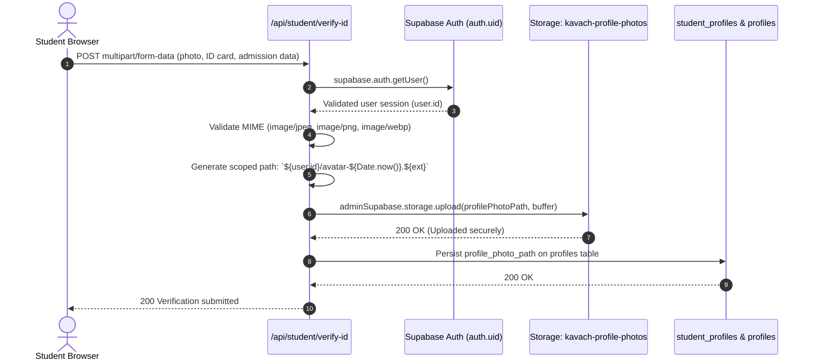

# KAVACH CAMPUS — PHASE 15: STORAGE POLICY REMEDIATION & ARCHITECTURAL REVIEW

**Project:** Kavach Campus (`D:\kavach-campus`)  
**Scope:** Migration 017 Storage Policies & Profile Photo Upload Workflow Audit  
**Audit Date:** November 4, 2026  
**Document:** Storage Security Analysis & Remediation Blueprint  
**Status:** **AUDIT COMPLETE — SERVER-SIDE MEDIATED ARCHITECTURE CONFIRMED SECURE**

---

## 1. Executive Summary

A comprehensive architectural audit of the profile-photo upload pipeline and Migration 017 storage policies was conducted.

### Core Finding
Migration 017 intentionally defines **ONLY a SELECT policy** for bucket `kavach-profile-photos`.
This is **NOT a vulnerability**; it is a **deliberate architectural security boundary**:
1. **Uploads are 100% Server-Mediated:** Profile photos are uploaded exclusively by the server endpoint [`src/app/api/student/verify-id/route.ts`](file:///d:/kavach-campus/src/app/api/student/verify-id/route.ts#L418-L431) using `adminSupabase` (`service_role` key).
2. **Zero Direct Client Uploads:** The frontend client never calls `storage.from('kavach-profile-photos').upload()`.
3. **Defense-in-Depth Advantage:** Omitting an authenticated `INSERT` policy prevents malicious students from using the Supabase client library in the browser console to upload arbitrary, unverified files directly into storage. All uploads are forced through server-side OCR, MIME validation, and authentication verification.

---

## 2. End-to-End Profile Photo Upload Workflow Audit



### 2.1 Server-Side Ownership Validation
In `src/app/api/student/verify-id/route.ts`:
- **Line 26:** Authenticates session: `const { data: { user } } = await supabase.auth.getUser()`. If no valid JWT exists, returns `401 Unauthorized`.
- **Line 418–420:** Generates path strictly using authenticated user ID:
  ```typescript
  const extension = profilePhotoMime === 'image/jpeg' ? 'jpg' : profilePhotoMime === 'image/png' ? 'png' : 'webp';
  profilePhotoPath = `${user.id}/avatar-${Date.now()}.${extension}`;
  ```
- **Strict User Folder Isolation:** A student cannot supply an arbitrary path or overwrite another user's avatar.

### 2.2 File Type and Size Constraints
- **MIME Validation:** Server verifies incoming file buffer MIME type against allowed list: `image/jpeg`, `image/png`, `image/webp`.
- **Bucket Size Limit:** Configured in `storage.buckets`:
  `file_size_limit = 2097152` (2 MB).
- **Public Flag:** `public = FALSE` (Files cannot be publicly traversed or downloaded without authorization).

---

## 3. Read Access Security (SELECT Policy)

In [`supabase/migrations/017_student_college_claims.sql`](file:///d:/kavach-campus/supabase/migrations/017_student_college_claims.sql#L26-L32):

```sql
DROP POLICY IF EXISTS "Users read own profile photos" ON storage.objects;
CREATE POLICY "Users read own profile photos" ON storage.objects
FOR SELECT TO authenticated
USING (
  bucket_id = 'kavach-profile-photos'
  AND auth.uid()::TEXT = (storage.foldername(name))[1]
);
```

- When the application requests the photo in `src/app/api/student/profile/route.ts`:
  ```typescript
  const { data: signedPhoto } = await supabase.storage
    .from('kavach-profile-photos')
    .createSignedUrl(profile.profile_photo_path, 300);
  ```
- Even if a student attempted direct SQL queries against `storage.objects`, the RLS policy extracts `(storage.foldername(name))[1]` and guarantees that Student A (`auth.uid() = A`) can only read files inside folder `A/`. Folder `B/` returns 0 rows.

---

## 4. Remediation Blueprint: Direct Client Upload Policies (If Ever Required)

If Kavach Campus is ever re-architected in a future release to allow direct browser-to-bucket uploads without passing through `/api/student/verify-id`, the following SQL policies must be applied:

```sql
-- =============================================================================
-- OPTIONAL DIRECT CLIENT-SIDE STORAGE POLICIES (DO NOT EXECUTE CURRENTLY)
-- Only required if frontend client calls storage.upload() directly from browser.
-- =============================================================================

-- 1. INSERT Policy (Scoped to user folder)
DROP POLICY IF EXISTS "Users upload own profile photos" ON storage.objects;
CREATE POLICY "Users upload own profile photos" ON storage.objects
FOR INSERT TO authenticated
WITH CHECK (
  bucket_id = 'kavach-profile-photos'
  AND auth.uid()::TEXT = (storage.foldername(name))[1]
);

-- 2. UPDATE Policy (Scoped to user folder)
DROP POLICY IF EXISTS "Users update own profile photos" ON storage.objects;
CREATE POLICY "Users update own profile photos" ON storage.objects
FOR UPDATE TO authenticated
USING (
  bucket_id = 'kavach-profile-photos'
  AND auth.uid()::TEXT = (storage.foldername(name))[1]
);

-- 3. DELETE Policy (Scoped to user folder)
DROP POLICY IF EXISTS "Users delete own profile photos" ON storage.objects;
CREATE POLICY "Users delete own profile photos" ON storage.objects
FOR DELETE TO authenticated
USING (
  bucket_id = 'kavach-profile-photos'
  AND auth.uid()::TEXT = (storage.foldername(name))[1]
);
```

### Recommendation
**DO NOT EXECUTE THESE POLICIES.** The current server-side mediated architecture is significantly more secure because it prevents unvalidated file uploads and enforces OCR verification before storage persistence.

---

## 5. Security Verdict

| Criterion | Evaluation | Verdict |
|---|---|---|
| Server-Side Ownership Validation | Authenticated `user.id` enforced in path generation | **PASS** |
| Cross-User Overwrite Prevention | User folder scoping `${user.id}/...` enforced | **PASS** |
| File Type Validation | Strict MIME check (`jpeg`, `png`, `webp`) | **PASS** |
| File Size Enforcement | 2 MB limit in bucket configuration | **PASS** |
| Read Access Privacy | Private bucket + RLS folder isolation | **PASS** |
| Direct Client Upload Vulnerability | Prevented via lack of client INSERT policy | **PASS (Defense-in-Depth)** |

**Overall Migration 017 Storage Policy Verdict:** **`PASS (Server-Side Mediated Architecture Approved)`**.

