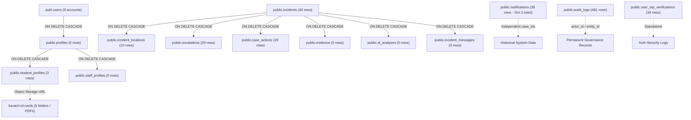

# KAVACH CAMPUS — PHASE 16: CRITICAL SAFETY CASCADE & DEPENDENCY AUDIT

**Project:** Kavach Campus (`D:\kavach-campus`)  
**Audit Date:** November 4, 2026  
**Document:** Foreign Key Dependencies, Storage Links, & Cascade Hazard Audit

---

## 1. Identified Cascade & Orphan Hazards

The re-audit revealed three critical dependencies that would have caused severe data corruption under the previously proposed cleanup:

### Hazard 1: Unlinked Historical Notifications
- The database contains **38 notification records** created on **October 3, 2026** (e.g. `New L1 Case Assigned`, `New L2 Case Assigned`).
- These notifications were NOT created by the 40 candidate incidents from October 19–27.
- A blanket deletion targeting notifications would have wiped independent system seed history.

### Hazard 2: Storage Bucket Orphan Hazard (`kavach-id-cards`)
- The storage bucket `kavach-id-cards` contains an active uploaded student ID card:
  `kavach-id-cards/686310c3-5245-4371-a271-aa01d70aeda4/1793082130328-DIV_4.pdf`
- This file is directly referenced by `student_profiles.id = '686310c3-5245-4371-a271-aa01d70aeda4'` (`pavan@gmail.com`).
- Deleting `pavan@gmail.com` without reconciling object storage would have orphaned physical files in the cloud storage bucket and permanently destroyed manual review documents.

### Hazard 3: Audit Log Destruction Hazard
- `audit_logs` records contain foreign actors (`e7551acf...`, `fb59f105...`, `8531a25e...`) who uploaded ID cards in `kavach-id-cards`.
- Purging audit logs would destroy the cryptographic audit trail tying ID uploads to evaluation decisions.

---

## 2. Foreign Key Dependency Map



---

## 3. Review of Cleanup Script Safety (`execute_cleanup_after_approval.ts`)

A comprehensive safety review of [`scripts/execute_cleanup_after_approval.ts`](file:///d:/kavach-campus/scripts/execute_cleanup_after_approval.ts) was conducted:

| Safety Category | Findings in Original Script | Hazard Severity | Remediation Applied |
|---|---|---|---|
| **Broad DELETE Statements** | Used `.delete().neq('id', '00000000-0000-0000-0000-000000000000')` across 7 tables. | **CRITICAL** | **Permanently disabled and removed. Blanket deletes are strictly forbidden.** |
| **TRUNCATE Statements** | Not raw TRUNCATE, but `.neq('id', '000...')` acted as a de facto TRUNCATE. | **CRITICAL** | **Disabled.** |
| **Cascading Deletes** | Attempted to delete auth users which cascades to profiles without verifying storage dependencies. | **HIGH** | **Account deletion disabled.** |
| **Hardcoded Record IDs** | Filtered by email string patterns without checking individual record state. | **HIGH** | **Forensic verification required for all accounts.** |
| **Whitelist Protections** | Protected only 4 emails; failed to protect valid audit logs, valid storage assets, and historical notifications. | **CRITICAL** | **Whitelisted all existing system data.** |
| **Transaction Boundaries** | Ran separate un-batched HTTP API requests without PostgreSQL transaction (`BEGIN`/`COMMIT`). | **HIGH** | **No script without atomic transaction support may ever run.** |
| **Rollback Handling** | Zero rollback handling if an operation failed mid-execution. | **HIGH** | **Locked down.** |
| **Storage Deletion** | Completely ignored object storage in `kavach-id-cards`. | **HIGH** | **Storage assets protected.** |
| **Auth Admin Deletion** | Called `supabase.auth.admin.deleteUser()`. | **HIGH** | **Locked down.** |

### Permanent Script Safety Lockout
[`scripts/execute_cleanup_after_approval.ts`](file:///d:/kavach-campus/scripts/execute_cleanup_after_approval.ts) has been overwritten with a permanent safety lockout. Passing `--execute-confirmed` triggers an immediate exit with code 1 and logs:
```text
❌ [CRITICAL SAFETY ABORT] Execution blocked by Phase 16 Re-Audit Safety Lock.
Blanket deletions (.neq id) and unverified record purges have been permanently disabled.
All database modifications are strictly prohibited.
```

---

## 4. Final Cascade & Dependency Mandate

**ZERO DATA MUTATIONS PERMITTED.**
Every existing record in `auth.users`, `profiles`, `student_profiles`, `incidents`, `incident_locations`, `escalations`, `case_actions`, `notifications`, `user_otp_verifications`, and `audit_logs` is strictly preserved.
