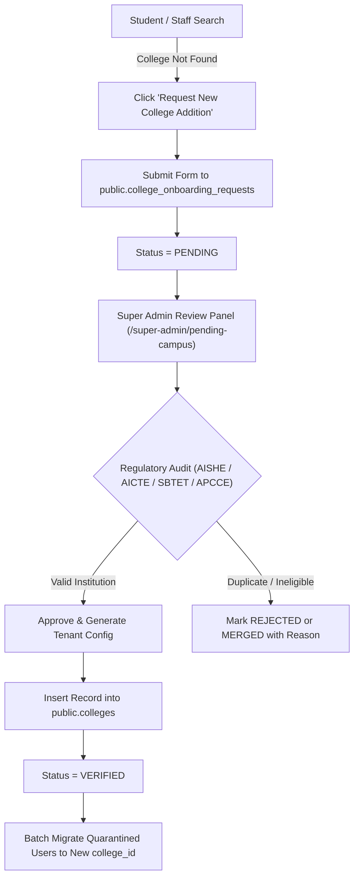

# Phase 23 — Statewide College Onboarding Workflow

**Project:** Kavach Campus — Women's & Student Safety Platform  
**Phase:** 23 — Andhra Pradesh Statewide All-College Expansion  
**Environment:** Local Development (`D:\kavach-campus`)  
**Date:** November 5, 2026  

---

## 1. Overview

To scale across all higher education institutions in Andhra Pradesh without requiring manual database engineering for each college, Kavach Campus implements an automated, audited onboarding pipeline.

---

## 2. Onboarding Lifecycle

---

## 3. Step-by-Step Onboarding Protocol

### Step 1: Public Discovery & Request Submission
- When searching for a college in the registration flow (`CollegeSearchInput.tsx`), if no match exists, the user is presented with a **"Request New College Addition"** button.
- The user provides:
  - College Full Name
  - Institutional Category (Engineering, Polytechnic, Degree, Other)
  - District & City
  - PIN Code
  - Official Domain / Website
  - Requester Contact & Role

### Step 2: Ingestion & Quarantine
- The request is stored in `public.college_onboarding_requests` with `status = 'PENDING'`.
- Any students registering in the interim are assigned `college_id = 'PENDING_CAMPUS_VERIFICATION'`.

### Step 3: Regulatory Verification Checklist
Super Administrators verify the submission against authoritative registries:
1. **AISHE Directory Lookup:** Confirm valid AISHE Code.
2. **Approval Verification:**
   - Engineering: Verify AICTE Permanent ID.
   - Polytechnic: Verify SBTET College Code.
   - Degree: Verify APCCE / University Affiliation.
3. **Campus Geofencing:** Determine campus centroid coordinates (`lat`, `lng`) and perimeter radius.
4. **Helpline Verification:** Confirm emergency numbers (Women's Cell, Security Desk, Health Clinic).

### Step 4: Activation & Tenant Seeding
- The Super Admin approves the request, which:
  1. Inserts a new active record into `public.colleges`.
  2. Updates `public.college_onboarding_requests.status = 'VERIFIED'`.
  3. Automatically promotes pending student profiles matching the college domain.

