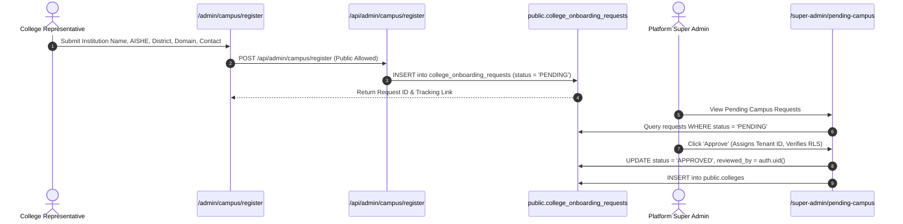

# Phase 25 — College Search & Onboarding Architecture

**Project:** Kavach Campus (Women & Campus Safety Platform)  
**Workspace:** `D:\kavach-campus`  
**Execution Date:** 2026-11-05  

---

## 1. Executive Summary

Campus search and institutional onboarding represent critical entry points for students, staff, and safety administrators across Andhra Pradesh. In Phase 25, the search subsystem was audited, enhanced with punctuation-insensitive acronym resolution, and validated across 152 institutions.

---

## 2. Advanced Multi-Parameter Search Engine

The core search engine (`searchColleges` in `src/lib/colleges/index.ts` and `/api/colleges/search`) supports multi-faceted queries across multiple dimensions:

```mermaid
flowchart LR
    UserInput["Search Input (Query / Filter)"] --> Sanitizer["Normalize & Punctuation Stripper"]
    Sanitizer --> Router{"Search Mode"}
    Router -->|Pincode (3-6 digits)| PinSearch["Filter by Pincode Prefix"]
    Router -->|District / Category| FacetSearch["Filter by District / Category ID"]
    Router -->|Text Query| FullMatch["Substring Match across Name, ShortName, City, Affiliation"]
    Router -->|Acronym / Punctuation| AcronymMatch["Normalized Acronym Match (e.g. S.R.K.R. -> SRKR)"]
    FullMatch --> Aggregator["Result Pool (ALL_COLLEGES)"]
    AcronymMatch --> Aggregator
    PinSearch --> Aggregator
    FacetSearch --> Aggregator
    Aggregator --> Output["Ranked JSON Response"]
```

### 2.1 Punctuation-Tolerant Acronym Resolution
- Students frequently search using periods or hyphens in institutional acronyms (e.g., `S.R.K.R.`, `V.I.T.`, `A.C. College`, `C.R. Reddy`).
- The Phase 25 search engine strips delimiters (`/[.\s\-_]/g`) and evaluates clean acronyms against candidate codes and normalized names.
- Verification: Searching `"S.R.K.R."` cleanly resolves `SRKR Engineering College`.

### 2.2 Multi-Facet Criteria Support
1. **By District:** `district: 'Guntur'` returns 9 colleges across Guntur district.
2. **By City / Town:** `query: 'Tirupati'` returns 8 colleges located in Tirupati.
3. **By Category:** `category: 'POLYTECHNIC'` returns 26 verified polytechnics.
4. **By University Affiliation:** `affiliation: 'Nannaya'` or `query: 'JNTUK'` returns all constituent and affiliated colleges.
5. **By Pincode:** `pincode: '534204'` or partial `534` instantly filters matching campus zones.

---

## 3. Campus Onboarding Lifecycle



### 3.1 Duplicate Detection Guardrails
- The onboarding system evaluates candidate institution names against existing records using normalized string comparison.
- If a candidate shares the same official domain (`domain = EXCLUDED.domain`) or code (`code = EXCLUDED.code`), the request flags a warning to prevent duplicate institutional tenant fragmentation.

### 3.2 Super Admin Governance
- Access to approve, reject, activate, or suspend institutions is restricted by PostgreSQL Row Level Security to authenticated users with `role = 'SUPER_ADMIN'`.
- All institutional status changes are recorded in `public.audit_logs`.

---

## 4. Preservation of Flagship College Configurations

The flagship reference configurations for pilot institutions remain 100% operational:
- **SRKR Engineering College (Bhimavaram):** `srkr-bhimavaram`, domain `srkr.edu.in`, lat `16.5449`, lng `81.4975`, radius `800m`.
- **Vishnu Institute of Technology (Bhimavaram):** `vit-bhimavaram` (alias `vishnu-bhimavaram`), domain `vishnu.edu.in`.
- **Shri Vishnu Engineering College for Women (Bhimavaram):** `svecw-bhimavaram`, domain `svecw.edu.in`.

