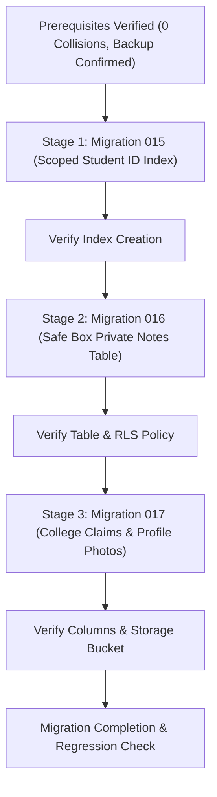

# Kavach Campus — Phase 4 Database Migration Execution Plan

**Document:** `docs/PHASE_4_DATABASE_EXECUTION_PLAN.md`  
**Date:** November 4, 2026  
**Auditor / Architect:** Senior Full-Stack & Security Systems Engineer (Antigravity Agent)  
**Target Environment:** Supabase Cloud PostgreSQL  
**Project ID:** `dvyiclyyvmsfipzrdowu`  
**SQL Editor URL:** `https://supabase.com/dashboard/project/dvyiclyyvmsfipzrdowu/sql`  
**Status:** **PROPOSED — AWAITING PROJECT OWNER EXPLICIT APPROVAL**  

---

## 1. Prerequisites Before Execution

Before executing any SQL scripts in the Supabase SQL Editor:
1. **Verify Target Project**: Ensure the active project in Supabase Dashboard is `kavach-campus` (Ref: `dvyiclyyvmsfipzrdowu`).
2. **Confirm Backup**: Verify a recent snapshot is available in **Project Settings > Database > Backups**.
3. **Collision Verification Completed**: Antigravity's live scan confirmed that **0 duplicate student IDs** exist in the database.
4. **Zero Downtime**: All migrations are purely additive / index swaps; no table drops or column deletions are involved.

---

## 2. Stage-by-Stage Execution Plan



---

### STAGE 1: Migration 015 — College-Scoped Student ID Uniqueness
**File:** `supabase/migrations/015_college_scoped_student_id_uniqueness.sql`

#### A. Execution SQL
```sql
-- Step 1: Drop previous global unique index if exists
DROP INDEX IF EXISTS public.idx_profiles_student_id;

-- Step 2: Create college-scoped partial unique index on profiles
CREATE UNIQUE INDEX IF NOT EXISTS idx_profiles_college_student_id
ON public.profiles(college_id, student_id)
WHERE student_id IS NOT NULL AND role = 'STUDENT';

-- Step 3: Add comment explaining index purpose
COMMENT ON INDEX public.idx_profiles_college_student_id IS
'Enforces student_id uniqueness scoped per college tenant to support multi-institution enrollment without ID collision.';
```

#### B. Verification Query
```sql
SELECT indexname, indexdef 
FROM pg_indexes 
WHERE tablename = 'profiles' AND indexname = 'idx_profiles_college_student_id';
```
*Expected Result: 1 row returned showing `UNIQUE INDEX idx_profiles_college_student_id ON public.profiles USING btree (college_id, student_id) WHERE ...`*

#### C. Rollback SQL (If Needed)
```sql
DROP INDEX IF EXISTS public.idx_profiles_college_student_id;
CREATE UNIQUE INDEX IF NOT EXISTS idx_profiles_student_id
ON public.profiles(student_id)
WHERE student_id IS NOT NULL AND role = 'STUDENT';
```

---

### STAGE 2: Migration 016 — Safe Box Private Notes
**File:** `supabase/migrations/016_safe_box_private_notes.sql`

#### A. Execution SQL
```sql
-- Step 1: Create safe_box_private_notes table
CREATE TABLE IF NOT EXISTS public.safe_box_private_notes (
  evidence_id UUID PRIMARY KEY REFERENCES public.evidence(id) ON DELETE CASCADE,
  owner_id UUID NOT NULL REFERENCES public.profiles(id) ON DELETE CASCADE,
  private_note TEXT NOT NULL CHECK (char_length(private_note) <= 2000),
  created_at TIMESTAMPTZ NOT NULL DEFAULT NOW()
);

-- Step 2: Enable Row Level Security
ALTER TABLE public.safe_box_private_notes ENABLE ROW LEVEL SECURITY;

-- Step 3: Create RLS Policy for student owner
DROP POLICY IF EXISTS "Students manage own Safe Box notes" ON public.safe_box_private_notes;
CREATE POLICY "Students manage own Safe Box notes"
ON public.safe_box_private_notes
FOR ALL
TO authenticated
USING (
  owner_id = auth.uid()
  AND EXISTS (
    SELECT 1
    FROM public.evidence
    WHERE evidence.id = safe_box_private_notes.evidence_id
      AND evidence.uploaded_by = auth.uid()
  )
)
WITH CHECK (
  owner_id = auth.uid()
  AND EXISTS (
    SELECT 1
    FROM public.evidence
    WHERE evidence.id = safe_box_private_notes.evidence_id
      AND evidence.uploaded_by = auth.uid()
  )
);

-- Step 4: Grant permissions
GRANT SELECT, INSERT, UPDATE, DELETE
ON public.safe_box_private_notes
TO authenticated;
```

#### B. Verification Query
```sql
SELECT table_name, is_insertable_into 
FROM information_schema.tables 
WHERE table_name = 'safe_box_private_notes';

SELECT policyname, permissive, roles, cmd 
FROM pg_policies 
WHERE tablename = 'safe_box_private_notes';
```
*Expected Result: Table exists; RLS policy 'Students manage own Safe Box notes' is active for authenticated users.*

#### C. Rollback SQL (If Needed)
```sql
DROP TABLE IF EXISTS public.safe_box_private_notes CASCADE;
```

---

### STAGE 3: Migration 017 — Student College Claims & Profile Photos
**File:** `supabase/migrations/017_student_college_claims.sql`

#### A. Execution SQL
```sql
-- Step 1: Add claimed_college_id to student_profiles
ALTER TABLE public.student_profiles
  ADD COLUMN IF NOT EXISTS claimed_college_id TEXT;

-- Step 2: Add profile_photo_path to profiles
ALTER TABLE public.profiles
  ADD COLUMN IF NOT EXISTS profile_photo_path TEXT;

-- Step 3: Create indexing on claimed college
CREATE INDEX IF NOT EXISTS idx_student_profiles_claimed_college_status
  ON public.student_profiles (claimed_college_id, verification_status)
  WHERE claimed_college_id IS NOT NULL;

-- Step 4: Provision kavach-profile-photos storage bucket
INSERT INTO storage.buckets (id, name, public, file_size_limit, allowed_mime_types)
VALUES (
  'kavach-profile-photos',
  'kavach-profile-photos',
  FALSE,
  2097152,
  ARRAY['image/jpeg', 'image/png', 'image/webp']
)
ON CONFLICT (id) DO UPDATE
SET public = FALSE,
    file_size_limit = 2097152,
    allowed_mime_types = ARRAY['image/jpeg', 'image/png', 'image/webp'];

-- Step 5: Create Storage Policy for authenticated user profile photos
DROP POLICY IF EXISTS "Users read own profile photos" ON storage.objects;
CREATE POLICY "Users read own profile photos" ON storage.objects
FOR SELECT TO authenticated
USING (
  bucket_id = 'kavach-profile-photos'
  AND auth.uid()::TEXT = (storage.foldername(name))[1]
);
```

#### B. Verification Query
```sql
SELECT column_name, data_type 
FROM information_schema.columns 
WHERE table_name = 'student_profiles' AND column_name = 'claimed_college_id';

SELECT id, name, public, file_size_limit 
FROM storage.buckets 
WHERE id = 'kavach-profile-photos';
```
*Expected Result: `claimed_college_id` column present in `student_profiles`; `kavach-profile-photos` bucket present with `public = false`.*

#### C. Rollback SQL (If Needed)
```sql
DROP INDEX IF EXISTS public.idx_student_profiles_claimed_college_status;
ALTER TABLE public.student_profiles DROP COLUMN IF EXISTS claimed_college_id;
ALTER TABLE public.profiles DROP COLUMN IF EXISTS profile_photo_path;
DELETE FROM storage.buckets WHERE id = 'kavach-profile-photos';
```

---

## 3. Post-Migration Verification Steps

Once applied by the project owner:
1. Run `npx tsx --env-file=.env.local scripts/verify_database_rls_and_schema.ts` to confirm Section 3 reports `APPLIED` for all three migrations.
2. Run `npm test` to ensure zero regressions across all 779 Vitest tests.
3. Verify Safe Box in browser (`/student/safe-box`) with a test note upload.

